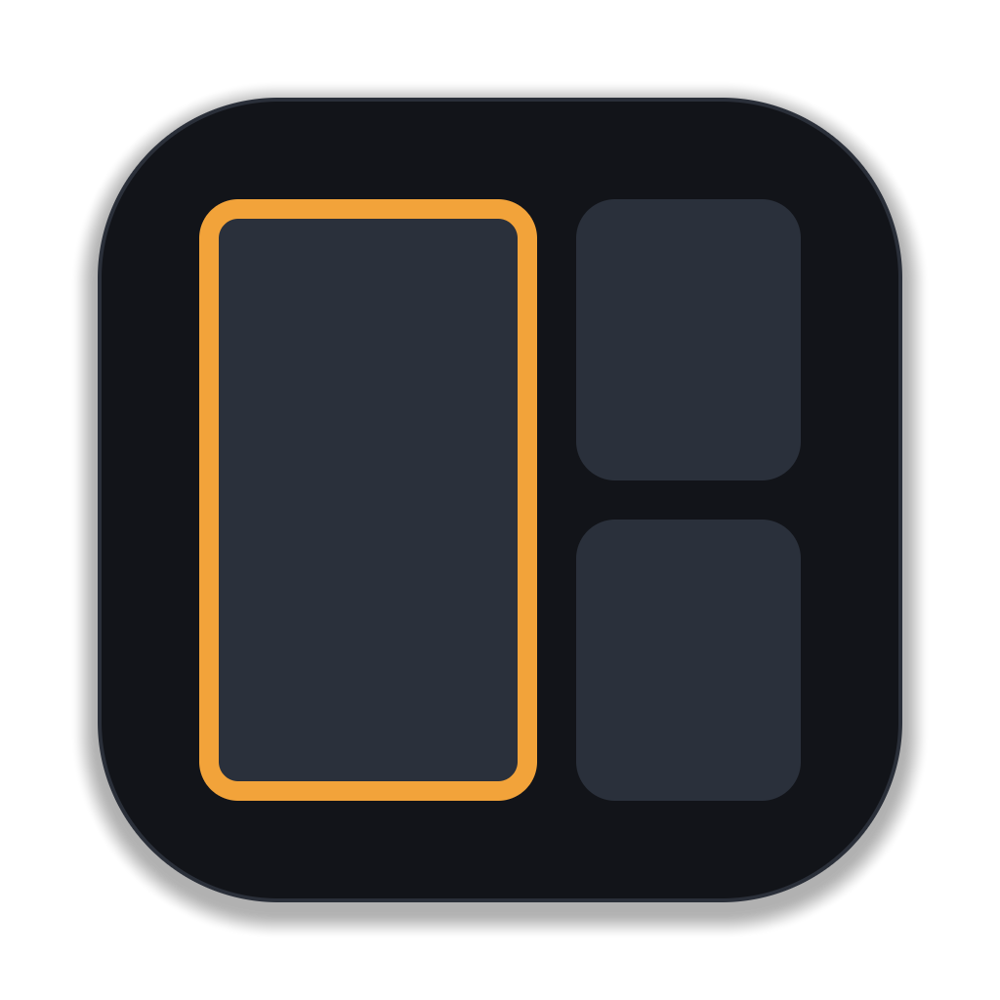
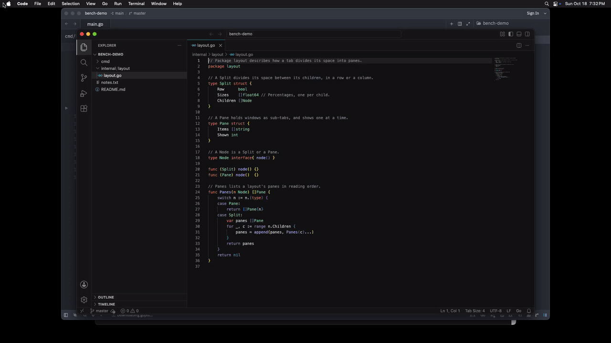
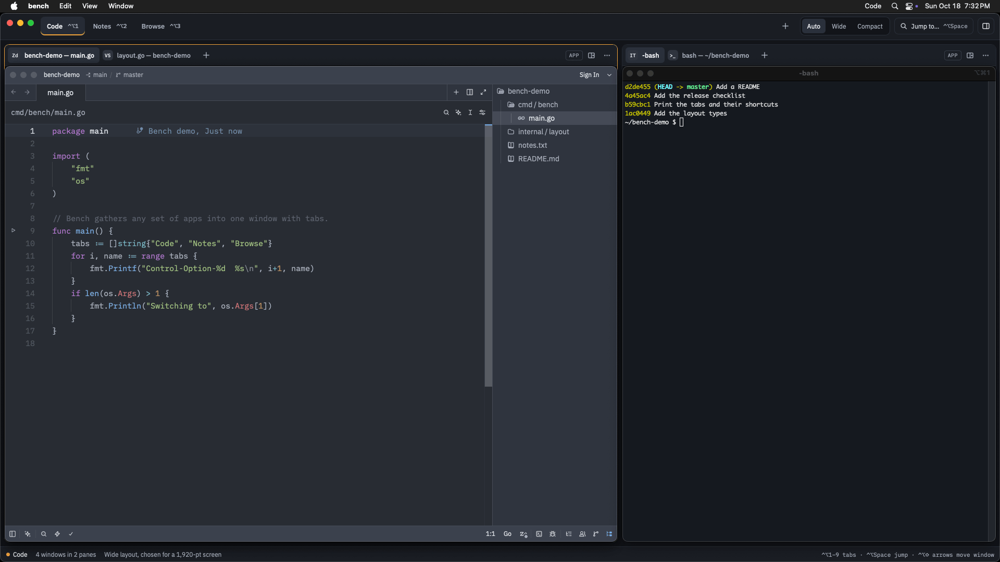
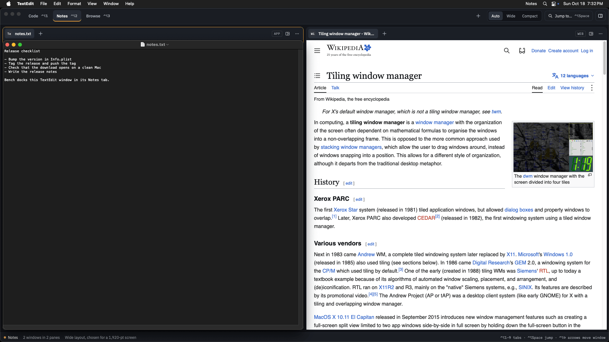
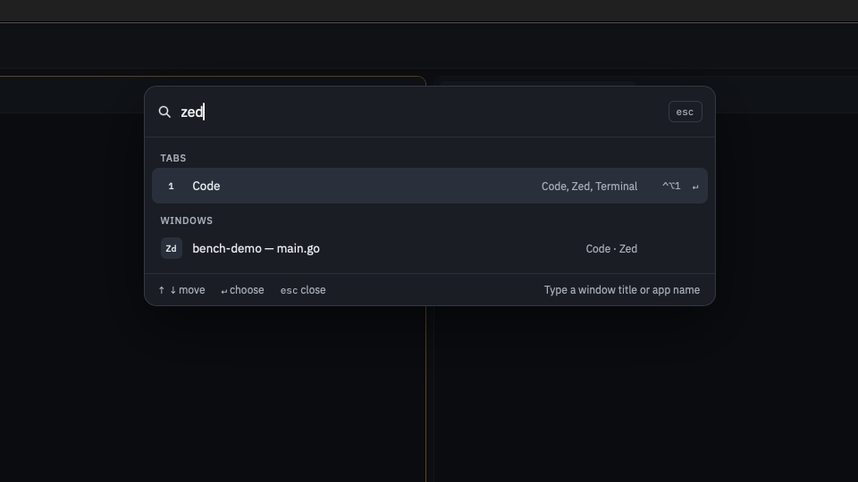
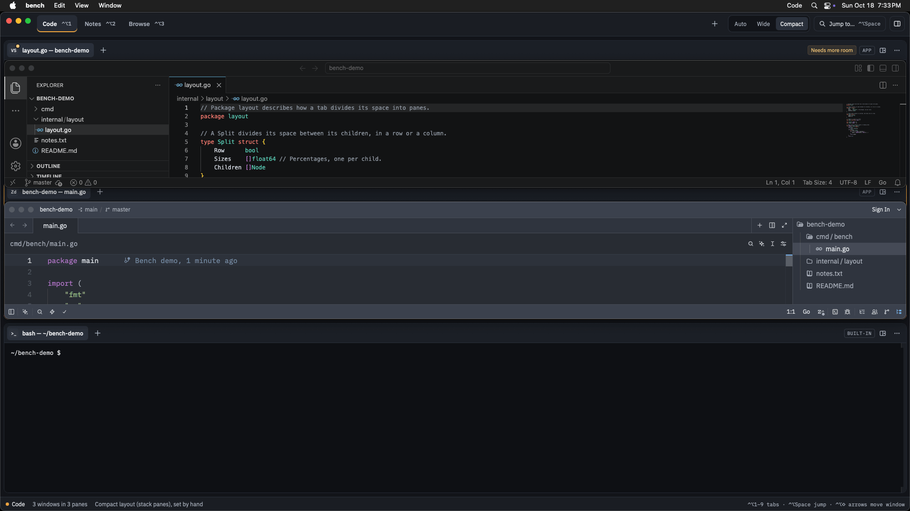

<div align="center">



# Bench

**Tabs for your whole Mac.** Put the apps you use for each task side by side
in one window, and switch tasks with one shortcut.

[](https://github.com/itbm/bench/releases/latest/download/Bench.dmg)

[](https://github.com/itbm/bench/releases/latest)
[](https://github.com/itbm/bench/actions/workflows/ci.yml)


[Features](#features) · [Install](#install) · [Get started](#get-started) ·
[FAQ](#faq) · [User guide](docs/user-guide.md)

</div>

<p align="center">
  
</p>

<p align="center"><sub>Recorded on a Mac with real apps: Zed, VS Code, iTerm2, TextEdit, and Safari. Sped up 1.5 times.</sub></p>

## What is Bench?

Bench is a free window manager for macOS that gives your apps tabs, like a
web browser. Make a tab for each kind of work, such as **Code**, **Chat**,
or **Research**, and fill it with the apps you use for that work: your code
editor beside a terminal, Slack beside your email, or a browser beside your
notes. Press Control+Option+1, 2, or 3 to switch tasks. Bench brings that
tab's windows forward, each sized to its place, and puts the rest away.

Bench works with the apps you already have, such as Zed, VS Code, Slack,
Brave, Safari, Obsidian, and iTerm2. Websites go in as web apps by default:
Safari, Chrome, Edge, Brave, and Vivaldi can make a site into an app of its
own, with the browser's protections and sign-ins. Where that isn't
possible, for example with Firefox, Bench shows the page itself. It shows
terminals itself too.

> [!NOTE]
> Bench is new, and version 0.1 is an early release. It runs on a real Mac
> with real apps in an automated test, but some features haven't been tried
> by hand yet. See [Project status](#project-status), and please
> [report anything that doesn't work](https://github.com/itbm/bench/issues).

## Why use Bench?

If you work with lots of apps at once, your Mac fills up with windows.
Command+Tab and Mission Control show all of them, from every task, so you
spend time looking for the right window and dragging windows back into
place. Bench groups your windows by task instead:

- **Switch tasks in one keystroke.** Each tab has a shortcut. Press it, and
  every window you need for that task is there, laid out the way you left
  it.
- **See only what you need.** Windows that belong to other tabs stay out of
  the way until you switch to their tab.
- **Keep using your own apps.** Bench arranges apps' real windows, so they
  work as they always do: typing, menus, drag and drop, and extensions.
- **Fit any screen.** On a monitor or a MacBook, apps sit side by side.
  In a narrow window, such as half of a MacBook's screen, Bench changes to
  a compact layout by itself.
- **Set it up without a config file.** Choose layouts in a visual editor,
  and drag windows where you want them.

## Features

<table>
  <tr>
    <td width="50%" valign="top">
      
      <p><b>Panes and sub-tabs.</b> Each tab is a layout of panes. A pane
      can hold several windows from any apps, with a sub-tab for each, like
      tabs in a browser.</p>
    </td>
    <td width="50%" valign="top">
      
      <p><b>Apps, web pages, and terminals.</b> Mix apps' windows with web
      pages, each with its own sign-ins, and terminals that Bench draws
      itself.</p>
    </td>
  </tr>
  <tr>
    <td width="50%" valign="top">
      
      <p><b>Jump palette.</b> Press Control+Option+Space and type a few
      letters to find any tab, window, or action.</p>
    </td>
    <td width="50%" valign="top">
      
      <p><b>Laptop and monitor layouts.</b> Bench chooses a wide or compact
      layout for the width of its window. You can also pick one yourself.</p>
    </td>
  </tr>
</table>

Bench also has:

- **Drag and drop.** Drag a sub-tab onto another pane to move its window
  there, onto a pane's edge to put it side by side, or onto a tab to move it
  to another task.
- **One window in several tabs.** Keep your email beside a browser in one
  tab and beside your notes in another. Hold Option as you drop a sub-tab on
  a tab, or choose **Also show in** in the window's **⋯** menu.
- **Keyboard control.** Switch tabs, focus panes, and move windows between
  panes without touching the mouse. You can change every shortcut.
- **Six layouts.** Right-click a tab and choose **Tab properties…** to pick
  one, such as side by side, main and side, three columns, or a grid of
  four. Drag the gaps between panes to resize them.
- **Rules for new windows.** Send an app's new windows to a tab of your
  choice, or leave them floating.
- **A menu bar item.** See the current tab, and switch tabs from the menu
  bar.
- **A safe exit.** When you quit Bench, every window becomes a normal window
  again, and apps that Bench hid come back. If Bench crashes, a helper puts
  your windows back.
- **Help in the app.** A welcome guide with a starting set-up and tips, a
  sheet of every keyboard shortcut, and **Help** menu items for both.

## Install

You need macOS 14 (Sonoma) or later, on a Mac with Apple silicon or an Intel
processor.

1. [Download Bench.dmg](https://github.com/itbm/bench/releases/latest/download/Bench.dmg)
   from the [latest release](https://github.com/itbm/bench/releases/latest).
2. Open `Bench.dmg`, and drag **Bench** to **Applications**.
3. Open Bench from Applications. Releases aren't notarised by Apple yet, so
   the first time, macOS says it can't check Bench for malware and doesn't
   open it. Close the message, open **System Settings ▸ Privacy &
   Security**, scroll down, and click **Open Anyway** next to the message
   about Bench. You only need to do this once for each version.
4. Follow Bench's welcome guide to turn on the **Accessibility**
   permission, which lets Bench move and size your windows. It can also
   open Bench when you log in, and start you off with a few tabs of apps
   you have.

Each release also has `Bench.zip`, and `SHA256SUMS.txt` to check your
download with `shasum -a 256 Bench.dmg`.

### Update Bench

Choose **Bench ▸ Check for Updates…**, or turn on **Check for a new
version once a day** in Settings to have Bench tell you when there's a new
one. Releases that include Sparkle download and install the new version for
you; their release notes say so. With an older release, download the new
version and replace Bench in Applications.

Until releases are notarised, macOS treats each version as a new app and
stops applying Bench's Accessibility permission. Bench notices, and its
banner says so: click **Turn on Accessibility**, which opens **System
Settings ▸ Privacy & Security ▸ Accessibility**, select Bench, and click
**−** to remove it. Then add Bench again, and turn it on.

### Uninstall Bench

Quit Bench, move it from Applications to the Bin, and delete the
`~/Library/Application Support/Bench` and `~/Library/Logs/Bench` folders.
Your apps and their windows aren't affected.

## Get started

Bench starts with one tab, Research, which holds your default browser.
Make it your own:

- To add an app, a window, a website, or a terminal to a pane, click the
  pane's **+**. For a website, Bench adds your web app of the site, or helps
  your browser make one.
- To rename a tab or change its layout, right-click the tab and choose
  **Tab properties…**.
- To add a tab, click **+** after the tabs.
- To change the settings for every tab, such as live previews, click the
  gear button at the right of the title bar to open **Settings**.

These shortcuts work from any app:

| Press | To |
| --- | --- |
| Control+Option+1 to 9 | Switch to tab 1 to 9. |
| Control+Option+Space | Open the jump palette. |
| Control+Option+arrow | Focus the pane in that direction. |
| Control+Option+Shift+arrow | Move the window to the pane in that direction, or split the pane there. |
| Control+Option+Tab | Show the next window in the focused pane. |
| Control+Option+0 | Put the tab's windows back in place. |

The [user guide](docs/user-guide.md) explains everything else, including the
optional [config file](docs/user-guide.md#config-reference) for shortcuts,
rules, and web pages with their own profiles.

## Permissions and privacy

| Permission | When Bench needs it | Why |
| --- | --- | --- |
| Accessibility | Always | To move and size other apps' windows into its panes, and to hide the windows that belong to other tabs. |
| Screen Recording | Only for live previews, which are off until you turn them on | To show a small, live picture of a window when you hold the pointer over its sub-tab. |
| Notifications | Only for web pages that send them, and for terminals you can't see that ring the bell, ask for a notification, or finish their command (**Settings ▸ Terminals** turns these off) | To pass notifications from web pages, such as Slack, and from terminals you can't see, such as Claude Code asking for an answer, to Notification Centre. |
| Camera and Microphone | Only for web pages and terminal programs that use them, such as a video call | To let them use the camera and microphone. macOS counts web pages and programs in Bench's terminals as Bench, so it asks for Bench. |
| Automation | Only for terminal programs that control other apps, such as `osascript` | To let them control those apps. macOS asks once for each app. |

Bench doesn't collect or send any data about you: it has no accounts,
analytics, or tracking. Its network traffic comes from the web pages you
add to it; from the icons of those pages, which Bench fetches itself,
from wherever the page says they are, or from `/favicon.ico` on the
page's site, without your sign-ins; and, only
if you turn on **Check for a new version once a day** in Settings, which
is off until you do, or choose **Check for Updates…**, from asking GitHub
for Bench's latest release, at most once a day, and downloading it when
you install it. A release that updates itself sends Bench's version with
that request, and, as a browser does, the cookies that GitHub gave it.
Other releases send only Bench's version. If you add VS Code for the Web,
it follows VS Code's own telemetry settings.

Bench isn't sandboxed, because macOS doesn't allow apps in the App Sandbox
to arrange other apps' windows.

## FAQ

### Does Bench put other apps inside its window?

No. macOS doesn't let one app hold another app's windows. Instead, Bench
keeps each app's real window exactly over its pane, moves it when you move
or resize Bench, and hides the windows that belong to other tabs. To you, it
looks and works like one window. Web pages and terminals are different:
Bench draws those itself, inside its own window.

### How is Bench different from Rectangle, Magnet, Stage Manager, or a tiling window manager?

- **Rectangle, Magnet, and macOS's own window tiling** snap one window at a
  time into part of the screen. They don't group windows by task.
- **Stage Manager** groups windows into sets, but doesn't lay them out side
  by side for you.
- **Tiling window managers**, such as AeroSpace, Amethyst, and yabai, tile
  windows automatically, and you mostly set them up with config files and
  the keyboard.

Bench gives each task a tab that you can see and click, with panes that hold
several windows as sub-tabs. You can arrange it all with drag and drop or a
visual editor, and add web pages and terminals.

### What happens when I quit Bench, or if it crashes?

When you quit, your windows stay where they are and work as normal windows.
Windows and apps that Bench hid come back. Quitting ends Bench's terminals,
so if one is still running something, such as a build, Bench asks first. If
Bench crashes, a small helper process puts hidden windows back. Bench
remembers your arrangement and restores it the next time it opens.

### Does Bench work with every app?

It works with any app that has standard windows. Bench leaves dialogs,
settings windows, and full-screen windows alone. If a window can't shrink to
fit its pane, Bench places it at the pane's top-left corner and says so.

### Does Bench work on Windows or Linux?

No. Bench only runs on macOS. On any computer, you can try its interface in
a web browser with the [browser preview](#try-the-interface-in-a-browser),
with placeholders for the apps.

### Is Bench free?

Yes. Bench is free to download and use, with no account or subscription.

## Project status

Bench 0.1 is an early release. Its core is covered by automated tests, and a
[recorded test](docs/development.md#the-macos-demo) runs it on macOS 15 on
Apple silicon with real apps: it docks windows, switches tabs with the
shortcuts, drags sub-tabs, splits panes, and uses the jump palette and the
compact layout.

These haven't been tried by hand yet: multiple displays, desktops (Spaces),
Intel Macs, macOS 14, live previews, sign-ins and notifications in web pages,
VS Code for the Web, and Open at login. If you use any of them, please
[tell us how it goes](https://github.com/itbm/bench/issues). The
[development guide](docs/development.md#project-status) has the full status.

## Build from source

You need macOS 14 or later, [Go 1.26](https://go.dev/dl/), and the Xcode
command-line tools (`xcode-select --install`).

```sh
git clone https://github.com/itbm/bench.git
cd bench
make run SIGN_IDENTITY=-
```

`make run` builds a universal `bin/Bench.app`, signs it ad hoc, and opens it.
If you have an Apple Development certificate, run `make run` without
`SIGN_IDENTITY`, so that macOS keeps Bench's Accessibility permission
between builds. Run `make help` to list the other targets.

### Try the interface in a browser

The browser preview runs Bench's real interface and workspace engine, with
placeholders in place of other apps' windows. It works on any computer with
Go 1.26:

```sh
make preview
```

Then open <http://localhost:8080>.

## Documentation

- [User guide](docs/user-guide.md): using Bench, keyboard shortcuts, the
  config file, and troubleshooting.
- [Development guide](docs/development.md): setting up, tests, CI, the
  recorded macOS demo, signing, releases, and debugging.
- [Architecture](docs/architecture.md): how Bench works and why.
- [Build spec](docs/spec.md) and [UI prototype](docs/prototype.html): the
  brief Bench is built from.

## Contributing

Bug reports and ideas are welcome in
[GitHub Issues](https://github.com/itbm/bench/issues). To work on the code,
start with the [development guide](docs/development.md). `make check` runs
the checks that CI runs on Linux.

Bench is written in Go with [Wails](https://wails.io). Its terminals use
[xterm.js](https://xtermjs.org), and its fonts are
[IBM Plex](https://www.ibm.com/plex/).

## Licence

Bench doesn't have a licence yet. It includes open source software, which
**Bench ▸ Acknowledgements** lists with each one's licence.
