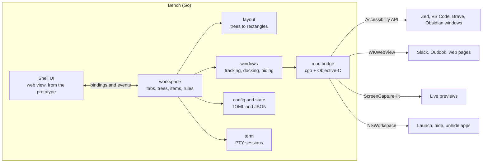

# Bench: build spec

Bench is a working name for a macOS app, written in Go, that gathers any set of apps into one window with tabs. Each tab holds a layout of panes, and each pane holds windows as sub-tabs. You can move any window to another pane, beside another window, or to another tab. Layouts adapt to the screen: wide on a monitor, compact on a laptop.

This document is the brief for building it. It goes with `bench-ui-prototype.html`, a clickable prototype of the interface.

## Contents

- [Files in this handoff](#files-in-this-handoff)
- [Goals and non-goals](#goals-and-non-goals)
- [Concepts](#concepts)
- [Embedding, mirroring, and moving](#embedding-mirroring-and-moving)
- [Screens and behaviour](#screens-and-behaviour)
- [Windows: tracking and rules](#windows-tracking-and-rules)
- [Keyboard shortcuts](#keyboard-shortcuts)
- [Architecture](#architecture)
- [Config file](#config-file)
- [Layout maths](#layout-maths)
- [Repository layout](#repository-layout)
- [Milestones](#milestones)
- [Testing](#testing)
- [Risks](#risks)
- [Open questions](#open-questions)
- [References](#references)

## Files in this handoff

| File | What it is |
| --- | --- |
| `bench-spec.md` | This brief. |
| `bench-ui-prototype.html` | A single-file, clickable prototype. Open it in a browser. It's the reference for the look, the layout behaviour, and the interactions. |

In the prototype you can:

- Switch tabs, add tabs, and see that only the first nine get shortcuts.
- Click sub-tabs to show different windows in a pane.
- Drag a sub-tab onto another pane (joins it), onto a pane's edge (splits it, for side by side), or onto a tab in the title bar (moves the window to that tab). The split button and the **⋯** menu do the same without a mouse.
- Add a window that isn't in a tab, a new window of an app, any installed app, a terminal, or a web page, with a pane's **+** button.
- Simulate a monitor (2,560 pt) or a laptop (1,512 pt) to see Auto switch between wide and compact.
- Hover a sub-tab to see a live preview. Previews are on in the prototype. In the app they're off until the user turns them on, because they need Screen Recording permission.

Window contents are placeholders: grey shapes stand in for Slack, Outlook, Brave, and Obsidian, and the code and terminal text is illustrative.

To reuse the prototype as the app's frontend:

- Keep the design tokens. They're CSS custom properties in `:root`.
- Keep the markup and class names for the title bar, tabs, panes, sub-tabs, menus, status bar, jump palette, add dialog, and layout editor.
- Replace the prototype's `state` with data from Go. Its shape (`tabs[].root` as a tree of splits and panes, and `items` by ID) matches the model in this spec.
- Position panes from the rectangles Go sends (see [Window model](#window-model)). The prototype uses CSS flexbox for convenience; the app shouldn't, so that Go has one source of truth for geometry.

## Goals and non-goals

### Goals

- Any number of tabs, each holding any apps: Slack, Outlook on the web, Zed, VS Code, a terminal, Brave, Obsidian, or anything else installed.
- Panes that understand windows: every window gets a sub-tab, and any window can move to another pane, beside another window, or to another tab.
- Layouts that adapt automatically to the screen the window is on, with a manual override.
- A keyboard-first jump palette for tabs, windows, and actions.
- An in-app layout editor, so the config file is optional.

### Non-goals for version 1

- Windows or Linux. The window management is macOS-specific.
- Putting other apps' windows inside Bench's own window. macOS doesn't allow it; see [Embedding, mirroring, and moving](#embedding-mirroring-and-moving).
- Splitting individual browser tabs. Bench works with windows, so to show two Brave tabs side by side, drag one out of Brave into its own window first.
- Syncing settings across Macs.

## Concepts

**Tab.** A named workspace with a layout. There's no limit on the number of tabs; the first nine get Control+Option+1 to 9, and the rest are reachable with Control+Option+] and [, the tab strip (which scrolls), and the jump palette. The default config starts with three: Comms (Slack, Outlook), Code (Zed, VS Code, terminals), and Research (Brave, Obsidian).

**Layout tree.** Each tab's layout is a tree. A split divides its space in a row or a column, with a size for each child as a percentage. Its children are panes or further splits. Presets create the starting tree; dragging and splitting edit it.

**Pane.** A leaf of the tree. It holds an ordered list of items, shows one at a time, and has a header with a sub-tab for each item.

**Item.** Something a pane can show. There are three kinds:

| Kind | Badge | What it is | Examples |
| --- | --- | --- | --- |
| Web | `WEB` | A web view that Bench owns, drawn inside Bench's window | Slack, Outlook on the web, any web page, VS Code for the Web |
| App | `APP` | Another app's real window, moved and sized to fit the pane | Zed, VS Code, Brave, Obsidian, web apps such as Gmail or Slack, any app |
| Built-in | `BUILT-IN` | A view that Bench draws itself | Terminal sessions |

One pane can hold items of different kinds and from different apps. For example, the Code tab starts with Zed and VS Code as sub-tabs of one pane.

A website can be an App item too, as a **web app**: a site that the user's browser has made into an app of its own, with its own windows. That's how the add dialog adds websites where it can, because the browser runs the site with its own protections and sign-in (see [Adding to a pane](#adding-to-a-pane)). Web items are for the rest, and for the default config's Slack and Outlook, whose menus switch them to web apps with one click (see [Switching a web page to a web app](#switching-a-web-page-to-a-web-app)).

**Sub-tab.** A button in a pane's header for one item, showing the app's monogram and the window's title. Clicking it shows that item. Dragging it moves the item.

**Presets.** Starting trees, used for new tabs and in the layout editor:

| Preset | Tree | Default sizes |
| --- | --- | --- |
| `single` | One pane | — |
| `side` (Side by side) | Row of two | 50, 50 |
| `main-side` (Main and side) | Row of two | 65, 35 |
| `three` (Three columns) | Row of three | 40, 30, 30 |
| `top-bottom` (Top and bottom) | Column of two | 65, 35 |
| `grid` (Grid of four) | Column of two rows of two, filled in reading order | 50, 50 each |

When a preset replaces a tree, the existing panes' items keep their order: pane 1's items go into the new pane 1, and so on. If the new tree has fewer panes, the extra panes' items join the last one. No item is lost.

**Small-screen behaviour.** Each tab chooses what happens on a small screen:

| Setting | Effect |
| --- | --- |
| `stack` | The top-level row becomes a column, so side by side becomes top and bottom. |
| `tabs` | The tab shows one pane containing every item as a sub-tab. The tree is kept and comes back on a large screen. |
| `same` | No change. |

**Size class.** `wide` or `compact`. In Auto mode, Bench compares the width of the screen the window is on with `compact_below` (default 1,800 pt). The user can force Wide or Compact from the title bar until they pick Auto again.

## Embedding, mirroring, and moving

macOS gives an app three ways to show another app's content. Bench uses all three, each where it fits.

| Approach | What you get | Limits | Where Bench uses it |
| --- | --- | --- | --- |
| **Embed** content Bench owns | Fully native inside Bench's window. Real embedding. | Only for things Bench can host itself: web pages and terminals. | Slack and Outlook as web views in the default config, web pages that the user's browser can't make into web apps, VS Code for the Web, and terminals. |
| **Move** the real window | Any app, fully usable: typing, drag and drop, menus, and shortcuts all work as normal. | It's still a separate window, so Bench must manage stacking and hiding carefully. | Every App item: Zed, VS Code, Brave, Obsidian, web apps, and anything else. |
| **Mirror** with ScreenCaptureKit | A live picture of any single window, smooth up to the display's refresh rate, even when the window is covered or off-screen. | Display only. Passing clicks and typing on to the real window isn't reliable enough for everyday use; text input, menus, and drag and drop are the usual problems. Needs Screen Recording permission, which macOS asks users to re-approve from time to time. Chromium-based apps (Brave, VS Code, Slack, Obsidian) can stop drawing windows that are covered, so a mirror may show a frozen frame. | Live previews: hovering a sub-tab, and window thumbnails in the jump palette. Optional. |

The fourth idea, putting another app's actual window inside Bench's window, isn't available. macOS has no public API for it, and sharing rendered content between processes (for example, with IOSurface) needs the other app's cooperation.

Two practical consequences:

- **VS Code can be embedded for real.** `code serve-web` (VS Code 1.82 or later) runs a local server for VS Code for the Web, which works on the Mac's own files and terminals. Bench can start it and show it in a Web item. Check that the extensions you rely on work there before switching; if not, use the desktop app as an App item.
- **Moving done well looks like embedding.** Bench draws the pane chrome, sizes the window to fit the pane body exactly, keeps it in place when Bench moves, and hides it when its tab or sub-tab isn't shown. Contain, a Mac app that groups windows into tabs, takes the same approach: it doesn't copy or mirror windows, and the originals stay fully usable.

## Screens and behaviour

The prototype shows all of these. Where the app must behave differently from the prototype, this section says so.

### Main window

- **Title bar.** Traffic lights, then the tab strip. Each tab shows its name and, for the first nine, its shortcut. The current tab has a raised background and a 2 pt accent underline. The strip scrolls sideways when tabs don't fit. A **+** after the strip opens the layout editor for a new tab.
- **Title bar, right side.** A segmented control for **Auto**, **Wide**, and **Compact**; a **Jump to…** button; and a button that opens the layout editor for the current tab.
- **Panes.** Laid out by the tab's tree, with an 8 pt gap and 8 pt padding. The focused pane has an accent border. Clicking anywhere in a pane focuses it.
- **Pane header.** Sub-tabs for the pane's items; a **+** to add to the pane; the shown item's badge; a **Show side by side** button (split right); and a **⋯** menu.
- **Status bar.** The tab, its window and pane counts, the size class and why (for example "Wide layout, chosen for a 2,560-pt screen"), and shortcut hints.

### Moving windows

Three ways, all doing the same thing:

1. **Drag a sub-tab.**
   - Onto the middle of a pane: the item joins that pane and is shown.
   - Onto the outer quarter of a pane, on any side: the pane splits in that direction, and the item goes into the new half. If the pane's parent split already runs in that direction, the new pane becomes a sibling, sharing the old pane's size equally; otherwise the pane is replaced by a new split.
   - Onto a tab in the title bar: the item moves to that tab's focused pane.
   - While dragging, show where it will land: a highlighted half of the pane for an edge, the whole pane for the middle, or a tinted tab.
2. **Use the pane's buttons.** **Show side by side** splits right with the shown item. The **⋯** menu has **Show side by side (split right)**, **Split down**, **Move to pane** (each other pane, named by its shown item), **Move to tab** (each other tab), and **Pop out of Bench**, and for a web page, **Use the** *name* **web app from** *browser* or **Make a web app in** *browser*… (see [Switching a web page to a web app](#switching-a-web-page-to-a-web-app)).
3. **Use the keyboard.** Control+Option+Shift+arrow moves the shown item of the focused pane into the neighbouring pane in that direction, or splits at that edge if there's no neighbour.

Rules:

- A pane can't be split by its only item; the menu and keyboard explain why instead of doing nothing.
- When a pane loses its last item, it's removed and its parent split closes up. The last pane in a tab stays, empty, with an **Add a window or app** button.
- Moving an item marks the tab's layout as custom. The layout editor says so, and choosing a preset starts again from that preset (keeping items in order).
- On a small screen with the `tabs` setting, there are no visible splits, so the split actions are disabled with the reason shown. Moving to another tab still works.
- **Pop out of Bench** returns an App item's window to a normal, free-floating window, and gives a Web or Built-in item a window of its own. The item then appears under **Not in a tab** in the jump palette, and under **Windows not in a tab** in the add dialog.

### Adding to a pane

The pane's **+** opens a searchable dialog with these groups, in order:

- **Windows not in a tab**: open windows Bench isn't managing, and items popped out of Bench.
- **Windows in other tabs**: items in other tabs, to show in this pane as well.
- **New window**: a new window of each app already in this tab.
- **Built in**: **New terminal**, and **Web page…**, which asks for an address (see below).
- **Apps**: every installed app other than a web app, from /Applications, ~/Applications, and /System/Applications, including their Utilities folders. Choosing one opens it if needed and adds its windows that aren't already in a tab. If it has none, Bench opens a new window (see [Docking with the Accessibility API](#docking-with-the-accessibility-api)).
- **Web apps**: the web apps that browsers have made, with the browser that made each: Safari's in ~/Applications, Chromium browsers' in folders there such as `Chrome Apps.localized`, and Orion's in ~/Applications/Orion/WebApps. Choosing one works as for any other app. They come after **Apps** because the dialog chooses the first row that matches, and a web app's hint names its browser: typing "chrome" should choose Chrome.

**Web page…** adds a website as a web app where it can, since a web app runs in the browser, with the browser's protections and sign-in, which Web items don't have (Google blocks sign-in in embedded web views). Return:

1. Adds the installed web app whose address is on the same host as the one typed, ignoring case, a leading `www.`, and default ports, if there's one: the default browser's, else Safari's, else the first by name. A Chromium web app's address is its Info.plist's `CrAppModeShortcutURL`; a Safari web app's is its `Manifest` dictionary's `start_url`, or else its `WKPushBundleMetadata` dictionary's `manifestId`. Orion's isn't known.
2. Else, without Accessibility permission, which App items need, adds a Web item, and says why.
3. Else, if the default browser (the app that opens `https` links) can make web apps, opens the site in it and shows the browser's steps to make one: Safari, Chrome, Edge, Brave, Vivaldi, Chromium, Chrome for Testing, and Orion can. The dialog then asks Go every 1.5 seconds whether the web app is installed, and adds it as soon as it is: the web app on the site's host, or else the one web app installed since the site was opened, whatever its address, since a browser records the address the site ended on, which may be on another host (slack.com sends a signed-in user to app.slack.com), and Orion records none. Meanwhile, the dialog stays open while the user is in the browser, focus in the browser's windows doesn't switch tabs, Bench doesn't hide the browser when Bench becomes active, and a new window of the browser stays out of the tab, under **Windows not in a tab**. **Show in Bench instead** adds a Web item; **Cancel** and Escape go back to the list. If Go is looking for the web app just then, the dialog waits for its answer first, and closes if it added the web app.
4. Else, as for Firefox, Arc, Opera, DuckDuckGo, Zen, an app that chooses a browser for each link, or a browser that Bench doesn't know, such as another browser built on Chromium, adds a Web item, and says why.

Option-Return, or **Show in Bench**, adds a Web item instead.

### Switching a web page to a web app

A Web item that the user has, such as the default config's Slack and Outlook, switches to a web app of its site from its **⋯** menu, or its sub-tab's right-click menu, with one click, never by itself. When the menu opens, it asks Go what to offer, worked out afresh each time from the installed apps and the item's given address (not the page it has gone to since):

1. If a web app of the site is installed, found as **Web page…** finds it, **Use the** *name* **web app from** *browser*.
2. Else, if Bench has Accessibility permission and the default browser can make web apps, **Make a web app in** *browser*….
3. Else, and for VS Code for the Web, nothing.

Scanning the installed apps can take a moment, so the menu opens at once, and the entry joins its end, after a separator, when the answer comes: nothing above it moves. For that, a web page's menu opens as wide as menus get, with room below it for the entry (it opens higher near the bottom of the window), and stays where it opened; an entry whose names don't fit on one line wraps, and if the menu then runs past the bottom of the window, it scrolls.

**Use** puts an App item for the web app in the Web item's place, in every tab that shows it: the same pane, the same place among the sub-tabs, and shown if the Web item was. The Web item and its web view close. The web app's window comes to the item as the add dialog finds one: a window that's popped out of Bench or that Bench doesn't manage; else, for a web app that's running without a window, its first window, or a new one if none comes soon; else a new window, opening the web app if it isn't running, with the launch timeout as for the add dialog. Until then, the item says Bench is opening the web app. Other windows that the web app opens meanwhile, such as the ones it restores as it starts, join the same pane without being shown. The menu then says what it did, as a toast.

**Make** opens the item's address in the default browser and opens the add dialog's make step, titled **Make a web app in** *browser*, with the browser's steps and a note that Bench puts the web app in place of this page as soon as it's ready. Bench waits as for **Web page…**: the dialog asks Go every 1.5 seconds, the browser stays on screen, and its new windows stay out of the tab. Once the web app is installed (the site's, or the only one installed since), it takes the Web item's place as for **Use**, and a window that Bench put in the tab by `new_windows` meanwhile, as a Chromium browser opens the web app it makes, moves there. The dialog's only button is **Cancel**, which, like Escape, closes it and leaves the Web item as it is. It closes by itself if the Web item goes.

If the Web item came from `config.toml`, its entry there becomes an `app` entry for the web app, in the same place, and Bench saves the file as the layout editor does, keeping `config.toml.bak`. `state.json` alone would keep the switch when Bench restarts, but resetting the tab's layout, or a `state.json` that's set aside, would bring the page back.

### Live previews

When live previews are on (`live_previews`), hovering an inactive sub-tab for 450 ms shows a small live preview of that window under it, with its title. The jump palette can show the same thumbnails beside windows. Previews come from ScreenCaptureKit and need Screen Recording permission, so they're off until the user turns them on in the layout editor's settings.

### On a laptop

The same window in the compact size class, using each tab's small-screen setting. In the default config, Code stacks its panes, and Comms and Research show one pane with every window as a sub-tab.

### Jump palette

Opens with the shortcut or **Jump to…**.

- A search field, focused on open, that filters by label and hint.
- Groups: **Tabs** (with each tab's apps and shortcut), **Windows** (every item in every tab, by title, with its tab and app), **Not in a tab**, and **Actions** (Rearrange this tab, Edit the layout of the current tab, New tab, and switching between Auto, Wide, and Compact).
- Up and Down arrows move the selection; Return runs it; Escape or clicking the backdrop closes it.
- Choosing a window switches to its tab, focuses its pane, and shows it. Choosing a window that's not in a tab adds it to the current tab's focused pane.

### Layout editor

A sheet over the window, for the current tab or a new one.

- **Name** and **Shortcut**. In version 1, shortcuts follow tab order; tabs after the ninth have none.
- **Layout**: the six presets, with a preview showing which items will land in which pane. For a custom layout, no preset is selected and the editor explains that choosing one starts again.
- **On small screens**: **Stack panes**, **One pane with sub-tabs**, or **Keep the layout**.
- **Small screens are narrower than** [number] **points**.
- Settings: **Open apps that aren't running**, **Hide windows that belong to other tabs**, **Switch tabs when another tab's window comes forward**, and **Show live previews of windows (needs Screen Recording)**.
- **Delete tab** (not for the last tab), **Cancel**, and **Save**. Deleting a tab doesn't close its windows; they move to **Not in a tab**.

### Behaviour when switching tabs

1. Hide what belongs only to other tabs (see [Hiding windows](#hiding-windows)).
2. For each item in the new tab:
   - App item: if its app isn't running, or the item's window no longer exists, open the app (`open_missing_apps`) and wait for a window that matches.
   - Web item: show its web view, creating it on first use.
   - Built-in item: show its view, starting the session on first use.
3. Arrange what's ready straight away, then check every 250 ms. When everything is ready, wait a further 750 ms (apps often resize their own windows on launch), then arrange again. Stop waiting after `launch_timeout` (default 15 s).
4. Focus the tab's focused pane.

### Behaviour when the screen changes

When a display is connected or disconnected, or Bench's window moves to another screen, wait 1.5 s for macOS to settle, then work out the size class again and rearrange the current tab without changing focus.

## Windows: tracking and rules

### Identity

Track each window by its `CGWindowID`, which stays the same while the window exists, even as its title changes. The Accessibility API doesn't expose it publicly; window managers use one private call for it (usually `_AXUIElementGetWindow`). AeroSpace, which otherwise uses only public APIs, does the same. If the call is unavailable, fall back to comparing `AXUIElement` references.

### Which windows become items

- Only standard windows (`kAXSubroleAttribute` is `kAXStandardWindowSubrole`) become items.
- Dialogs, sheets, floating panels, and system dialogs stay floating above Bench, centred on their parent window. Don't dock them.
- `[[rule]]` entries in the config can float any window by app and title, for example a browser's picture-in-picture window.

### New windows

When an app opens a standard window, Bench places it in the first matching case:

1. A `[[rule]]` with `float = true` matches: leave it floating.
2. A `[[rule]]` with `tab = "…"` matches: add it to that tab, in the pane holding the app's most recently used window, or else that tab's focused pane.
3. Otherwise, follow `new_windows`:
   - `app-pane` (default): add it to the pane holding the app's most recently used window, looking in the current tab first, then other tabs, then the pane the config gives the app. If there's none, use the current tab's focused pane.
   - `focused-pane`: add it to the current tab's focused pane.
   - `float`: leave it floating, for the user to add.

Bench shows the new window in its pane. If that pane is in another tab, [focus following](#focus-following) decides whether to switch.

### Focus following

Links and notifications often bring another tab's window forward: a link clicked in Slack opens in a Brave window that lives in Research, for example. When a window that belongs to another tab becomes focused, Bench follows `follow_focus`:

- `switch-tab` (default): switch to that tab.
- `bring-here`: move the window into the current tab's focused pane.
- `off`: do nothing.

### Closing

When a window closes, remove its item. If that empties a pane, remove the pane as described in [Moving windows](#moving-windows).

### Hiding windows

- **Inactive sub-tabs.** Keep a pane's other windows in the same frame, directly behind the shown one. Switching sub-tabs then only raises a window, which is instant. If a window can't shrink to the pane (its minimum size is too big), park it instead (below). When the shown item is a Web or Built-in item, which Bench draws inside its own window, park the pane's App windows too, or they'd cover it.
- **Other tabs** (`hide_other_tabs`). If all of an app's items are in other tabs, hide the app with `NSRunningApplication` `hide`. If the app also has items in the current tab, park its other windows: move them to a bottom corner of the screen, outside the visible area. macOS doesn't allow a window fully off-screen, so a 1-pixel line stays visible in the corner. AeroSpace hides windows the same way, and its guide suggests putting the Dock at the bottom with automatic hiding on, to make the line less noticeable. With more than one display, use a corner that doesn't touch another display. Minimising is the fallback, but its animation makes switching slow.
- **Other apps** (`hide_other_apps`). When this is on, switching tabs also hides apps that Bench doesn't manage.
- **On quit or crash.** Put every parked window back on screen. Install a signal handler and a crash handler for this.

### Desktops (Spaces)

The Accessibility API only reports windows on the current desktop, so Bench and the apps it manages should stay on one desktop. If a managed window moves to another desktop, mark its item as unavailable rather than removing it.

### Remembering the arrangement

Save the live arrangement to `state.json` whenever it changes: each tab's tree and sizes, and for each item its kind, the app's bundle ID, `CGWindowID`, last title, and creation order. Window IDs change when an app restarts, so after a restart, match windows to items by bundle ID and exact title first, then by creation order, then put what's left in the pane that holds that app (or the config's pane for it). **Reset layout** in the layout editor returns a tab to its config layout.

## Keyboard shortcuts

Global shortcuts work from any app. Every shortcut is configurable.

| Shortcut | Action |
| --- | --- |
| Control+Option+1 to 9 | Switch to tab 1 to 9 |
| Control+Option+] and [ | Next and previous tab |
| Control+Option+Space | Open the jump palette |
| Control+Option+0 | Rearrange the current tab |
| Control+Option+arrow | Focus the pane in that direction |
| Control+Option+Shift+arrow | Move the shown window to the pane in that direction, or split there |
| Control+Option+Tab, and with Shift | Next and previous sub-tab in the focused pane |

Control+Option+Space is also macOS's default shortcut for switching input sources when more than one is set up, and window tools such as Rectangle use Control+Option+arrow by default. If registering a shortcut fails, say so in the status bar and suggest another.

## Architecture

### Overview



### Recommended stack

| Need | Choice | Notes |
| --- | --- | --- |
| Language | Go (current release) with cgo | macOS 14 or later. |
| Window and UI | Wails v3 | Go backend with a web frontend in WKWebView. v3 supports multiple windows, events, and frameless windows. It's still a pre-release beta (the maintainers describe the API as stable), so pin the version. |
| Native macOS calls | A small Objective-C layer, built with cgo | Window levels, web views, the Accessibility API, ScreenCaptureKit, launching and hiding apps, and screen notifications. Keep it in one package so the UI layer can be swapped. DarwinKit's authors don't recommend it for large or complex programs, so prefer hand-written Objective-C for these calls. |
| Global shortcuts | `golang.design/x/hotkey` | Supports macOS. It needs Accessibility trust, which Bench needs anyway. Hotkey events must be handled on the main thread; if they don't arrive under Wails, register them through the bridge with Carbon's `RegisterEventHotKey` instead. |
| Terminal | `@xterm/xterm` in the frontend, `github.com/creack/pty` in Go | One PTY session per terminal item. |
| Config and state | TOML with `github.com/BurntSushi/toml` or `github.com/pelletier/go-toml/v2`; JSON for state | In `~/Library/Application Support/Bench/`. |

If Wails v3 causes problems, the fallback is the same split without Wails: an Objective-C window hosting one WKWebView for the UI, with a JavaScript message handler for UI-to-Go calls.

### Window model

The hard part is keeping other apps' windows visible inside Bench's panes. They're separate windows, so if Bench's window comes to the front, it covers them.

**Approach A (start here).** Bench's window sits one level below normal windows (`NSNormalWindowLevel - 1`). Docked windows stay at the normal level, so they're always above Bench's window, inside their pane bodies. Clicking Bench's tabs, sub-tabs, or pane headers makes Bench active without covering the docked windows. Web items and terminals are views inside Bench's own window, so they need no special handling.

```text
┌ Bench window (level: normal - 1) ───────────────────────────┐
│  Comms   Code   Research   +       Auto Wide Compact  Jump… │
├─────────────────────────────────────┬───────────────────────┤
│ [Zed: bench] [VS Code: ui] +   APP  │ [zsh] [go test] +     │
├─────────────────────────────────────┼───────────────────────┤
│                                     │                       │
│  Zed's own window, docked here      │  Bench's terminal     │
│  (normal level, so it's on top);    │  view (inside Bench)  │
│  VS Code's window waits behind it   │                       │
│                                     │                       │
├─────────────────────────────────────┴───────────────────────┤
│ Code · 4 windows in 2 panes · Wide layout, chosen for a…    │
└─────────────────────────────────────────────────────────────┘
```

The catch: unrelated windows (a Finder window, say) can also sit above Bench, and Bench can't come in front of them. When Bench becomes active with an unrelated window overlapping it, hide that app, or briefly raise Bench to the normal level and then re-raise the docked windows. Decide during the milestone 4 spike.

**Approach B (fallback).** Split Bench's chrome into windows that never overlap a docked window: one for the title bar, one for the status bar, and one strip per pane header, with a decorative backdrop below normal level to fill the gaps. Nothing interactive overlaps a docked window, so ordering stops mattering. It costs more windows to keep in sync.

Whichever approach wins:

- Don't use macOS full screen for Bench's window. Docked windows can't follow it into a full-screen Space. Offer **Fill the screen** (zoom) instead.
- When Bench's window moves or resizes, re-dock every shown App item, on `NSWindowDidMoveNotification` and `NSWindowDidResizeNotification`, throttled to one update per frame.
- Go owns the geometry. The `layout` package computes each pane's rectangle in window content coordinates (top-left origin, points). Go sends the rectangles to the UI, which draws the pane chrome at those positions. Go then docks each shown App item's window into its pane body: the pane rectangle inset by its 1 pt border, below the 40 pt header and its 1 pt divider.

### Docking with the Accessibility API

- Check trust with `AXIsProcessTrustedWithOptions`, passing `kAXTrustedCheckOptionPrompt` on first run.
- Find an app's windows with `AXUIElementCreateApplication(pid)` and `kAXWindowsAttribute`.
- Move and size with `kAXPositionAttribute` and `kAXSizeAttribute`, using `AXValueCreate` with `kAXValueTypeCGPoint` and `kAXValueTypeCGSize`. Set the size, then the position, then the size again: some apps clamp the size to fit the screen at the old position.
- Bring a window to the front of its app with `kAXRaiseAction`.
- Watch each app with an `AXObserver` for `kAXWindowCreatedNotification`, `kAXFocusedWindowChangedNotification`, and `kAXTitleChangedNotification`, and each docked window for `kAXWindowMovedNotification`, `kAXWindowResizedNotification`, and `kAXUIElementDestroyedNotification`.
  - If the user drags a docked window away, mark the item as undocked and show **Dock again** in the pane, rather than snapping it back.
  - Ignore notifications caused by Bench's own moves.
- Restore a minimised window by setting `kAXMinimizedAttribute` to false. Leave windows in native full screen alone, and show "In full screen" on the item.
- Hide and show apps with `NSRunningApplication` `hide` and `unhide`. Launch with `NSWorkspace`, using `URLForApplicationWithBundleIdentifier:` and `openApplicationAtURL:configuration:completionHandler:`.
- If a window's minimum size is bigger than its pane, place it at the pane's top-left and show "Needs more room" on the item.
- To open a new window of a running app (the add dialog's **New window**), press the app's **New Window** menu item through the Accessibility API. If it has none, activate the app and open it again with `NSWorkspace`; most apps then open a window if they have none showing.

**Coordinates.** The Accessibility API uses global coordinates with the origin at the top-left of the primary display and y increasing downwards. AppKit uses the bottom-left of the primary display, with y increasing upwards. Convert with `y_ax = primaryHeight - (y_appkit + height)`. Everything is in points, not pixels.

To find a bundle ID, run `osascript -e 'id of app "Brave Browser"'`.

### Web items

- One `WKWebView` per Web item, as a subview of Bench's window, positioned in its pane body and hidden when its sub-tab isn't shown.
- Give each profile its own persistent data store with `+[WKWebsiteDataStore dataStoreForIdentifier:]` (`WKWebsiteDataStore(forIdentifier:)` in Swift; macOS 14 or later). It takes a UUID, so derive a stable, name-based UUID from the item's `profile`. Logins then persist and stay separate per profile.
- Open links to other sites in the user's default browser, through `WKNavigationDelegate`; keep sign-in pages in the item.
- **Notifications.** Web Push isn't available in WKWebView. For notifications while an item is loaded, inject a user script that replaces `window.Notification` and forwards each notification through a `WKScriptMessageHandler` to Go, which posts it with `UNUserNotificationCenter`. Clicking the notification shows the item.
- **Sign-in.** Google blocks its sign-in pages in embedded web views (the error is `disallowed_useragent`), and Web items are embedded web views. If the user signs in to Slack with Google, use a web app of Slack, which the add dialog's **Web page…** and the Slack item's menu make where the browser can, or the Slack desktop app, as an App item instead.
- **VS Code for the Web.** For a `vscode` item, pick a free port and write a random token to a file only the user can read. Start `code serve-web --host 127.0.0.1 --port <port> --connection-token-file <file> --accept-server-license-terms`, and load the address it prints (`http://127.0.0.1:<port>/?tkn=<token>`) with `&folder=<path>` added. Never load it at `localhost`: macOS looks that up as `::1` first, where the server isn't listening, so another process could listen there and receive the token. Don't use `--without-connection-token`: the server gives full access to files and terminals, so anything that can reach the port could use it. Stop the server when Bench quits.
- **Keyboard.** When a Web item has focus, make sure Command shortcuts reach the page. VS Code for the Web relies on Command+P, Command+W, and many others, so keep Bench's own menu shortcuts out of their way.

### Terminal items

- The frontend draws each session with `@xterm/xterm` and its fit add-on, inside the pane body.
- Go starts the user's `$SHELL` as a login shell with `creack/pty`, in the item's folder, streams output to the frontend as events, and writes keystrokes from the frontend to the PTY.
- When the pane resizes, the frontend sends the new columns and rows, and Go calls `pty.Setsize`.
- Sessions keep running when hidden. The sub-tab title is the running command and the folder. Use the title the shell sets with an escape sequence if it sets one; otherwise read the PTY's foreground process. On quit, send `SIGHUP` to each session.

### Live previews

- Capture with ScreenCaptureKit: `SCContentFilter(desktopIndependentWindow:)` for the hovered window, at a low frame rate (around 10 fps) and small size.
- Show previews in a small native panel fed directly with the captured frames, rather than sending frames through the web view.
- Only start capturing on hover, and stop when the preview closes. If Screen Recording isn't granted, hide the setting's effect and explain how to grant it.

### Frontend and Go

Expose a `Workspace` service to the frontend through Wails bindings for actions, and push state with events.

UI to Go (bound methods):

| Method | Effect |
| --- | --- |
| `SwitchTab(index)` | Switch tabs. |
| `SetMode(mode)` | `auto`, `wide`, or `compact`. |
| `FocusPane(paneID)` | Focus a pane. |
| `ShowItem(paneID, itemID)` | Show an item in its pane. |
| `MoveItem(itemID, tab, paneID, zone)` | `zone` is `center`, `left`, `right`, `top`, or `bottom`. |
| `MoveItemToTab(itemID, tab)` | Into that tab's focused pane. |
| `AddToPane(paneID, source)` | `source` is a floating item, a new window of an app, an installed app, a terminal, or a web address. |
| `PopOut(itemID)` and `Redock(itemID)` | Undock and dock again. |
| `SetSizes(splitID, sizes)` | When the user drags a divider. |
| `Rearrange()` | Arrange the current tab again. |
| `SaveTab(index, tab)`, `DeleteTab(index)`, `ResetLayout(index)` | From the layout editor. |
| `TermInput(itemID, data)` and `TermResize(itemID, cols, rows)` | Terminal input and size. |

Go to UI (events):

| Event | Payload |
| --- | --- |
| `bench:state` | Tabs (name, tree with split and pane IDs, sizes, and each pane's items and shown item), the current tab, focused pane, mode, size class and reason, screen width, each visible pane's rectangle, items by ID (kind, app, monogram, title, status: `ready`, `launching`, `missing`, `undocked`, `needs-room`, `full-screen`, or `unavailable`), and floating items. |
| `bench:toast` | Short message text. |
| `term:data` | Item ID and output bytes. |

### Permissions and signing

- **Accessibility**: required, for docking and global shortcuts. On first run, explain why before macOS prompts.
- **Screen Recording**: only for live previews, requested when the user turns them on.
- **Notifications**: requested when the first web notification arrives.
- macOS ties the Accessibility permission to the app's code signature. If every development build is signed ad hoc, the permission resets often. Sign development builds with the same certificate every time, such as an Apple Development certificate.

## Config file

Bench keeps two files in `~/Library/Application Support/Bench/`:

- `config.toml`: tabs, their starting layouts, settings, shortcuts, and rules. Bench creates it on first run, and the layout editor updates it, as does switching a web page in it to a web app (keeping a `config.toml.bak` of the previous version).
- `state.json`: the live arrangement after dragging and splitting. Bench writes it; users don't need to.

```toml
[settings]
compact_below = 1800          # Screens narrower than this, in points, are small.
gap = 8                       # Points between panes.
open_missing_apps = true      # Open a tab's apps if they aren't running.
hide_other_tabs = true        # Hide windows that belong to other tabs.
hide_other_apps = false       # Also hide every app Bench doesn't manage.
new_windows = "app-pane"      # app-pane, focused-pane, or float
follow_focus = "switch-tab"   # switch-tab, bring-here, or off
live_previews = false         # Needs Screen Recording permission.
launch_timeout = "15s"

[shortcuts]
tab_modifiers = "ctrl+alt"          # Plus 1 to 9.
next_tab = "ctrl+alt+]"
previous_tab = "ctrl+alt+["
jump = "ctrl+alt+space"
rearrange = "ctrl+alt+0"
focus_pane_modifiers = "ctrl+alt"   # Plus an arrow key.
move_window_modifiers = "ctrl+alt+shift"
next_window = "ctrl+alt+tab"

[[tab]]
name = "Comms"
layout = "side"
sizes = [45, 55]
small_screens = "tabs"

  [[tab.pane]]
  items = [{ web = "https://app.slack.com/client", profile = "slack", name = "Slack" }]

  [[tab.pane]]
  items = [{ web = "https://outlook.office.com/mail/", profile = "outlook", name = "Outlook" }]

[[tab]]
name = "Code"
layout = "main-side"
sizes = [65, 35]
small_screens = "stack"

  [[tab.pane]]
  items = [{ app = "dev.zed.Zed" }, { app = "com.microsoft.VSCode" }]

  [[tab.pane]]
  items = [{ terminal = "~/code" }]

[[tab]]
name = "Research"
layout = "side"
sizes = [60, 40]
small_screens = "tabs"

  [[tab.pane]]
  items = [{ app = "com.brave.Browser" }]

  [[tab.pane]]
  items = [{ app = "md.obsidian" }]

[[rule]]
app = "com.brave.Browser"
title = "Picture in picture"
float = true
```

### Item fields

Each item needs exactly one of `app`, `web`, `vscode`, or `terminal`.

| Field | Item kind | Meaning |
| --- | --- | --- |
| `app` | App | Bundle ID. Every standard window of the app in this tab starts in this pane, unless another pane claims it with `title`. |
| `title` | App | Only windows whose title contains this text, ignoring case. |
| `url` | App, with `title` | A link to open in the app when no matching window exists. |
| `web` | Web | Address to load. |
| `profile` | Web | Data store name; items with the same profile share logins. |
| `vscode` | Web | A folder to open in VS Code for the Web (see [Web items](#web-items)). |
| `terminal` | Built-in | Starting folder. |
| `command` | Built-in | A command to run instead of the shell. |
| `name` | Web, built-in | Label for the sub-tab before the page or shell sets a title. |

An app can appear in several tabs and panes. Use `title` to divide its windows; windows that match no `title` go to the first pane that lists the app without one.

### Tab fields

| Field | Meaning |
| --- | --- |
| `name` | Tab name. Names must be unique. |
| `layout` | A preset: `single`, `side`, `main-side`, `three`, `top-bottom`, or `grid`. |
| `sizes` | Optional percentages for the preset's top-level split. Normalise them if they don't add up to 100. |
| `small_screens` | `stack`, `tabs`, or `same`. Defaults to `stack`. |
| `[[tab.pane]]` | One per pane in the preset, in reading order. Extra panes are an error; missing ones start empty. |

### Rules

`[[rule]]` entries take `app`, an optional `title`, and one of `float = true` or `tab = "<tab name>"` (where new windows of that app go).

### Validation

Check `config.toml` on load and on save, and report problems with the tab name and field, without crashing. Treat these as errors: an unknown preset or small-screen setting; more panes than the preset has; an item with none or more than one of `app`, `web`, `vscode`, and `terminal`; a `web` address that isn't `https`; duplicate tab names; and a rule naming a tab that doesn't exist. If `state.json` doesn't parse or doesn't match the config's tabs, set it aside as `state.json.bad` and start from the config.

## Layout maths

All values are in points.

1. **Tree to unit rectangles.** Start with the whole pane area as `{0, 0, 1, 1}`. For each split, divide its rectangle along its direction by its sizes (normalised to fractions), in order. Each pane ends up with a unit rectangle: fractions of the pane area.
2. **Unit rectangle to frame.** Given the pane area `A` (the window's content area between the title bar and the status bar), the gap `g` (the `gap` setting), and a pane's unit rectangle `u`:

```text
half = g / 2
x0 = A.x + half        w0 = A.w - g
y0 = A.y + half        h0 = A.h - g

x = round(x0 + u.x * w0 + half)
y = round(y0 + u.y * h0 + half)
w = round(u.w * w0 - g)
h = round(u.h * h0 - g)
```

`round(v)` is `floor(v + 0.5)`. This gives a gap of `g`, give or take a point of rounding, between any two panes, however deeply nested, and at every edge.

These cases come from the tested prototypes. Use them as table-driven tests:

| Area `{x, y, w, h}` | Gap | Tree | Expected pane frames, in reading order |
| --- | --- | --- | --- |
| `{0, 25, 2560, 1415}` | 8 | `main-side` 65, 35 | `{8, 33, 1651, 1399}`, `{1667, 33, 885, 1399}` |
| `{0, 25, 2560, 1415}` | 8 | `side` 50, 50 | `{8, 33, 1268, 1399}`, `{1284, 33, 1268, 1399}` |
| `{0, 25, 2560, 1415}` | 8 | `side` 45, 55 | `{8, 33, 1140, 1399}`, `{1156, 33, 1396, 1399}` |
| `{0, 33, 1512, 949}` | 8 | `top-bottom` 65, 35 | `{8, 41, 1496, 604}`, `{8, 653, 1496, 321}` |
| `{0, 0, 1000, 800}` | 8 | `side` 50, 50 | `{8, 8, 488, 784}`, `{504, 8, 488, 784}` |
| `{0, 0, 1000, 800}` | 8 | `grid` | `{8, 8, 488, 388}`, `{504, 8, 488, 388}`, `{8, 404, 488, 388}`, `{504, 404, 488, 388}` |
| `{0, 25, 2560, 1415}` | 8 | Row 65, 35, with the right side a column 50, 50 | `{8, 33, 1651, 1399}`, `{1667, 33, 885, 696}`, `{1667, 737, 885, 696}` |
| `{100, 25, 500, 400}` | 0 | `single` | `{100, 25, 500, 400}` |

Choosing the size class:

```text
if mode is "wide" or "compact": use it
else if width of the screen the window is on < compact_below: compact
else: wide
```

Small-screen settings change the tree before the maths runs: `stack` turns a top-level row into a column; `tabs` replaces the tree with a single pane holding every item; `same` changes nothing.

## Repository layout

A suggested starting point. Adjust it to fit the Wails v3 project template.

```text
bench/
  cmd/bench/              Entry point: the app, plus CLI subcommands for development.
  internal/config/        Load, validate, save, and default config; state.json.
  internal/layout/        Trees, presets, unit rectangles, frames, size class. Pure Go.
  internal/workspace/     Tabs, items, moving, rules, focus following, switching.
  internal/windows/       Window tracking, docking, stacking, parking. Uses Platform.
  internal/platform/      The Platform interface and a fake for tests.
  internal/mac/           darwin only: cgo and Objective-C for windows, web views,
                          Accessibility, ScreenCaptureKit, NSWorkspace, screens.
  internal/term/          PTY sessions.
  frontend/               The UI, started from bench-ui-prototype.html.
  build/darwin/           Info.plist, entitlements, icons.
```

Keep everything outside `internal/mac` free of cgo, so the core builds and tests on any OS.

```go
// internal/platform: what Bench needs from macOS.
type Platform interface {
	Screens() []Screen
	ScreenOfWindow() Screen
	RunningApps() []App
	InstalledApps() []AppInfo
	OpenApp(bundleID, url string) error
	Windows(app App) ([]Window, error) // Standard and floating, with IDs, titles, and subroles.
	SetFrame(w Window, r layout.Rect) error
	Raise(w Window) error
	Park(w Window, s Screen) error
	Unminimise(w Window) error
	Hide(app App) error
	Unhide(app App) error
	Focus(w Window) error
	Events() <-chan Event // Window created, destroyed, moved, resized, focused, retitled.
}
```

## Milestones

Build in this order. Each milestone should leave something runnable.

### 1. Skeleton and config

- Go module, packages, and CI running `go vet` and `go test ./...` on macOS and Linux.
- Config and state load, defaults, validation, and save, with a `bench check-config` subcommand.
- **Done when** an invalid config reports the tab and field for each problem, and the defaults round-trip through save and load unchanged.

### 2. Layout trees

- Trees, presets, preset redistribution, unit rectangles, frames, small-screen settings, and size class.
- A `bench layout --width 2560 --height 1415` subcommand that prints every tab's frames as JSON.
- **Done when** every case in [Layout maths](#layout-maths) passes as a table test, and replacing a tree with any preset never loses an item.

### 3. Windows without a Bench window

- The `internal/mac` bridge for the Accessibility API and NSWorkspace, window identity, the Accessibility prompt, and the `windows` package: tracking, docking, stacking, and parking.
- A `bench arrange <tab>` subcommand that arranges a tab across the whole screen, showing each pane's first window.
- **Done when**, using a test config with Terminal (`com.apple.Terminal`) as an App item in place of the built-in terminal, `bench arrange Code` docks Zed, VS Code, and Terminal correctly on a monitor and a laptop, keeps VS Code stacked behind Zed in the same frame, parks a Brave window that belongs to another tab, and puts everything back on quit.

### 4. Shell window and the layering spike

- Wails v3 window with the prototype's UI: hidden title bar with the traffic lights in the tab strip, panes drawn at the rectangles from Go, and the status bar.
- Docked App items inside the window, using approach A from [Window model](#window-model).
- **Done when** clicking Bench's tabs, sub-tabs, and pane headers never hides a docked window; moving or resizing Bench re-docks within one frame after the mouse is released; and the team has written down which approach to keep.

### 5. Sub-tabs and moving windows

- Sub-tabs, dragging (middle, edges, title-bar tabs), the split button, the **⋯** menu, keyboard moves, pop out, empty-pane collapse, new-window rules, focus following, and `state.json`.
- **Done when** you can drag one of three Brave windows from a pane to that pane's right edge and see the two side by side; move it to another tab by dropping it on the tab; and quit and reopen Bench with the arrangement intact.

### 6. Web items

- WKWebView items with per-profile data stores, link handling, the notification bridge, pop out, dock again, and VS Code for the Web.
- **Done when** Slack and Outlook stay signed in after quitting and reopening Bench, and a Slack message notification appears in macOS Notification Centre.

### 7. Terminal items

- `@xterm/xterm` and `creack/pty`, several sessions as sub-tabs, resizing, and sessions that survive tab switches.
- **Done when** `vim`, `htop`, and `git log` behave as they do in macOS Terminal.

### 8. Switching, shortcuts, and screens

- Global shortcuts, Auto, Wide, and Compact, small-screen settings, the launch-and-wait loop, hiding apps and parking windows across tabs, and screen-change handling.
- **Done when** unplugging the monitor moves the current tab to its compact layout within 2 seconds, without changing focus.

### 9. Palette, editor, add dialog, and previews

- The jump palette, the layout editor, the add dialog with installed apps, draggable dividers, and live previews.
- **Done when** every palette action works by keyboard alone, saving the editor updates `config.toml` and the window, and previews appear within half a second of hovering.

### 10. Packaging

- A signed `.app`, an option to open at login, a menu bar item showing the current tab, and a first-run guide for permissions.

## Testing

- **Unit tests** for `config`, `layout`, `workspace`, and `windows`, using a fake `Platform`. An earlier prototype of the switching logic ran over 100 behaviour checks this way without a Mac. Add cases for moving items (including splitting a pane by its only item, which must be refused), collapsing empty panes, preset redistribution, new-window rules, focus following, parking, and matching windows after an app restart.
- **Frontend checks**: drive the UI in a headless browser with mocked Go events. The prototype was checked this way: sub-tabs, dragging to a pane, an edge, and a tab; the menu and keyboard moves; the add dialog; small screens; the editor; many tabs; and previews.
- **Manual checks on a Mac**, before each release:
  - Laptop alone; laptop with an external monitor; unplugging and plugging in the monitor while Bench is running.
  - Apps not running; running with no windows; minimised; in native full screen.
  - Three Brave windows in one pane; one moved beside another; one in another tab; Brave quit and reopened.
  - A link clicked in Slack that opens in a Brave window in another tab.
  - Dialogs, settings windows, and picture-in-picture staying floating.
  - A docked window dragged out by the user.
  - Bench on a second desktop (Space).

## Risks

| Risk | Impact | What to do |
| --- | --- | --- |
| Bench's window covers docked windows when clicked | High | Spike approach A in milestone 4; fall back to approach B. |
| Parked windows leave a 1-pixel line visible in the screen's corner | Low | Hide whole apps whenever possible; suggest the Dock at the bottom with automatic hiding on. |
| Window titles change constantly in browsers, so matching after a restart is imperfect | Medium | Track by window ID while running; after a restart, fall back to creation order, then the app's pane. |
| Matching windows needs one private call | Low | Fall back to comparing `AXUIElement` references if it disappears. |
| Windows on other desktops are invisible to the Accessibility API | Medium | Keep everything on one desktop; mark items unavailable rather than dropping them. |
| An app's minimum size is bigger than its pane | Medium | Place it at the top-left, flag "Needs more room", and suggest the compact layout. |
| Electron apps (VS Code, Obsidian, Slack desktop) create windows late or replace them | Medium | Watch for new windows and retry within `launch_timeout`. |
| Google sign-in is blocked in web views | High, if Slack uses Google sign-in | Use a web app of Slack, which the add dialog makes by default, or the Slack desktop app, as an App item. |
| No Web Push in WKWebView | Medium | Notifications only while an item is loaded, through the bridge; or dock the desktop app. |
| Screen Recording re-approval prompts and frozen previews of covered Chromium windows | Low | Keep previews optional and off by default; label previews as live only when frames are arriving. |
| Accessibility permission resets during development | Medium | Sign every build with the same certificate. |
| Wails v3 is still in beta | Medium | Pin the version, and keep native code in `internal/mac` so the UI layer can change. |
| Shortcut clashes (input sources, Rectangle) | Low | Make shortcuts configurable, and report registration failures. |

## Open questions

Decide these early; the defaults above are a starting point.

1. **Slack and Outlook:** web items, web apps, or their desktop apps as App items? It depends partly on how the user signs in. The add dialog adds websites as web apps where the browser can make them, but the default config keeps Slack and Outlook as web items, which their menus switch to web apps with one click.
2. **VS Code:** the desktop app as an App item, or VS Code for the Web as a real embedded item?
3. **Terminal:** built-in sessions, or macOS Terminal or another terminal app as App items?
4. **Auto layout:** decide by the width of the screen (as specified), or by the width of Bench's window?
5. **More than one screen:** one Bench window on the largest screen, or one per screen?
6. **Name:** Bench is a placeholder.

The defaults assume "Zen" meant Zed, the code editor (`dev.zed.Zed`). Any app works, so changing it is a one-line edit.

## References

- [AeroSpace guide: how it hides windows](https://nikitabobko.github.io/AeroSpace/guide)
- [AeroSpace README: public APIs and one private call](https://github.com/nikitabobko/AeroSpace)
- [Apple: ScreenCaptureKit (WWDC22)](https://developer.apple.com/videos/play/wwdc2022/10155)
- [9to5Mac: screen recording prompts in macOS Sequoia](https://9to5mac.com/2024/10/07/macos-sequoia-screen-recording-popups/)
- [Chromium: Mac web contents occlusion](https://chromium.googlesource.com/chromium/src/+/b8b1f428821b753c4b27498e4f17dd1505848dca)
- [Apple Developer Forums: embedding another process's window](https://developer.apple.com/forums/thread/680330)
- [Coder docs: `code serve-web`](https://coder.com/docs/@v2.16.1/ides/web-ides)
- [VS Code CLI commands, including `serve-web` flags (community docs)](https://mintlify.wiki/microsoft/vscode/cli/commands)
- [Setapp: Contain](https://setapp.com/apps/contain)
- [Wails v3 beta release notes](https://newreleases.io/project/github/wailsapp/wails/release/v3.0.0-beta.6)
- [Wails v3: window basics](https://docs-preview.wails.io/features/windows/basics/)
- [DarwinKit on pkg.go.dev](https://pkg.go.dev/github.com/progrium/darwinkit)
- [golang.design/x/hotkey on pkg.go.dev](https://pkg.go.dev/golang.design/x/hotkey)
- [Apple Developer Forums: web push in WKWebView](https://developer.apple.com/forums/thread/760767)
- [WebKit: building profiles with WKWebsiteDataStore](https://webkit.org/blog/14423/building-profiles-with-new-webkit-api/)
- [Google: OAuth in embedded web views](https://developers.googleblog.com/2021/06/upcoming-security-changes-to-googles-oauth-2.0-authorization-endpoint.html)
- [Zed on macOS (bundle ID)](https://zed.dev/docs/macos.html)
- [Brave in Fleet's app library (bundle ID)](https://fleetdm.com/app-library/brave-browser)
