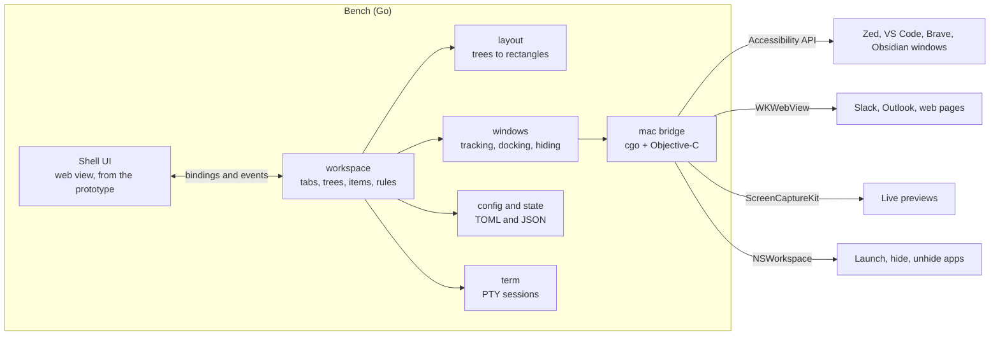

# Bench: build spec

Bench is a working name for a macOS app, written in Go, that gathers any set of apps into one window with tabs. Each tab holds a layout of panes, and each pane holds windows as sub-tabs. You can move any window to another pane, beside another window, or to another tab. Layouts adapt to the width of Bench's window: wide when it fills a monitor, compact on a laptop or in half a monitor.

This document is the brief for building it. It goes with `bench-ui-prototype.html`, a clickable prototype of the interface.

## Contents

- [Files in this handoff](#files-in-this-handoff)
- [Goals and non-goals](#goals-and-non-goals)
- [Concepts](#concepts)
- [Embedding, mirroring, and moving](#embedding-mirroring-and-moving)
- [Screens and behaviour](#screens-and-behaviour)
- [Windows: tracking and rules](#windows-tracking-and-rules)
- [Keyboard shortcuts](#keyboard-shortcuts)
- [Architecture](#architecture)
- [Config file](#config-file)
- [Layout maths](#layout-maths)
- [Repository layout](#repository-layout)
- [Milestones](#milestones)
- [Testing](#testing)
- [Risks](#risks)
- [Open questions](#open-questions)
- [References](#references)

## Files in this handoff

| File | What it is |
| --- | --- |
| `bench-spec.md` | This brief. |
| `bench-ui-prototype.html` | A single-file, clickable prototype. Open it in a browser. It's the reference for the look, the layout behaviour, and the interactions. |

In the prototype you can:

- Switch tabs, add tabs, and see that only the first nine get shortcuts.
- Click sub-tabs to show different windows in a pane.
- Drag a sub-tab onto another pane (joins it), onto a pane's edge (splits it, for side by side), or onto a tab in the title bar (moves the window to that tab). The split button and the **⋯** menu do the same without a mouse. In the app, a window that isn't in a tab can be dragged onto a pane by its own title bar too.
- Add a window that isn't in a tab, a new window of an app, any installed app, a terminal, or a web page, with a pane's **+** button.
- Simulate a monitor (2,560 pt) or a laptop (1,512 pt) to see Auto switch between wide and compact.
- Hover a sub-tab to see a live preview. Previews are on in the prototype. In the app they're off until the user turns them on, because they need Screen Recording permission.

Window contents are placeholders: grey shapes stand in for Slack, Outlook, Brave, and Obsidian, and the code and terminal text is illustrative.

To reuse the prototype as the app's frontend:

- Keep the design tokens. They're CSS custom properties in `:root`: the dark set, which is the prototype's, and a light set, `frontend/light.css`, checked for contrast in the same way, which the **Colours** setting (`appearance`) chooses. **Match macOS** (`system`) is the default, as Apple's Human Interface Guidelines ask. Each set has a small layer for macOS's **Increase contrast** (`prefers-contrast: more`), whichever the setting: stronger lines, quiet text at 7:1 at least, and a 2 pt border on the focused pane. With a `gap` of 0, that border is 1 pt where the pane meets the edge of the pane area.
- Keep the markup and class names for the title bar, tabs, panes, sub-tabs, menus, status bar, jump palette, add dialog, and layout editor, which became the app's Tab properties.
- Replace the prototype's `state` with data from Go. Its shape (`tabs[].root` as a tree of splits and panes, and `items` by ID) matches the model in this spec.
- Position panes from the rectangles Go sends (see [Window model](#window-model)). The prototype uses CSS flexbox for convenience; the app shouldn't, so that Go has one source of truth for geometry.

## Goals and non-goals

### Goals

- Any number of tabs, each holding any apps: Slack, Outlook on the web, Zed, VS Code, a terminal, Brave, Obsidian, or anything else installed.
- Panes that understand windows: every window gets a sub-tab, and any window can move to another pane, beside another window, or to another tab.
- Layouts that adapt automatically to the width of Bench's window, with a manual override.
- A keyboard-first jump palette for tabs, windows, and actions.
- Tab properties and Settings in the app, so the config file is optional.

### Non-goals for version 1

- Windows or Linux. The window management is macOS-specific.
- Putting other apps' windows inside Bench's own window. macOS doesn't allow it; see [Embedding, mirroring, and moving](#embedding-mirroring-and-moving).
- Splitting individual browser tabs. Bench works with windows, so to show two Brave tabs side by side, drag one out of Brave into its own window first.
- Syncing settings across Macs.

## Concepts

**Tab.** A named workspace with a layout. There's no limit on the number of tabs; the first nine get Control+Option+1 to 9, and the rest are reachable with Control+Option+] and [, the tab strip (which scrolls), and the jump palette. The default config starts with one, Research, holding the default browser, since a Mac may not have any other app Bench could name. The example config, which the browser preview starts with, has three: Comms (Slack, Outlook), Code (Zed, VS Code, terminals), and Research (Brave, Obsidian).

**Layout tree.** Each tab's layout is a tree. A split divides its space in a row or a column, with a size for each child as a percentage. Its children are panes or further splits. Presets create the starting tree; dragging and splitting edit it.

**Pane.** A leaf of the tree. It holds an ordered list of items, shows one at a time, and has a header with a sub-tab for each item.

**Item.** Something a pane can show. There are three kinds:

| Kind | Badge | What it is | Examples |
| --- | --- | --- | --- |
| Web | `WEB` | A web view that Bench owns, drawn inside Bench's window | Slack, Outlook on the web, any web page, VS Code for the Web |
| App | `APP` | Another app's real window, moved and sized to fit the pane | Zed, VS Code, Brave, Obsidian, web apps such as Gmail or Slack, any app |
| Built-in | `BUILT-IN` | A view that Bench draws itself | Terminal sessions |

One pane can hold items of different kinds and from different apps. For example, the Code tab starts with Zed and VS Code as sub-tabs of one pane.

A website can be an App item too, as a **web app**: a site that the user's browser has made into an app of its own, with its own windows. That's how the add dialog adds websites where it can, because the browser runs the site with its own protections and sign-in (see [Adding to a pane](#adding-to-a-pane)). Web items are for the rest, and for the example config's Slack and Outlook, whose menus switch them to web apps with one click (see [Switching a web page to a web app](#switching-a-web-page-to-a-web-app)).

**Sub-tab.** A button in a pane's header for one item, showing the app's icon and the window's title, or a name the user has given a terminal or web page. Clicking it shows that item. Dragging it moves the item.

**Tile.** The square before a sub-tab's title, and before each row of the jump palette, the add dialog, **Settings ▸ Launchers**, an empty pane's list, and the welcome guide's starter tabs. It shows the app's icon, which macOS draws from the app's bundle, or for a web page, the page's own icon. Where there's none, as for a terminal, a page with no icon Bench can read, an app that isn't installed, and everything in the browser preview, or until the icon loads, it shows the app's monogram, two letters such as **Zd** for Zed, in 10 pt text, the smallest that Apple's guidelines allow on the Mac. It's 20 points square in a sub-tab, with or without an icon, so headers stay the same height, and a marker of the item's status sits on its corner.

**Presets.** Starting trees, used for new tabs and in Tab properties:

| Preset | Tree | Default sizes |
| --- | --- | --- |
| `single` | One pane | — |
| `side` (Side by side) | Row of two | 50, 50 |
| `main-side` (Main and side) | Row of two | 65, 35 |
| `three` (Three columns) | Row of three | 40, 30, 30 |
| `top-bottom` (Top and bottom) | Column of two | 65, 35 |
| `grid` (Grid of four) | Column of two rows of two, filled in reading order | 50, 50 each |

When a preset replaces a tree, the existing panes' items keep their order: pane 1's items go into the new pane 1, and so on. If the new tree has fewer panes, the extra panes' items join the last one. No item is lost.

**Small-screen behaviour.** Each tab chooses what happens on a small screen:

| Setting | Effect |
| --- | --- |
| `stack` | The top-level row becomes a column, so side by side becomes top and bottom. |
| `tabs` | The tab shows one pane containing every item as a sub-tab. The tree is kept and comes back in the wide layout. |
| `same` | No change. |

**Size class.** `wide` or `compact`. In Auto mode, Bench compares the width of its own window with `compact_below` (default 1,280 pt). So a window that fills the screen of a 13-inch or 14-inch MacBook (1,470 or 1,512 pt) shows its panes side by side, and a window tiled into half of a MacBook's screen is compact. Once the window is compact, it stays compact until it is 40 pt wider than `compact_below`, so that dragging its edge to and fro doesn't change the layout each time. The user can force Wide or Compact from the title bar until they pick Auto again. In the `tabs` view, **Show side by side** changes to Wide, with **Undo**, and the toast says how to go back.

## Embedding, mirroring, and moving

macOS gives an app three ways to show another app's content. Bench uses all three, each where it fits.

| Approach | What you get | Limits | Where Bench uses it |
| --- | --- | --- | --- |
| **Embed** content Bench owns | Fully native inside Bench's window. Real embedding. | Only for things Bench can host itself: web pages and terminals. | Slack and Outlook as web views in the example config, web pages that the user's browser can't make into web apps, VS Code for the Web, and terminals. |
| **Move** the real window | Any app, fully usable: typing, drag and drop, menus, and shortcuts all work as normal. | It's still a separate window, so Bench must manage stacking and hiding carefully. | Every App item: Zed, VS Code, Brave, Obsidian, web apps, and anything else. |
| **Mirror** with ScreenCaptureKit | A live picture of any single window, smooth up to the display's refresh rate, even when the window is covered or off-screen. | Display only. Passing clicks and typing on to the real window isn't reliable enough for everyday use; text input, menus, and drag and drop are the usual problems. Needs Screen Recording permission, which macOS asks users to re-approve from time to time. Chromium-based apps (Brave, VS Code, Slack, Obsidian) can stop drawing windows that are covered, so a mirror may show a frozen frame. | Live previews: hovering a sub-tab, and window thumbnails in the jump palette. Optional. |

The fourth idea, putting another app's actual window inside Bench's window, isn't available. macOS has no public API for it, and sharing rendered content between processes (for example, with IOSurface) needs the other app's cooperation.

Two practical consequences:

- **VS Code can be embedded for real.** `code serve-web` (VS Code 1.82 or later) runs a local server for VS Code for the Web, which works on the Mac's own files and terminals. Bench can start it and show it in a Web item. Check that the extensions you rely on work there before switching; if not, use the desktop app as an App item.
- **Moving done well looks like embedding.** Bench draws the pane chrome, sizes the window to fit the pane body exactly, keeps it in place when Bench moves, and hides it when its tab or sub-tab isn't shown. Contain, a Mac app that groups windows into tabs, takes the same approach: it doesn't copy or mirror windows, and the originals stay fully usable.

## Screens and behaviour

The prototype shows all of these. Where the app must behave differently from the prototype, this section says so.

### Main window

- **Title bar.** Traffic lights, then the tab strip. Each tab shows its name and, for the first nine, its shortcut, at its right end, except in the compact size class, where the tabs need the room (`tab_shortcut_hints`: `auto`, `always`, or `never`); its tooltip has the shortcut either way. The current tab, and a tab under the pointer or with the keyboard focus, show a × in the shortcut's place, which closes the tab (see [Closing tabs and windows](#closing-tabs-and-windows)); a tab that doesn't show its shortcut has an empty slot for it instead, the same width as the ×. The current tab has a raised background and a 2 pt accent underline. A tab with the keyboard focus has a 2 pt accent ring inside its edges, as a sub-tab and a segmented control's button have, since the strips they scroll in cut off what's outside them. A tab is at most 200 pt wide: a longer name is cut short with an ellipsis, keeping the shortcut, and the tooltip has the whole name. A tab's unread total follows its name, on the current tab too, apart from in the `tabs` small-screen view (see **Unread counts**). The strip scrolls sideways when tabs don't fit (see **Strips that don't fit**). A **+** right after the last tab, which stays at the end of the strip when it scrolls, opens Tab properties for a new tab. In the `tabs` small-screen view, the one pane's sub-tabs, **+**, and other header controls follow, after a divider (see **Density and pane headers**). The rest of the title bar's width is empty, and moves and zooms the window.
- **Tab menu.** Right-clicking (or Control-clicking) a tab opens its menu at the pointer, without switching to it: **Tab Properties…**, which opens Tab properties for that tab, whichever is current, and **Rename…**, which renames it in place, as double-clicking it does (see **Renaming in place**), and **Move Tab Left** and **Move Tab Right** (disabled at either end); then **Rearrange**, which switches to the tab first if it isn't current, and **Reset Layout**, which doesn't ask first, as in Tab properties; then **Close Tab…** (**Close All Windows…** on the only tab) and **Delete Tab (Keep Windows)**, which isn't there on the only tab (see [Closing tabs and windows](#closing-tabs-and-windows)); then **New Tab…**, and, once a tab has been deleted or closed, **Reopen Closed Tab** with that tab's name below it, and once a web page or terminal has been closed, **Reopen Closed Page** or **Reopen Closed Terminal** with its name below it, with its app, as Bench's messages give it, such as "Slack — # general" (see [Undo and closed tabs](#undo-and-closed-tabs)). It has no **Undo**, which the menu bar's Tab menu and the jump palette have. The menu follows its tab by name when other tabs are added or deleted, and closes if its tab is deleted. A menu asked for from the keyboard opens below the tab. The prototype has no tab menu.
- **Menu names and groups.** Every entry of Bench's own menus (the **⋯** menu, a sub-tab's, a tab's, an empty pane's, a terminal's, and the layout menu) has title case, as macOS menus do ("Split Right with an Empty Pane": articles, short conjunctions, and short prepositions stay lower case, but first and last), and the name that the menu bar gives the same command, so that one command has one name in the menus, the jump palette, and the docs. Buttons, toasts, tooltips, dialogs' text, and the palette's hints keep sentence case. A window's **⋯** menu puts its common actions first, where the menu opens: **Reload Page**, **Rename…**, and the Close entry, last in the group. The menu itself (`tabindex="-1"`) has the focus when it opens, with no entry chosen, as a macOS menu opens, so that a second Return from habit can't close the window: Down Arrow or Home goes to the first entry, and Up Arrow or End to the last. **Move to Tab** and **Also Show In** are submenus (`role="menu"`, with an entry that has `aria-haspopup="menu"` and `aria-expanded`), drawn beside the menu, not in it, so that the menu's scrolling doesn't cut them off: to its right, overlapping it by 4 pt, with their first entry level with the entry that opened them, or to its left where there's no room on the right, and moved up as far as they need to stay inside the window. The pointer opens one after resting on its entry for 200 ms, or at once with a click, but not if it leaves the menus before then, and closes it after resting on another entry; while it moves towards the open submenu, across the entries between, the submenu stays open, until it stops for 400 ms. Right Arrow, Return, or Space on the entry opens it, with the focus on its first entry that's on; in the submenu, the arrows, Home, and End move among its entries, and Left Arrow or Escape closes it, giving the focus back to the entry. Up and Down Arrow in the menu close it as the focus moves on, and Escape there, where the focus stays while the pointer opens a submenu, closes the menu with it.
- **Title bar, right side.** A segmented control for **Auto**, **Wide**, and **Compact**; a **Jump to…** button; and a gear button that opens **Settings**, where the prototype has a button that opens its layout editor for the current tab. When the title bar is narrower than 1,200 pt, or in the compact size class, it slims to leave the tabs more room: the segmented control becomes one button that names the mode (**Auto ▾**) and opens a menu of the three, with the one in use ticked and why the layout is in use, and **Jump to…** becomes its magnifying glass, whose tooltip and accessible name include its shortcut. A slim title bar stays one row: its strips scroll to leave room for the controls. When the title bar is narrower than 1,000 pt, the amber notes of a hidden status bar (see **Status bar**) show only their numbers; their tooltips and accessible names keep the words. **View ▸ Layout** also has **Auto**, **Wide**, and **Compact**, ticked to match, without shortcuts.
- **Panes.** Laid out by the tab's tree, with a gap and padding of 4 pt by default (`gap`; Settings offers 8, 4, and 2 pt, never 0, which would leave no divider to grab). The focused pane has an accent border. Clicking anywhere in a pane focuses it. Double-clicking a divider, or Return on one selected from the keyboard, gives its split's children equal sizes (`EvenSizes`), with **Undo**; a split whose children are already equal stays as it is.
- **Zoom Pane.** The `zoom_pane` shortcut, or **Zoom Pane** in the jump palette, **Pane** menu, an item's **⋯** menu, or an empty pane's menu shows one pane alone (`ZoomPane`): it fills the pane area, with its own sub-tabs, and the tab's other panes' App windows go out of sight, as in the compact size class. Its header stays, even with `pane_headers = "auto"`, with an accent **Zoomed** chip that shows every pane again (`ShowAllPanes`), as do the shortcut again, and **Show All Panes**, which **Zoom Pane** becomes, in the palette and the menus. The status bar says **One pane zoomed**, as a button that does the same. The zoom ends when the tab changes, another pane is focused, or the zoomed pane's shown item moves to another pane; Control+Option+arrow focuses and moves across the tab's whole layout. The tab keeps its panes, sizes, and items, and the zoom isn't saved: Bench starts with every pane shown. A tab with one pane, or in the `tabs` view, has nothing to zoom.
- **Arranging the panes from the keyboard.** Five actions change the current tab's panes without the mouse (decision 59 in [architecture.md](architecture.md)). Each has a shortcut, off by default (`grow_pane`, `shrink_pane`, `equal_panes`, `next_layout`, and `previous_layout`), a row in the jump palette's **Actions**, and an item in the menu bar: **Pane ▸ Grow Pane**, **Shrink Pane**, and **Make Panes Equal**, and **Tab ▸ Next Layout** and **Previous Layout**.
  - **Grow Pane** and **Shrink Pane** (`GrowPane`, `ShrinkPane`) make the focused pane 5 percentage points larger or smaller in the split that holds it. When it grows, each other child of the split gives up room in proportion to its room above 10%; when it shrinks, the others share the room in proportion to their sizes. No child goes below 10%, the smallest a divider drags to. The toast says how the split's children share it, in its order, as whole percentages that add up to 100, each named by what its pane shows, or a nested split by its panes: "Zed 70% · Terminal 30%". A pane at the limit says so: "This pane is as wide as it can be." (or narrow, for a row, and tall or short, for a column, or the `stack` view's column).
  - **Make Panes Equal** (`EqualPanes`) gives every split of the tab equal sizes, as a double-click on each of its dividers would: "Made the panes the same size." It's refused when they look equal already.
  - **Next Layout** and **Previous Layout** (`StepLayout(1)` and `StepLayout(-1)`) give the tab the next or previous of the six layouts, in Tab properties' order (Single, Side by side, Main and side, Three columns, Top and bottom, Grid of four), wrapping, with the layout's own sizes, keeping the items in order as Tab properties does: the first pane's items go to the new first pane, and so on. A custom tab goes on from the layout whose shape its tree still has: the preset it had before it became custom (`fromPreset` in `state.json`), while the tree has that preset's shape, or else the preset with the tree's shape (one pane, a row of two or three panes, a column of two, or a column of two rows of two), where the sizes tell Side by side from Main and side. From a tree with no layout's shape, Next Layout gives the first layout with room and Previous Layout the last. Empty panes are dropped first, unless a new window is on its way to one, or the add dialog is open for it after a split with an empty pane, and a layout with fewer panes than the tab has left is skipped, so that two panes' items never end up in one. The toast names the layout: "Layout: Three columns". The layout and sizes are the live arrangement, saved in `state.json` as a dragged divider is; `config.toml` keeps its layout until Tab properties changes it.
  - Each toast has **Undo**. A run of them on one tab, each within 10 seconds of the last, while nothing else has changed the tab's tree or kept an undo step, shares one step, so that **Undo** puts the tab back as it was before the first; its own toast then says "Put back the sizes of the panes.", or "Put back the layout." if the run changed the layout.
  - In the `tabs` view all five are refused: "In the compact layout, this tab shows its windows as one pane. Choose Wide to arrange its panes." While a pane is zoomed, **Grow Pane** and **Shrink Pane** are refused, as the pane fills the tab, and the other three show every pane first. A tab with one pane has nothing to resize or make equal. A tab whose panes only its own layout has room for, or none, can't change layout, and says so. The palette leaves out, and the menus disable, what would be refused (`display.arrange`).
- **Every tab at once.** An overview of the tabs, to choose one from (decision 60 in [architecture.md](architecture.md)), opens from **View ▸ Show All Tabs**, **Show All Tabs** in the jump palette's **Actions**, and the `show_all_tabs` shortcut, which is off by default and closes it too. It's a sheet like the jump palette, as wide as the window allows, up to 1,120 pt, with a search field and a grid of cards that scrolls, two or more to a row, in Bench's smallest window too. Each tab is a card, in the tab strip's order: its name and shortcut; **Current** on the current tab's; the bell, ⚠, and camera and microphone marks that its tab and sub-tabs show; and its panes drawn to scale, as the wide layout has them, in the pane area's shape, each with the shown item's tile, marker, and title, then its other items' tiles, four at most and then a count. It shows no pictures of the windows, so it needs no Screen Recording, and the frontend draws it from the View alone. The tab used last is chosen as it opens, with the accent's outline. Typing filters the cards by every word, in the tab's name or an item's label, as the palette matches; the Left and Right arrows choose the card before or after, Up and Down the card a row above or below, as drawn, stopping at the ends; 1 to 9, with nothing typed, switch to that tab; Return or a click switches to the card chosen, and a Control-click, which macOS sends as a `contextmenu` event, works as a click, on a card and on the backdrop; Escape or a click on the backdrop closes it, and gives the keyboard back as the palette does. For VoiceOver, the field is a combobox whose active descendant is the chosen card, an option in a listbox, whose label is the tab's name and shortcut, then "current tab" or "last used", how many windows, the windows its panes show, and its marks; the drawing is hidden from it.
  - **Hold to switch.** The `last_tab` shortcut works as Command-Tab does for apps. Pressed and let go, it goes back to the tab used last, as before. While its modifiers stay held, Bench waits for them to be let go, asking macOS every 20 ms (`[NSEvent modifierFlags]`), since a global hot key reports only its press. Held more than 300 ms, Bench comes forward and shows the overview with the tabs most recently used first: the current tab, the tab used last, which is chosen, then the others in the order they were left, then those not used since Bench opened, in the tab strip's order. Each further press of the shortcut chooses the next tab, wrapping, as do `next_tab` and the Right arrow, in the overview or with `focus_pane_modifiers`; `previous_tab`, the Left arrow, and `send_to_last_tab` (the shortcut with Shift added, by default) choose the tab before, as Command-Shift-Tab does; the Up and Down arrows choose the card a row above or below, as drawn, stopping at the first and last; `zoom_pane`, whose key is Return, switches at once, as do Return and a click; a tab's shortcut switches to that tab; Escape, or a click on the backdrop, stays on the current tab. The other shortcuts do nothing until the hold ends. Letting go of the modifiers switches to the tab chosen, which gives that tab's focused pane the keyboard. Any other shortcut pressed before the tabs show first switches to the last used tab, as a quick press does, and then acts on that tab, as when the shortcut switched at once. Bench doesn't wait, and switches at once, while a menu or dialog is open, when the shortcut has no modifiers, or while Bench is hidden and `show_on_tab_shortcut` is off. Before Bench has switched tabs, a hold shows the tabs too, with the first other tab in the tab strip chosen, and a quick press says "There's no tab to go back to yet. Switch tabs first." A hold ends without switching once the Mac has slept or woken, or the user has come back to their session, as the keys were let go of meanwhile, and once it has lasted a minute, in case Bench missed the keys being let go. In the browser preview, the page tells Go which modifiers it holds. The **Last used tab** row of Settings ▸ Keyboard and the **Keyboard Shortcuts** sheet says "hold ⌃⌥ to choose a tab", with the shortcut's modifiers, after its keys.
- **Pane header.** 40 pt tall, or 32 pt in the compact density, with a 1 pt divider below. Sub-tabs for the pane's items; a **+** to add to the pane; the shown item's badge, or for a web page, its host (see [Web items](#web-items)); a **Show side by side** button (split right); and a **⋯** menu. Each sub-tab has a × at its right end that closes its item, shown on the pane's shown sub-tab, after its title, and on others under the pointer or with the keyboard focus (see [Closing tabs and windows](#closing-tabs-and-windows)). Right-clicking a sub-tab opens its item's **⋯** menu at the pointer, and right-clicking the header's empty space opens the shown item's. The **⋯** button's own menu opens below it. An empty pane has no **⋯**: right-clicking its header or body opens a menu at the pointer with **Add to Pane…** and, in a tab with more than one pane, other than in the `tabs` view, **Close Pane**, as its body's buttons do, and **Zoom Pane** (see **Zoom Pane**). An empty pane's body says that it has no windows yet, and how to bring one in: "Drag a sub-tab here, or press ⌃⌥⇧ and an arrow to move the shown window here.", with the `move_window_modifiers` shortcut as configured, or only "Drag a sub-tab here." while that shortcut is off.
- **Density and pane headers.** **Density** (`density`: `auto`, `standard`, or `compact`; `auto` is compact in the compact size class) sizes Bench's chrome for a 13- or 14-inch MacBook with a trackpad. Standard: a title bar of 52 pt and a 1 pt line, tabs 36 pt, title bar buttons 32 pt, pane headers 40 pt, sub-tabs 30 pt, and header buttons 28 pt. Compact: a title bar of 38 pt and a 1 pt line, tabs 30 pt, title bar buttons 28 pt, pane headers 32 pt, sub-tabs 26 pt, and header buttons 24 pt. Go sets each pane's header height, docks its window below it, and sends it in the View; the UI draws that height. In the app, the title bar keeps the density it had at launch, matching the native title bar (see [Window model](#window-model)), and Settings says that it changes when Bench next opens, for a density that would change it; the panes change at once. The browser preview's title bar follows the density at once.
  - In the `tabs` small-screen view, the one pane has no header (0 pt): its sub-tabs, **+**, and other header controls are in the title bar, after the tabs' **+**, and the pane's frame reaches up to the top of the pane area, over the gap there. The tab strip starts at 100 pt wide, and the pane's part, with its sub-tabs and controls, at 240 pt. The tab strip takes two parts in three of the room that's left. Each strip grows up to its whole width, and scrolls on its own. A sub-tab there is at most 220 pt wide, and the shown one 242 pt, for its ×. The sub-tabs keep everything a header's have: clicking, dragging, right-clicking, markers, and tooltips. Right-clicking the empty part of the pane's controls opens the shown item's menu, or for an empty pane, the pane's.
  - With **Hide the sub-tab row when a pane holds one app window** (`pane_headers = "auto"`; `"always"`, the default, keeps every header), a pane that holds one App item with a window, while Bench can dock windows, and that has nothing to report, has no header, so that the app's own title bar stands in for it: its window is docked just inside the pane's border. A window that needs more room is judged against that taller body. A second item brings the header back at once; a status brings it back once it has lasted 1 second, so that a status that comes and goes doesn't move the window down and up; and once back, the header goes again only after 2 seconds with nothing to report. A pane seen for the first time since its tab was shown decides at once. Web pages and terminals always keep their headers. The jump palette's **Add to Pane…** and its **This window** group, which ends with **Window Options…**, stand in for the missing header's buttons.
- **Strips that don't fit.** The tab strip and each pane's sub-tabs scroll sideways rather than squash. A sub-tab is at least 96 pt wide and at most `clamp(220pt, 30% of the pane, 360pt)`, the shown one 22 pt more, for its ×, with its whole title in its tooltip. Over a strip that doesn't fit, a mainly vertical wheel scrolls it sideways (a wheel that counts in lines moves 40 pt a line), and a sideways swipe scrolls it as usual; turning the wheel over a strip hides any live preview. An end with more to show fades out over 24 pt. After every redraw, and as the window is resized, each strip scrolls to keep the current tab, or the pane's shown sub-tab, in view, clear of the fades; a strip the user has scrolled by hand, or moved the keyboard along to another tab or sub-tab, stays where it is until it shows another tab or sub-tab, gets another one, or the window is resized. Dragging a tab or sub-tab within 24 pt of either end of a strip scrolls it, faster nearer the end, so that a tab out of view can take the drop, or a place between tabs or sub-tabs out of view. Scroll bars follow **Show scroll bars** (`scroll_bars`): `auto` shows them when macOS shows scroll bars all the time (`NSScroller.preferredScrollerStyle` is legacy, as with Show scroll bars set to Always, or a mouse and no trackpad), which Bench follows as it changes; `always` and `never` override it. A shown bar is 4 pt thin (3 pt in the compact density) and sits in the title bar's bottom padding, or the pane header's below the sub-tabs, so no height changes and no docked window moves, and pressing the tab strip's bar scrolls it rather than moving the window. The browser preview reports scroll bars shown only while scrolling.
- **Status bar.** One line: the current tab's window and pane counts as drawn ("shown as one pane" in the `tabs` small-screen view, and every pane while one is zoomed); **One pane zoomed** while one is; a note of how many windows have a problem and need attention, which opens a list of them; the size class in short (**Wide**, **Compact**, or **Auto: wide**), with why in its tooltip and in a message when it's clicked (for example "Wide layout, chosen for a window 2,560 pt wide"); notices; and shortcut hints, a button that opens the **Keyboard Shortcuts** sheet (see [Keyboard shortcuts](#keyboard-shortcuts)), absent while every shortcut is off. It doesn't repeat the tab's name, which the title bar shows. When there's no room, the notice and then the size class are cut short, and the shortcut hints go. The prototype's dot before the tab's name meant nothing, and is gone. It can be hidden (`show_status_bar`), and the panes then take its height: the windows that need attention and the notices become amber buttons in the title bar, beside **Jump to…**, that open the same lists below them, and messages show on one line in the middle of the title bar's empty space for at most 4 seconds. If that space is under 240 pt, a message goes over the tabs instead, and only failing that over the controls at the right; never over the traffic lights. Messages let clicks through to the title bar, except on any buttons they carry. The browser preview does the same. The notices' list ends with **Recent messages**: the last 20 messages and notices, latest first, each with the time it came, its whole text, which can be selected, and **Copy**, and **Undo** for a message whose toast had it, while its change is still the latest (see [Undo and closed tabs](#undo-and-closed-tabs)). A notice joins them once it's gone. While there are no notices, the status bar has a button for the list in their place, and **Help ▸ Recent Messages** and the jump palette open it whether the status bar shows or not. Bench also writes its warnings and errors, and each notice, to a log file (see [Config file](#config-file)).
- **Renaming in place.** Double-clicking a tab, or **Rename…** in its menu, turns its name into a text field, with the name selected; for a tab that isn't current, the first click switches to it, and the second doesn't again, and on the current tab, neither click gives the tab's window the keyboard, which a single click does after a moment. The field then takes the keyboard back from whatever the switch, or Bench lowered after a menu, gave it to (`FocusUI`). Return saves the name with `SaveTab`, keeping the tab's layout (preset `custom`, which keeps the tab's panes and its `config.toml` layout) and small-screen setting; a name that another tab has is numbered as Tab properties numbers it, and an arrow and the numbered name after the field say so first. An unchanged or empty name keeps the tab's. Escape, or the field losing the focus, cancels. A double-click on a tab never zooms the window, as one on the title bar's own space does: tabs, and the field, don't move the window. **Rename…** in the menu of a terminal's or web page's sub-tab does the same for its title, with `RenameItem`: the name is the item's own (`label` in `state.json`), shown on its sub-tab and in the jump palette in place of the title its shell or page sets, which keeps changing underneath. **Use Automatic Title**, which shows that title, or an empty name, takes the name away. App items take their title from the app and can't be renamed. Renaming doesn't raise Bench.
- **Markers and tooltips.** A sub-tab whose window isn't ready has a marker on its tile, a different shape for each kind of status: a warning sign for a problem, a ring while it opens, and an i for information (full screen, another desktop, minimised). Its menu's first line says why. A sub-tab's tooltip has its whole title with its app, the title its shell or page sets if the user has named it, why it isn't ready, and the other tabs it's in. Every icon button, tab, and sub-tab has a tooltip, and controls change under the pointer and when pressed; nothing depends on hovering alone.
- **Unread counts.** With `unread_counts` on (the default; **Settings ▸ General**), a sub-tab shows its item's unread count in a grey pill before its title, after the bell, and a tab shows the total of its items after its name (decision 61 in [architecture.md](architecture.md)). The counts come from two places:
  - **Dock badges.** An App item shows the badge on its app's Dock icon, which Bench reads through Accessibility from the Dock's items (`AXStatusLabel`), every 5 seconds, and again when an app comes to the front, at most once a second, while it has the permission. A badge is the whole app's, so it shows on one item: the app's first in tab order (the tabs in order, then their panes in reading order and the panes' items in order), of those drawn as sub-tabs; its tooltip and spoken name say "whole app" when the app has other items. An app that isn't running, or has no Dock icon, has no badge.
  - **Page titles.** A Web item whose page has loaded since Bench started shows the count at the start of its title in round or square brackets, such as "(3) Inbox", "[12] Chat", "(1,234) Mail", or "(99+) Inbox". A page has loaded once its web view reports its title: until then, the title is the one from the last time Bench ran, which can be out of date, and has no count. Bench makes a page's web view the first time it shows the page (see [Behaviour when switching tabs](#behaviour-when-switching-tabs)), so a page in a tab that hasn't been shown since Bench started, or that isn't its pane's shown sub-tab, has no count until then. The sub-tab, the jump palette, the add dialog, and toasts show the title without it; a title that is the count alone shows the app's name. A name the user gave the item stays as it is. A popped-out page's window has its whole title, with the count.
  - A badge of digits is a count, with a "+" for more; any other badge, such as "•" or "!", is a dot with no number. The pill shows at most "999+", and its tooltip has the whole count, as "1,234 unread". A pill for one digit is round, 16 pt across; a longer one is as wide as its text. The pills are grey in every appearance, apart from the blue bell and the amber ⚠, with text at 4.5:1 contrast or more, 7:1 with Increase contrast. The ×'s place on a tab stays clear of the pill, and a sub-tab's × never covers it. In the `tabs` small-screen view, the current tab has no pill: its sub-tabs, with their counts, are beside it in the title bar, and the pill would push its × out of the tab strip in a narrow window. Its tooltip and spoken name still have the total.
  - A screen reader reads a tab's total after its name, as "Comms, 15 unread", and a sub-tab's count in its name, after its title and app, as "general, Slack (3 unread)"; the pills themselves are hidden from it. The overview of every tab shows each tab's total and the count of the item each pane shows.
  - With `unread_counts` off, Bench doesn't read the Dock, and pages' titles keep their counts.
- **Dialogs.** Tab properties, Settings, the add dialog, the jump palette, and the welcome guide are sheets inside the window, and never taller than it: their headers and buttons stay in view, and only their middles scroll. On a window less than 760 points tall they start nearer the top, clear of the traffic lights, and Tab properties' layout preview is shorter. Each moves when the user drags its header (not a field or button in it) and resizes from a grip in its bottom-right corner, down to 420 by 300 points (200 points tall for the palette and the add dialog, and 560 points wide for Settings), staying inside the window and clear of the traffic lights; the layout preview and the lists grow with it. A double-click on the header puts it back in the middle. The Keyboard Shortcuts sheet and the questions before quitting and closing move too, but don't resize. The overview of every tab neither moves nor resizes. Moving a dialog doesn't size it: one the user hasn't resized stays as tall as its contents, cut short above the window's bottom edge. Bench remembers each dialog's size in `state.json`, and where it was while Bench runs; a dialog that a smaller window cut short gets its place and size back when the window grows. Menus don't move.

### Moving windows

Three ways, all doing the same thing:

1. **Drag a sub-tab.**
   - Onto a strip of sub-tabs, which is a pane's header, buttons and all, or in the `tabs` view the title bar's part with the pane's sub-tabs: the item goes between the two sub-tabs either side of the pointer, before the first whose middle is right of it, or after the last, in that pane (`MoveItemAt`). Along its own pane, this only puts the sub-tabs in another order. A strip never splits.
   - Onto the middle of a pane's body: the item joins that pane and is shown.
   - Onto the outer quarter of a pane's body, on any side: the pane splits in that direction, and the item goes into the new half. If the pane's parent split already runs in that direction, the new pane becomes a sibling, sharing the old pane's size equally; otherwise the pane is replaced by a new split.
   - Onto a tab in the title bar: the item moves to that tab's focused pane.
   - Onto the tabs' **+**, or the title bar's own space just after it, for as far again as the **+** is wide: the item moves to a new tab of its own, as **Move to Tab ▸ New Tab** does. With Option held, it's shown there as well, as **Also Show In ▸ New Tab** does. A drop on the rest of the title bar's own space does nothing, so it still cancels the drag. The title bar's space still moves the window when pressed; a tab dragged there goes to the end of the tabs, as before.
   - While dragging, show where it will land: a line between two sub-tabs, a highlighted half of the pane's body for an edge, the whole body for the middle, or a tinted tab or **+**. The **+** has a dashed outline while a sub-tab is dragged. No line shows where the drop would change nothing, next to the dragged sub-tab.
   - Go holds the same rule (`layout.DropAt`), for when it finds drop targets itself: a header or the title bar's strip inserts at a place, a body's edges split.
2. **Use the pane's buttons.** **Show side by side** splits right with the shown item. The **⋯** menu (see **Menu names and groups**) has, first, the common actions, where the menu opens: **Reload Page**, for a Web item, **Rename…** and, for one the user has named, **Use Automatic Title**, for a terminal or web page (see **Renaming in place**), and **Close Window**, **Close Page**, or **Close Terminal**, or for an item in other tabs too, **Remove from This Tab** and **Close Everywhere** (see [Closing tabs and windows](#closing-tabs-and-windows)). Then **Split Right**, **Split Down**, **Split Right with an Empty Pane** and **Split Down with an Empty Pane**, which put an empty pane on that side (`SplitPane`) and open the add dialog for it at once, taking the pane away again (`CancelSplit`) if the dialog closes without adding anything, and **Zoom Pane** (see **Zoom Pane**); **Move Left** and **Move Right** along the strip the sub-tab is drawn in (disabled at its ends); **Move to Pane**, a heading over each other pane, as **Pane with** *shown item*, or **Empty Pane**; the **Move to Tab** submenu (every tab, the current one disabled, the first nine with their `send_to_tab_modifiers` shortcut, then **New Tab**) and the **Also Show In** submenu (every tab, those the item is in already disabled, then **New Tab**); **Open** *app* and **Remove** *app* **from This Pane** under **Closed Windows**, for each app the pane is waiting for (see [Closing](#closing)); for a Web item, its **Page** group (see **Page controls** under [Web items](#web-items)); and **New Terminal in** *folder* for a terminal, **Dock Again**, **Show Again**, **Open in Browser**, and **Pop Out of Bench** (**Remove from Bench** for an App item with no window). For a web page, **Use the** *name* **Web App from** *browser* or **Make a Web App in** *browser*… joins the end (see [Switching a web page to a web app](#switching-a-web-page-to-a-web-app)).
3. **Use the keyboard.** Control+Option+Shift+arrow moves the shown item of the focused pane into the neighbouring pane in that direction, or splits at that edge if there's no neighbour.

Rules:

- A pane can't be split by the only item it shows; the menu and keyboard explain why instead of doing nothing.
- When a pane loses its last item, it's removed and its parent split closes up. The last pane in a tab stays, empty, with an **Add a window or app** button. A pane that holds only hidden items stays (see [Closing](#closing)).
- Moving an item to another pane marks the tab's layout as custom. Tab properties says so, and choosing a preset starts again from that preset (keeping items in order). Putting a pane's sub-tabs in another order doesn't.
- In the `tabs` view, the one strip holds the whole tab in reading order. An item moved along it stays in its own pane if a sub-tab beside its new place is in that pane, and otherwise joins the pane of the sub-tab it goes before, or after. Its own pane stays, even if that leaves it empty, so the wide layout keeps its panes and their sizes; the message says so.

#### Moving tabs

- Drag a tab along the title bar: a caret between two tabs, thicker than a sub-tab's and with a dot at each end, shows where it goes. Only a press on a tab starts the drag, after 4 pt, never a press on its × or on the title bar's own space, which moves the window, and not with one tab. A drop anywhere in the title bar counts, by the pointer's place along the strip; elsewhere, or with Escape, the tab stays. The release isn't a click on the tab.
- **Move Tab Left** and **Move Tab Right** in a tab's menu (disabled at either end), **Move Tab Left** and **Move Tab Right** in the jump palette for the current tab, **Tab ▸ Move Tab Left** and **Move Tab Right** (disabled at either end), and **Position** in Tab properties.
- `MoveTab` moves the tab in the model and in `config.toml` together, saved with a `.bak` as Tab properties saves it. The current tab stays current, each window stays in its tabs, and each tab keeps its arrangement. Shortcuts follow the order. The toast, such as "Moved Comms to 3rd place (⌃⌥3).", has **Undo**, which puts the tab back in `config.toml` too.
- **Move to Tab ▸ New Tab** and **Also Show In ▸ New Tab**, in the **⋯** menu, a sub-tab's menu, and the jump palette's **This window** group for the focused pane's shown item, and a drop on the tabs' **+**, call `MoveItemToNewTab(item, also)`. In one step, Go adds a tab after the others with the single layout, named after the item's app and numbered as Tab properties numbers a taken name ("Code (1)", then "Code (2)"), moves the item there from the tab it's shown in, which becomes custom, or with `also` adds it there as well, switches to the new tab, and saves `config.toml` with a `.bak`. Its toast says what happened, such as "Moved Terminal — zsh to a new tab, Terminal.", with **Undo**, which takes the new tab away again, from `config.toml` too, and puts the item back where it was.
- In the compact layout with the `tabs` setting, there are no visible splits. So **Show Side by Side (Wide Layout)** in the **⋯** menu and the jump palette, **Pane ▸ Show Side by Side (Wide Layout)** in place of **Split Right**, the pane's split button, and the move-window keys' → change to the wide layout (`ShowSideBySide`), which shows the tab's panes, with the window shown and focused in its pane. A tab of two or more panes keeps its tree, and the toast says how to go back: "Changed to the wide layout, to show *name* side by side. To go back, choose Auto at the right of the title bar." A tab of one pane would show nothing side by side, so the window gets a pane of its own on the right, as **Split Right** gives it, and the toast says so: "Changed to the wide layout, and gave *name* a pane of its own, to show it side by side. Undo removes the pane and goes back to Auto." Either toast has **Undo**, which puts back the layout and the arrangement. The other split actions are not in the menus, and the move-window keys' other arrows say "Splits are hidden in the compact layout. Choose Wide to show them." Moving to another tab still works.
- **Pop Out of Bench** returns an App item's window to a normal, free-floating window, and gives a Web or Built-in item a window of its own. The item then appears under **Not in a tab** in the jump palette, and under **Windows not in a tab** in the add dialog. Its toast says how to bring it back: "Moved *name* out of Bench. To add it back, drag it onto a pane and wait a moment, or use +." (without the drag while `drag_to_add` is off).
- **Bringing a window in.** A window that's out of the tabs (popped out with Bench, opened elsewhere and not in a tab, or dragged out of its pane) comes into a pane in three ways:
  - **Drag it onto a pane** (`drag_to_add`, on by default). While the user drags such a window by its title bar and the pointer rests on a pane of the current tab for half a second, a guide shows over the pane: its body's middle (join the pane, as a sub-tab) and, unless splits are off or the pane holds no other window, a target near each edge (split the pane there), the one the pointer is on highlighted, with what the drop does as a label ("Add to this pane", "New pane on the left", and so on). Once shown, the target follows the pointer within the pane; leaving the pane, or a quiet drag (no report for 2 seconds), takes it away. Releasing the window there docks it there. A drag that changes the window's size, as from an edge, is no drop; nor are windows that a `float = true` rule matches, non-standard windows, and windows in full screen or minimised, which Bench asks the platform about as the guide shows and at the drop, as a drag doesn't say. Nothing is followed while Bench's window isn't on the active desktop (Space). Bench's hiding, another app than the dragged window's becoming active, and Bench being raised (a menu or dialog open) take the guide away. Bench's own popped-out windows dock once their drag ends.
  - **Add Front Window**, in the jump palette's **Actions** and the **Pane** menu, and the `add_front_window` shortcut (**Add front window to this pane** in Settings ▸ Keyboard, off by default): the window the user last gave the keyboard outside Bench's main window, if it's out of the tabs, goes into the current tab's focused pane, and a hidden Bench comes back to show it. Bench focusing a window itself doesn't count.
  - **Back to Bench**: a button in the title bar of a popped-out web page's window, a bar along the top of a popped-out terminal's window and an entry in its right-click menu, and **Window ▸ Back to Bench** for the popped-out window that has the keyboard. The item goes into the current tab's focused pane, and Bench comes forward on it.
  - The toast says what happened: "Added *name* to this pane." with **Pop out**, which pops it out again; for a window dragged out of a pane, "Moved *name* to this pane." with **Undo**, or "Docked *name* again." on its own pane. A window dragged out of its pane docks again, its **Dock again** gone; its places in other tabs stay as they are.
- **Remove from Bench**, in place of **Pop Out of Bench** for an App item with no window (its app has quit, isn't installed, or has no window for it), removes the item from every tab, so Bench stops opening the app for it. The pane's status message offers it as a button too. Such an item shows only while Bench opens its app for it, or lacks Accessibility permission (see [Closing](#closing)).

### Adding to a pane

The pane's **+** opens a searchable dialog with these groups, in order. Its search keeps the rows whose label or hint has the text as typed, whole, ignoring case and accents, not word by word as the jump palette does, so that a command such as `code .` isn't taken for a window and is offered to run (see below):

- **Launchers**: the user's launchers (see [Launchers](#launchers)), first, because the dialog chooses the first row that matches: typing `claude` should choose the Claude launcher, not a Claude desktop window. Typing matches a launcher's name only, not the command and folder of its hint.
- **Windows not in a tab**: open windows Bench isn't managing, and items popped out of Bench.
- **Windows in other tabs**: items in other tabs, to show in this pane as well.

  The rows of these two groups have tick boxes, to add several windows at once: a click on the box, or Shift-Return on the selected row, ticks it, and a bar below the list says how many are ticked, with **Add *N* windows**, which Return does too while any are ticked. They join the pane in the dialog's order (`AddWindowsToPane`), and the pane shows the first. With none ticked, a click on the row itself still adds just that row; while any are ticked, a click on a window's row ticks or unticks it, so that a click never drops the ticks. The box takes clicks over 24 by 24 points, and the dialog's other rows keep an empty slot as wide, so that the tiles line up.
- **New window**: a new window of each app already in this tab.
- **Built in**: **New terminal in *folder***, first when the pane, or else the focused pane, shows a terminal whose shell is in a folder other than the home folder, which starts the shell there; **New terminal**, your shell in the home folder; **New terminal in…**, which shows macOS's folder picker as a sheet on Bench's window, starting in that terminal's folder, and adds a terminal in the folder chosen, or leaves the dialog at its list if the user cancels (the browser preview has no picker, so it opens **New terminal…** at its **Folder** field, filled in with that folder); **New terminal…**, which asks for a command, a name, and a folder (see below); **Web page…**, which asks for an address (see below); and **Browse…**, which finds an app, or a program or script, in macOS's open panel (see below).
- **Apps**: every installed app other than a web app, from /Applications, ~/Applications, and /System/Applications, including their Utilities folders and the folders one level inside /Applications, such as /Applications/Setapp, and the apps chosen with **Browse…** since Bench opened. Choosing one opens it if needed and adds its windows that aren't already in a tab. If it has none, Bench opens a new window (see [Docking with the Accessibility API](#docking-with-the-accessibility-api)).
- **Web apps**: the web apps that browsers have made, with the browser that made each: Safari's in ~/Applications, Chromium browsers' in folders there such as `Chrome Apps.localized`, and Orion's in ~/Applications/Orion/WebApps. Choosing one works as for any other app. They come after **Apps** because the dialog chooses the first row that matches, and a web app's hint names its browser: typing "chrome" should choose Chrome.

**Web page…** adds a website as a web app where it can, since a web app runs in the browser, with the browser's protections and sign-in, which Web items don't have (Google blocks sign-in in embedded web views). Return:

1. Adds the installed web app whose address is on the same host as the one typed, ignoring case, a leading `www.`, and default ports, if there's one: the default browser's, else Safari's, else the first by name. A Chromium web app's address is its Info.plist's `CrAppModeShortcutURL`; a Safari web app's is its `Manifest` dictionary's `start_url`, or else its `WKPushBundleMetadata` dictionary's `manifestId`. Orion's isn't known.
2. Else, without Accessibility permission, which App items need, adds a Web item, and says why.
3. Else, if the default browser (the app that opens `https` links) can make web apps, opens the site in it and shows the browser's steps to make one: Safari, Chrome, Edge, Brave, Vivaldi, Chromium, Chrome for Testing, and Orion can. The dialog then asks Go every 1.5 seconds whether the web app is installed, and adds it as soon as it is: the web app on the site's host, or else the one web app installed since the site was opened, whatever its address, since a browser records the address the site ended on, which may be on another host (slack.com sends a signed-in user to app.slack.com), and Orion records none. Meanwhile, the dialog stays open while the user is in the browser, focus in the browser's windows doesn't switch tabs, Bench doesn't hide the browser, when Bench becomes active or by `hide_other_apps` or `hide_other_tabs`, and leaves its windows in other tabs where they are, since it may have opened the site in one, and a new window of the browser stays out of the tab, under **Windows not in a tab**. **Show in Bench instead** adds a Web item; **Cancel** and Escape go back to the list. If Go is looking for the web app just then, the dialog waits for its answer first, and closes if it added the web app.
4. Else, as for Firefox, Arc, Opera, DuckDuckGo, Zen, an app that chooses a browser for each link, or a browser that Bench doesn't know, such as another browser built on Chromium, adds a Web item, and says why.

Option-Return, or **Show in Bench**, adds a Web item instead.

Bench adds `https://` to an address typed without one, or `http://` for an address on this Mac, which may be `http` (see [Validation](#validation)). An address on this Mac, such as `localhost:3000`, is added as a Web item at once, without looking for a web app. Go's refusal shows under the address field, not as a toast, tied to the field with `aria-describedby`, with `aria-invalid` on the field, until the address changes: "That isn't a web address. Try example.com." for an address that isn't one; "Bench shows http pages only from this Mac, such as localhost. Try https://example.com." for an `http` address on another host; and "Type a web address, such as example.com." for none.

The dialog's foot says how to add an app it doesn't list: "Open any app, and its windows show under Windows not in a tab". Text that matches no row gets a note saying the same, and one row, **Run “*text*” in a new terminal…**, which opens **New terminal…** with the text as its command.

**New terminal…** is a form with **Command** (empty for just the shell), **Name** (the sub-tab's label, empty for the title the terminal sets), **Folder** (empty for the home folder) with **Choose…**, which shows macOS's folder picker as a sheet on Bench's window, and two tick boxes: **Start again when Bench opens** (ticked) and **Save as launcher** (unticked). Return in a field, or **Add**, adds the terminal (`AddToPane` with a `terminal` source that has the command, name, folder, and `startAgain`), and closes the dialog; Escape or **Back** goes back to the list. While the form or **Web page…**'s address has something typed, Escape, **Back**, a click outside the dialog, and a command that opens another dialog in its place ask first, and after Escape or **Back**, **Discard** goes back to the list (see [Changes not saved](#changes-not-saved)). Bench starts the user's shell as an interactive login shell and types the command into it once its line editor is ready, so the command finds what it would in the user's own terminal, and the shell stays at its prompt when the command ends. With **Start again when Bench opens** unticked, the command is typed but not run when Bench next opens. With **Save as launcher** ticked, Bench first saves the launcher (`SaveLauncher`), which a name-less launcher gets from its command's program or folder, and the terminal takes that name; if Go refuses it, the form stays open and says why. The browser preview has no folder picker: **Choose…** says to type the folder.

**Browse…** closes the dialog, so that Bench is lowered below the docked windows, and shows macOS's open panel as a window of its own in front of them, not a sheet, starting in /Applications, or the folder of what was last chosen with it, with **Add** as its button (`BrowseToAdd`). Bench waits for the panel without blocking, and a second **Browse…** while it's open brings it to the front and says it's open already. Then:

- An app, wherever it is, is added to the pane as the **Apps** rows add one, if the tab is still the one it was chosen from; otherwise Bench adds nothing and says why. Bench registers it with LaunchServices, so that it opens by its bundle ID, and lists it under **Apps** until it quits.
- A program or script reopens the dialog at **New terminal…**, filled in with its file name as the name and a command for the user to check: the program's bare name if the user's interactive login shell finds that same file by it, or else its path, quoted for the shell, with the program's folder as the folder. A script without the execute bit runs with the program its `#!` line names, or else the one for its extension (`sh`, `zsh`, `bash`, `python3`, `ruby`, `perl`, or `node`). Anything else is refused, and says why.
- **Cancel** reopens the dialog at its list. Neither reopens it if the tab has changed or another dialog or menu has opened meanwhile.

The browser preview has no open panel: **Browse…** says so.

### Launchers

A launcher is a `[[launcher]]` entry in `config.toml`: a terminal that types a command into the user's shell, or an app's window on a folder or link. The add dialog lists launchers first, and the jump palette after the tabs and windows, by name, with a hint of what each opens, and typing finds them by name only, and each choice adds a new terminal or window to the pane (the focused pane, from the jump palette). An app launcher opens its folder, as a `file://` link, or its link in its app, and docks the window whose title has its `title`, or the folder's name; a window of the app that matches already is added instead.

**Settings ▸ Launchers** lists them, each with **Edit**, which shows its fields below it (a terminal's command, name, folder, and **Start again when Bench opens**; an app launcher's name, folder, link, and window title, but not its app), and **Remove**, and **New terminal launcher**. Settings' **Save** sends the launchers with `SaveSettings` only if they changed, replacing the file's; one without a name is named as **Save as launcher** names one, or an app launcher after its app. **Cancel** keeps them as they were, after asking (see [Changes not saved](#changes-not-saved)).

### Switching a web page to a web app

A Web item that the user has, such as the example config's Slack and Outlook, switches to a web app of its site from its **⋯** menu, or its sub-tab's right-click menu, with one click, never by itself. When the menu opens, it asks Go what to offer, worked out afresh each time from the installed apps and the item's given address (not the page it has gone to since):

1. If a web app of the site is installed, found as **Web page…** finds it, **Use the** *name* **Web App from** *browser*.
2. Else, if Bench has Accessibility permission and the default browser can make web apps, **Make a Web App in** *browser*….
3. Else, and for VS Code for the Web and a page on this Mac (see **Addresses** in [Web items](#web-items)), nothing.

Scanning the installed apps can take a moment, so the menu opens at once, and the entry joins its end, after a separator, when the answer comes: nothing above it moves. For that, a web page's menu opens as wide as menus get, with room below it for the entry (it opens higher near the bottom of the window), and stays where it opened; an entry whose names don't fit on one line wraps, and if the menu then runs past the bottom of the window, it scrolls.

**Use** puts an App item for the web app in the Web item's place, in every tab that shows it: the same pane, the same place among the sub-tabs, and shown if the Web item was. The Web item and its web view close. The web app's window comes to the item as the add dialog finds one: a window that's popped out of Bench or that Bench doesn't manage; else, for a web app that's running without a window, its first window, or a new one if none comes soon; else a new window, opening the web app if it isn't running, with the launch timeout as for the add dialog. Until then, the item says Bench is opening the web app. Other windows that the web app opens meanwhile, such as the ones it restores as it starts, join the same pane without being shown. The menu then says what it did, as a toast.

**Make** opens the item's address in the default browser and opens the add dialog's make step, titled **Make a web app in** *browser*, with the browser's steps and a note that Bench puts the web app in place of this page as soon as it's ready. Bench waits as for **Web page…**: the dialog asks Go every 1.5 seconds, the browser stays on screen, and its new windows stay out of the tab. Once the web app is installed (the site's, or the only one installed since), it takes the Web item's place as for **Use**, and a window that Bench put in the tab by `new_windows` meanwhile, as a Chromium browser opens the web app it makes, moves there. The dialog's only button is **Cancel**, which, like Escape, closes it and leaves the Web item as it is. It closes by itself if the Web item goes.

If the Web item came from `config.toml`, its entry there becomes an `app` entry for the web app, in the same place, and Bench saves the file as Tab properties does, keeping `config.toml.bak`. `state.json` alone would keep the switch when Bench restarts, but resetting the tab's layout, or a tab whose arrangement isn't kept from `state.json`, would bring the page back.

### Live previews

When live previews are on (`live_previews`), hovering an inactive sub-tab for 450 ms shows a small live preview of that window under it, with its title. The jump palette can show the same thumbnails beside windows. Previews come from ScreenCaptureKit and need Screen Recording permission, so they're off until the user turns them on in Settings.

### On a laptop

The same window in the compact size class, using each tab's small-screen setting, in the compact density by default. In the example config, Code stacks its panes, and Comms and Research show one pane with every window as a sub-tab, in the title bar.

### Welcome guide

A sheet over the window, the first time Bench opens and from **Help ▸ Show Welcome Guide** or **Show Welcome Guide** in the jump palette, with **Step N of M** and **Back** in its footer:

1. **Welcome to Bench**: what Bench needs from macOS, and why. Accessibility, with **Turn on Accessibility**, which asks macOS and opens its list in System Settings, and a line saying to turn Bench on there, or the updated-version text (see [Permissions and signing](#permissions-and-signing)); Screen Recording, optional, for live previews, with **Turn on Screen Recording**, then **Quit and Reopen Bench** once it's asked; and an **Open Bench when you log in** tick box (`SetOpenAtLogin`), with **Open Login Items** while macOS needs the user to allow it.
2. **Choose a starting set-up**, the first time only, and only if there's something to offer. First, while any windows aren't in a tab, **A tab of your open windows**, with their apps and **Choose windows…**, which opens **New tab** at **Windows that are open** (see [Tab properties](#tab-properties)); its **Make tab** and **Cancel** come back to the set-up, which names the tab made, until the toast's **Undo** deletes it. Then, under **Suggested tabs**, a few tabs made only of apps that are installed (`StarterTabs`), such as Comms with Slack and Mail, Code with VS Code and a terminal, and Plan with Obsidian and Calendar, each with its apps and **Remove**. Each pane takes the first of a few apps that's installed and that no tab has already; a tab with nothing but a terminal, or whose name a tab has, isn't suggested. **Add N tabs** adds the ones kept after the tabs there are, saving `config.toml` (`UseStarterTabs`), and **Start with one tab** keeps the first config as it is; with more than one tab there already, as in a `config.toml` copied from another Mac, it reads **Don't add tabs**, and the introduction doesn't offer to start with one tab. Either way, **Back** and **Continue** skip the set-up from then on, though the step count still counts it, so the tips are step 3 of 3.
3. **A few tips**: tabs and their shortcuts; sub-tabs and dragging them, with Option to show a window in two tabs; **Jump to…**; and right-click menus, with the shortcuts as configured. **Done** dismisses the guide for good (`DismissFirstRun`); Escape closes it until Bench next opens.

### Jump palette

Opens with the shortcut or **Jump to…**.

- A search field, focused on open, that filters by label and hint. Each typed word with a letter or digit in it, in any order, must be in a row's label (a window's whole title, with its app's name, counts as its label) or its hint, ignoring case and accents. Rows rank by where their words are: at the start of the label first, then at the start of a word in it, inside it, at the start of a word in the hint, and inside the hint; words typed side by side as the label has them rank higher still. Groups keep their rows together, and the group with the best row comes first; rows that rank the same keep their order. Only if no row has every word does a word match a word of a label or hint that starts with the same letter and has the typed letters in order, with others between, so that "termnal" finds Terminal. A launcher is found by its name only.
- Groups: **Last change** (**Undo** *name*, such as **Undo Close Tab**, while there's a change to undo, with what it did, such as "Closed Code", and the `undo` shortcut; it's first, but with nothing typed, Return passes it by: see [Undo and closed tabs](#undo-and-closed-tabs); it's found by "undo", and by the change's name and what it did only as a hint is, so that "close page" finds Close Page before Undo Close Page), **Tabs** (with each tab's apps and shortcut: the tab that was current before this one first, marked **last used** and with the `last_tab` shortcut, so that Return with nothing typed goes back to it, then the others in the tab strip's order), **Windows** (every item in every tab, by title, with its tab and app, the one used last first: an item counts as used when it's shown, when its pane is focused, and when its tab is switched to while it's the focused pane's), **Not in a tab**, **Launchers** (see [Launchers](#launchers)), after the tabs and windows, so that Return with nothing typed, or a tab's name typed, never starts a command, **This window** (what the focused pane's shown item's **⋯** menu offers, from the same list, with the same names, so that the two can't differ: Reload Page, Rename… and Use Automatic Title, the Close entries, the splits, Move Left and Right, Move to Pane ▸ each pane, named with its heading, Move to Tab ▸ and Also Show In ▸ each tab or New Tab, named with their submenu, the closed windows' **Open** and **Remove**, a web page's Page ▸ entries, such as Page ▸ Find in Page…, New Terminal in its folder, Dock Again, Open in Browser, and Pop Out of Bench, each with its shortcut and the item's name as hint; entries that are disabled, and Zoom Pane, which is the pane's, are left out; then Window Options…, which opens the **⋯** menu in the palette's place, below the pane's **⋯** button, or inside the top right corner of a pane with no header, for what joins it once Go answers, such as a web page's web app), and **Actions**, with the names that the menu bar gives the same commands, and a hint in sentence case (Show All Tabs, with the `show_all_tabs` shortcut, which opens the overview of every tab (see **Every tab at once**), Rearrange, Add Front Window while the window in front before Bench is out of the tabs, with its name and the `add_front_window` shortcut, Zoom Pane, or Show All Panes while one is zoomed, with the `zoom_pane` shortcut, Grow Pane, Shrink Pane, Make Panes Equal, Next Layout, and Previous Layout, with their shortcuts, the focused pane's name, the tab's, or the layout each gives as hint, while each would do something (see **Arranging the panes from the keyboard**), the first three also found by words that aren't shown, such as "resize", "wider", and "same size", Add to Pane… for the focused pane, New Terminal… and Add Web Page…, which open the add dialog for the focused pane at its **New terminal…** form or at **Web page…**'s address, Close Pane for an empty one while the tab has others, Close Tab… for the current tab, which asks first as the tab's menu does, Delete Tab (Keep Windows) while there's more than one tab, Fill the Screen except in the browser preview, Tab Properties… for every tab, the current one first, with the tab's name in its hint, Move Tab Left and Right, New Tab…, New Tab from Open Windows…, Reopen Closed Tab for each tab kept, Reopen Closed Page and Reopen Closed Terminal for each item kept, with its name, with its app, and its tab in the hint, Settings…, Reload config.toml, Recent Messages, Keyboard Shortcuts, which opens the **Keyboard Shortcuts** sheet, Show Welcome Guide, and Layout ▸ Auto, Wide, and Compact, but the one in use).
- Up and Down arrows move the selection; Return runs it; Escape, clicking the backdrop, or the shortcut again closes it. If the shortcut opened it while a docked App window had the keyboard, the window gets the keyboard back when it closes, unless what was chosen focused something else.
- Choosing a window switches to its tab, focuses its pane, and shows it. Choosing a window that's not in a tab, or a launcher, adds it to the current tab's focused pane.

### Tab properties

A sheet over the window for one tab's own properties, titled **Tab properties**, or **New tab** for a new one. It opens for any tab from the tab's menu (right-click the tab), for the current tab from the jump palette and **Tab ▸ Tab Properties…**, and for a new tab from **+** and **New Tab…**. When it closes, the focus goes back to what opened it: for the tab's menu, the tab, wherever it has moved to; if the tab has been deleted, the current tab. Unlike the prototype's layout editor, it doesn't hold the settings that apply to every tab: those are in [Settings](#settings).

- **Name** and **Position**. Names are unique, ignoring case: a name that another tab has is numbered when it's saved, "Code" becoming "Code (1)", then "Code (2)", and a line under the field says so first. A new tab starts with a name that's free. Shortcuts follow tab order; tabs after the ninth have none. **Position** lists the places among the tabs, each with the shortcut a tab there has, such as "1st (⌃⌥1)", or "10th" alone; a line under it says how to reach a tab with no shortcut, and for one with a shortcut, a **Shortcut** line below the layout names it, such as "⌃⌥2, which follows the tab's position. Settings ▸ Keyboard changes the keys." A new tab's is last until another is chosen.
- **Layout**: the six presets, with a preview showing which items will land in which pane. For a custom layout, no preset is selected and Tab properties explains that choosing one starts again.
- **On small screens**: **Stack panes**, **One pane with sub-tabs**, or **Keep the layout**, with a line saying when Bench's window counts as small, from the threshold in Settings.
- For a new tab, **Start with**, beside the title: **An empty layout**, the default, or **Windows that are open**, which **Tab ▸ New Tab from Open Windows…** and the jump palette's **New Tab from Open Windows…** choose. It lists the windows not in a tab, ticked, grouped by app with the app's icon and each window's title, and in a group that starts closed, **Windows in other tabs**, unticked, each with its tab. The layout suggested follows the number of apps ticked (one, **Single**; two, **Side by side**; three, **Three columns**; four or more, **Grid of four**) until the user chooses one, and the preview shows each app's windows as sub-tabs of a pane of its own, in order, the apps after the last pane in it. The name is the first ticked app's until the user types one. **Make tab** (`NewTabFromWindows`) makes the tab, switches to it, and docks the windows: those of other tabs show there as well, as **Also Show In** does. Its toast's **Undo** removes the tab and puts the windows back where they were.
- **Delete tab** (not for the last tab or a new one), **Reset layout** (not for a new one), **Cancel**, and **Save**. Deleting a tab doesn't close its windows; they move to **Not in a tab**. The tab's menu has it too, as **Delete Tab (Keep Windows)**, beside **Close Tab…**, which closes them. The toasts after **Delete tab** and **Reset layout** have **Undo** (see [Undo and closed tabs](#undo-and-closed-tabs)). **Save** calls `SaveTab` with the tab's name, preset, and small-screen setting, and its place if one was chosen. With changes not saved, **Cancel**, Escape, a click outside, and a command that opens another dialog in its place ask first (see [Changes not saved](#changes-not-saved)).

### Settings

A sheet over the window for the settings that apply to every tab. It opens from the gear button at the right of the title bar, **Bench ▸ Settings…**, and **Settings…** in the jump palette, and says that a tab's own name, layout, and small-screen setting are in its Tab properties, and how to open them. Its settings are in eight sections, which it shows one at a time, 760 points wide and 760 tall, or as tall as the window has room for, unless the user resizes it, so that it doesn't change size between them. A section with more than fits scrolls, with a shadow at the top or bottom edge while there's more that way. A list of the sections down its left side chooses one: screen readers find it as a vertical list of tabs, one stop for Tab, in which the Up and Down arrows, Home, and End move and show each section as the focus moves; Tab goes on into the section. In a dialog under 560 points wide, a pop-up menu of the sections beside the title takes the list's place. Settings resizes down to 560 points wide, not 420, so that only a window too narrow for it, as the app's smallest is, hides the list; a size remembered from before Settings had sections, which opened 560 points wide, shows the list too. Settings opens at the section it showed last, which the page keeps in its storage, or while the page lives if it can't use its storage; **Keyboard settings**, from a notice, opens it at **Keyboard**. A section with changes not saved has a dot in the list, which screen readers hear as "changed", and "(changed)" in the pop-up menu. The sections:

- **General**: **Open Bench at login**, **Open Bench filling the screen** (`fill_screen`), **Bring back a hidden Bench with tab shortcuts** (`show_on_tab_shortcut`), **Show unread counts on tabs and sub-tabs** (`unread_counts`), with a line saying where the counts come from, **Ask before quitting while a terminal is running something** (`confirm_quit_busy_terminals`, see [Terminal items](#terminal-items)), **Ask before closing a tab's windows** (`confirm_close`, see [Closing tabs and windows](#closing-tabs-and-windows)), **Menu bar item**: **Icon and tab name**, **Icon only**, or **Hidden** (`menu_bar`), and **Check for a new version once a day** (`check_for_updates`, off by default; see [Permissions and signing](#permissions-and-signing)), with a line saying that Bench asks GitHub, and either that it offers to install a new version, with Sparkle, or that it links to the download. With **Hidden** chosen, a line says that the jump shortcut and Bench's icon in the Dock still bring Bench back. While macOS needs the user to allow Bench's login item, a line under **Open Bench at login** says so, with **Open Login Items**, which opens System Settings ▸ General ▸ Login Items.
- **Appearance**: **Show status bar** (`show_status_bar`), with a line saying what moves to the title bar without it; **Hide the sub-tab row when a pane holds one app window** (`pane_headers`: ticked is `auto`), with a line saying what takes the row's place and where its buttons are then; **Colours**: **Match macOS**, **Light**, or **Dark** (`appearance`), with a line saying what the choice does, and that web pages and the apps in the panes follow macOS either way; **Density**: **Automatic**, **Standard**, or **Compact** (`density`), with a line saying what the choice does and, in the app, if the choice would change the title bar, that it changes when Bench next opens; **Space between panes**: **8 pt**, **4 pt**, or **2 pt** (`gap`), plus the config file's value if it's another; **Show shortcuts on tabs**: **Automatic**, **Always**, or **Never** (`tab_shortcut_hints`); and **Show scroll bars**: **Automatic**, **Always**, or **Never** (`scroll_bars`), with a line saying what the choice does, and for **Automatic**, whether macOS shows scroll bars all the time now. While Settings is open, the colours, density, and space between panes chosen show at once (`PreviewSettings`), as a line at the top of the section says: the View's `appearance` and `density` follow them, and its panes are drawn as the space and density would place them, in the browser preview with the title bar too, but no window moves and nothing is saved. **Save** keeps them, and closing Settings without saving, or the page loading again, puts them back.
- **Windows**: **Open apps that aren't running**, **Hide windows that belong to other tabs**, **Also hide apps that aren't in any tab** (`hide_other_apps`), **Show live previews of windows (needs Screen Recording)**, and **Drag windows onto Bench to add them** (`drag_to_add`), with a line saying how (see **Bringing a window in**); **New windows go to**: **The app's pane**, **The focused pane**, or **Leave floating** (`new_windows`); and **When another tab's window comes forward**: **Switch to its tab**, **Bring it here**, or **Do nothing** (`follow_focus`), each with a line saying what the choice does. Turning on live previews without Screen Recording permission asks for it at once and opens System Settings at its list, and a note explains how to grant it, with **Open Screen Recording** and, as macOS applies the permission only as Bench opens, **Quit and Reopen Bench**.
- **Keyboard**: every field of `[shortcuts]`, in config order, each with what it does, a field that shows its shortcut, or **Off**, the keys Bench adds to a field of modifiers (such as "with the arrow keys"), **Turn off**, and a line saying whether it works: "Works.", or why it doesn't, or may not, with a **Use** button for a suggestion that Bench checked it can register, such as **Use ⌃⌥⌘J** (see [Keyboard shortcuts](#keyboard-shortcuts)). Clicking the field records: Bench releases its global shortcuts (`PauseShortcuts`) until recording stops, so that the keys reach the field, and the field takes the next shortcut pressed with ⌃, ⌥, or ⌘, or an F key; for a field of modifiers, the modifiers held once they're all let go. Escape, Tab, or a click elsewhere stops recording, and Delete or Backspace turns the shortcut off. A shortcut that another field has already gets a warning that names the field, and **Save** refuses it. Each change is checked with `CheckShortcuts`, without saving it. **Restore defaults** puts every field back to its default.
- **Small screens**: **Compact layout when Bench is narrower than** [number] **points** (`compact_below`), with a line explaining what Bench compares it with.
- **Terminals**: **Text size**, from 9 to 24 points (`terminal_font_size`), **Use Option as Meta key** (`terminal_option_as_meta`), **Notify me when a terminal in another tab needs attention** (`notify_terminals`), and **Keep terminal output between launches** (`keep_terminal_output`), whose line says that output can hold secrets, and that turning it off removes what Bench kept, each with a line saying what it does (see [Terminal items](#terminal-items)).
- **Launchers**: the launchers, to edit or remove, and **New terminal launcher** (see [Launchers](#launchers)).
- **Advanced**: **Wait for apps to open**, in seconds (`launch_timeout`).
- **Cancel** and **Save**. **Cancel**, Escape, and a click outside close Settings, asking first if it has changes not saved, as does a command that opens another dialog in its place (see [Changes not saved](#changes-not-saved)). **Save** calls `SaveSettings` with the whole `[settings]` table, keeping the settings that only the config file sets, and the `[shortcuts]` fields that **Keyboard** changed, which Bench registers again at once, then `SetOpenAtLogin` if that changed. Settings closes once Go has accepted the settings; if Go refuses them, it stays open and shows why. If Go can't change Open at login, Bench says why; if macOS needs the user to allow the login item first, Settings says so (see **General**).

### Changes not saved

Settings, Tab properties, **New tab**, and the add dialog's **New terminal…** form and **Web page…** address hold what the user changed or typed until it's saved. When one of them has changes, Escape, **Cancel**, a click outside it, or a command that would open another dialog in its place (such as **Settings…**, **New Tab…**, **Show All Tabs**, the jump shortcut, or the `show_all_tabs` shortcut, from the menu bar or a shortcut) asks first, in an alert over the dialog, which stays where it is, inert, under a scrim:

- The title says what would go: **Discard changes to Settings?**, **Discard changes to Tab properties?**, **Discard the new tab?**, **Discard the web address?**, or **Discard the new terminal?**, and a line under it names the Settings sections changed, the tab, or the address.
- **Discard**, at the left, closes the dialog without saving, ending Settings' preview, and goes on with the command that asked. **Keep editing**, and Escape, go back to the dialog as it was, with the focus where it was. **Save**, the default, at the right, named as the dialog's own button (**Save**, **Make tab**, or **Add**), saves as that button does, and then goes on; if Go refuses, the dialog stays open with the reason. A dialog that can't be saved as it is, such as a new tab of windows with none ticked, has no **Save** in the question, and **Keep editing** is the default.
- While the question is open, or the question before quitting, other commands that open a dialog do nothing: the question is answered first. The question before quitting with busy terminals takes this question's place, and its **Cancel** goes back to the dialog. **Close Tab…** and **Close Window** from the menu bar leave the dialog open, and ask only if Go asks before closing, as its question would take the dialog's place.

A dialog with no changes closes at once. In the add dialog, Escape and **Back** go back to its list, asking first in the same way while the form or the address has something typed: **Discard** goes back to the list, and **Add** adds, as the form's **Add** does. The jump palette's search isn't kept, as it is only a search.

### Behaviour when switching tabs

1. Hide what belongs only to other tabs (see [Hiding windows](#hiding-windows)).
2. For each item in the new tab:
   - App item: if its app isn't running, or the item's window no longer exists, open the app (`open_missing_apps`) and wait for a window that matches. While Bench waits, the item shows, saying that Bench is opening its app (see [Closing](#closing)). Until an app launches again, by any means, or the user clicks **Open** for it, don't ask it again if macOS said it isn't installed (its item says *App* isn't installed), if the user quit it (see [Closing](#closing)), or if it was running and gave no window for the item's `url` within `launch_timeout` the last time Bench asked: asking again on every switch would only bring it forward. A switch that comes before `launch_timeout` has passed since a switch asked the app, when none of the items it asked for has a window yet, waits for that window without asking again; one that comes later, with the app running, takes it that the app gave no window. An app's launch forgets these asks, apart from those of the last `launch_timeout`, which it may be answering.
   - Web item: show its web view, creating it on first use.
   - Built-in item: show its view, starting the session on first use.
3. Arrange what's ready straight away, then check every 250 ms. When everything is ready, wait a further 750 ms (apps often resize their own windows on launch), then arrange again. Stop waiting after `launch_timeout` (default 15 s).
4. Focus the tab's focused pane.

### Behaviour when the screen changes

When a display is connected or disconnected, or Bench's window moves to another screen, wait 1.5 s for macOS to settle, then work out the size class again and rearrange the current tab without changing focus.

## Windows: tracking and rules

### Identity

Track each window by its `CGWindowID`, which stays the same while the window exists, even as its title changes. The Accessibility API doesn't expose it publicly; window managers use one private call for it (usually `_AXUIElementGetWindow`). AeroSpace, which otherwise uses only public APIs, does the same. If the call is unavailable, fall back to comparing `AXUIElement` references.

### Which windows become items

- Only standard windows (`kAXSubroleAttribute` is `kAXStandardWindowSubrole`) become items.
- Dialogs, sheets, floating panels, and system dialogs stay floating above Bench, centred on their parent window. Don't dock them.
- `[[rule]]` entries in the config can float any window by app and title, for example a browser's picture-in-picture window.

### New windows

When an app opens a standard window, Bench places it in the first matching case:

1. A `[[rule]]` with `float = true` matches: leave it floating.
2. A `[[rule]]` with `tab = "…"` matches: add it to that tab, in the pane holding the app's most recently used window, or else that tab's focused pane.
3. The add dialog's **Web page…**, or a Web item's make step (**Make a web app in** *browser*), waits for the default browser to make a web app, and the window is the browser's: leave it floating, under **Windows not in a tab** (see [Adding to a pane](#adding-to-a-pane) and [Switching a web page to a web app](#switching-a-web-page-to-a-web-app)).
4. Otherwise, follow `new_windows`:
   - `app-pane` (default): add it to the pane holding the app's most recently used window, looking in the current tab first, then other tabs, then the pane the config gives the app. If there's none, use the current tab's focused pane.
   - `focused-pane`: add it to the current tab's focused pane.
   - `float`: leave it floating, for the user to add.

Bench shows the new window in its pane. If that pane is in another tab, [focus following](#focus-following) decides whether to switch.

### Focus following

Links and notifications often bring another tab's window forward: a link clicked in Slack opens in a Brave window that lives in Research, for example. When a window that belongs to another tab becomes focused, Bench follows `follow_focus`:

- `switch-tab` (default): switch to that tab.
- `bring-here`: move the window into the current tab's focused pane.
- `off`: do nothing.

### Closing

When a window closes and its app keeps running, remove its item. If that empties a pane, remove the pane as described in [Moving windows](#moving-windows).

When an app quits, keep its App items, without windows, as remembered places, so that its windows go back to them when it opens again (see [Remembering the arrangement](#remembering-the-arrangement)):

- **Hidden.** An App item without a window isn't drawn as a sub-tab, unless Bench lacks Accessibility permission, when it can't tell which windows are open, or Bench is opening its app for it right now: a tab switch or **Open** waits for its window while the app launches, or a placement that hasn't expired is to give it the app's next window. Leave hidden items out of the pane's sub-tabs, the tab's window count and app list, the jump palette, Tab properties' preview, the add dialog's **Windows in other tabs** and **New window**, keyboard moves, sub-tab cycling, and the rule that a pane can't be split by its only item. An item whose window disappeared without an event still shows until Bench checks again.
- **In place.** Hiding never changes the model: the item keeps its place in its pane and tab, and when its window comes back, it shows there again, as the pane's shown item if it was. A pane whose shown item is hidden shows its most recently used other item. When an item leaves a pane, or the tab, the pane keeps showing what it showed: if the item was its shown item, the nearest item that isn't hidden takes its place; if the item was hidden, the most recently used item that isn't. The `tabs` view's pane does the same.
- **Panes stay.** A pane stays even if all its items are hidden. It lists the apps it's waiting for, one for each app with hidden items in it (in the whole tab, for the `tabs` view's one pane), in reading order, each with its status text, such as *App* isn't running. A pane with nothing to show lists them in its body, each with **Open** *app* (unless the app isn't installed) and **Remove from this pane**, above its **Add a window or app** button and, in a tab with more than one pane, **Close this pane**. A pane that shows something lists them in its **⋯** menu, under **Closed windows**.
- **Open** (`OpenItem`) fills one of the app's hidden items in the pane: the item the pane last showed, if it's the app's, or else the app's most recently used. Refuse an unknown item, or one that isn't an App item in a pane of the current tab. Show the item, and if it has a window, just arrange and focus it. Otherwise, clear the app's quit, not-installed, open-failure, and no-window records. Without Accessibility permission, just open the app: the item's pane, which then shows it saying that its app isn't running, offers **Open** *app* as a button beside **Remove from Bench**. If the app is running, ask it for a new window (open the item's `url` in it, or press **New Window**); otherwise launch it. Either way, its next window goes to the item, ahead of the app's other remembered items by creation order, and the item shows, saying that Bench is opening the app, until the window comes or the launch timeout passes. Refusals: "Bench couldn't open a new *App* window." if asking fails, "Bench couldn't open *App*, because it isn't installed." if macOS says so (record the app as not installed), and "Bench couldn't open *App*." otherwise.
- **Remove from this pane** (`RemoveRemembered`) forgets the app's hidden items in the pane of the current tab (in the whole tab, for the `tabs` view's pane). An item that's in other tabs too only leaves this tab. A pane left empty closes up. Toast "Removed *App* from this pane.", or refuse with "This pane isn't waiting for *App*." if there are none.
- **Close Pane** in the menus, and an empty pane's **Close this pane** button (`ClosePane`), forget the pane's hidden items in this tab, removes the pane so that the rest of the tab closes up, and marks the tab's layout custom. Refuse in the `tabs` view, for the tab's only pane ("This is the tab's only pane."), and for a pane that shows something ("This pane has windows in it. Move them to another pane first.").

When the user quits an app that has items (`AppTerminated`), record it, and save it in `state.json`. Tab switches don't open an app the user quit (see [Behaviour when switching tabs](#behaviour-when-switching-tabs)) until it launches again, by any means, or the user clicks **Open**. These quits aren't the user's, and aren't recorded:

- Quits within 5 minutes after the user chooses Log Out, Restart, or Shut Down (`NSWorkspaceWillPowerOffNotification`). If an app cancels the log-out, nothing says so.
- A quit of a copy of the app other than the running one, by its process ID, as when an updater starts the new version before the old one has quit. Only that copy's windows go, and the app stays running.

### Closing tabs and windows

The user closes items and tabs from Bench; closing an App window is the same as pressing its close button, so its app can ask about unsaved changes.

- **The × on a sub-tab.** At the sub-tab's right end. The pane's shown sub-tab always shows it, in a slot of its own after the title, as a tab has, so that the × doesn't cover its title: the sub-tab is 22 pt wider for it, at its widest too. In a strip that's full, which scrolls, every sub-tab is at its narrowest, 96 pt, and there's no room to give: the slot goes, and the × is over the end of the title. The others show it under the pointer or with the keyboard focus, over the end of the title, so that the sub-tab is no wider. Over a title, the title fades into it, and is cut off rather than ended with an ellipsis. Its box, which takes the clicks, is 20 × 20 pt, Apple's smallest size for a control on the Mac, around a smaller glyph. Hidden, it takes no clicks (`visibility: hidden`). It isn't a separate control for screen readers: Delete or Backspace on the sub-tab closes from the keyboard, as the × does (see **Keys in Bench's window**), and so does the **⋯** menu. Pressing it hides and cancels live previews, never starts a drag, and doesn't show the item or focus its pane. Status markers stay where they are. A middle-click on a sub-tab does the same, on `auxclick` or the `mouseup` before it, whichever comes first, since WebKit may not send `auxclick`; not while a menu or dialog is open, or a sub-tab is dragged.
- **The × on a tab.** In the slot of the tab's shortcut: the current tab shows it instead of its shortcut, and other tabs under the pointer or with the keyboard focus. It's 20 × 20 pt, as a sub-tab's is. A tab that doesn't show its shortcut (after the ninth tab, in the compact size class with `tab_shortcut_hints = "auto"`, or with `"never"`) has an empty 20 pt slot for the × in its place, so the × never covers the tab's name, and the tab is as wide with it as without. A middle-click on a tab does the same, and so do Delete and Backspace on a tab that has the keyboard focus.
- **Menus.** The **⋯** menu (and a sub-tab's right-click menu) ends its first group with **Close Window**, **Close Page**, or **Close Terminal**. For an item that's in other tabs too, it has **Remove from This Tab** and **Close Everywhere** instead. Without Accessibility permission, an App item's entry is disabled, with a note: "Closing an app's window needs Accessibility permission." A tab's menu has **Close Tab…**, and the jump palette has **Close Tab…** for the current tab in its Actions, and **Close Window** (or **Remove from This Tab** and **Close Everywhere**) for the focused pane's shown item in its **This window** group. **Tab ▸ Close Tab…** (**Close All Windows…** while there's one tab) and **Pane ▸ Close Window** do the same, without shortcuts; the latter names the kind of item, as **Pane ▸ Close Page** or **Close Terminal**, or **Remove from This Tab** for an item in other tabs too. No shortcut closes anything.
- **Items in other tabs too.** The ×, a middle-click, the palette's entry, and **Pane ▸ Close Window** take such an item out of this tab only (`RemoveItemFromTab`), and the ×'s tooltip says "Remove from this tab". **Close Everywhere** closes it. On a sub-tab with no window, which only remembers a place, the ×'s tooltip says **Remove from Bench**, as its menu does: `CloseItem` forgets it.
- **`CloseItem(itemID, sure, dontAsk)`.** A Web item's view closes, and a Built-in item's session ends, at once, and the item goes from every tab. For a Web or Built-in item in a tab, the toast says "Closed *name*." with **Undo**, which opens it again in its place, and Bench keeps it for **Reopen Closed Page or Terminal** (see [Undo and closed tabs](#undo-and-closed-tabs)). A busy terminal (see [Terminal items](#terminal-items)) with `confirm_quit_busy_terminals` on and `sure` false isn't closed: Go returns the question instead (`ask`, with the terminal in `busy`), which the UI shows as "Close terminal?", "“npm run dev” is still running in “zsh — ~/code”. Close the terminal and end it?", with **Close**, **Cancel**, and **Don't ask again**. **Close** calls again with `sure`, and with `dontAsk` if ticked, which turns the setting off as the quit question's does. An App item with a window is closed with `Platform.PressClose`: the window's AX close button, or, for a window without one, focusing it and pressing its app's **Close Window** or **Close** menu item. Its item stays until the window goes. A second Close on a window that Bench has asked already, as from a double click on the ×, does nothing until the check below finds the window still open: its app may be asking about unsaved changes, with its close button off.
- **`CloseTab(index, sure, dontAsk)`.** Closes the tab's App windows, web pages, and terminals, other than items that are in another tab too, which stay there, and deletes the tab at once, as `DeleteTab` does: from the model and from `config.toml`, with the rules that name it. With `sure` false, it closes nothing and returns the question when `confirm_close` is on and it would close two or more things, or a busy terminal, and, with `confirm_close` off, still when it would end a busy terminal and `confirm_quit_busy_terminals` is on (`busyOnly`), as closing the terminal alone would. The question has the number of windows, pages, and terminals it would close, how many stay, the busy terminals, how many rules name the tab, how many of the tab's items `config.toml` lists, and whether it's the only tab. The UI asks in one sentence, its title, which says what closes: "Close Code and its 2 windows, 1 page, and 1 terminal?". Below it, only a busy terminal, which closing ends, is named: "“claude” is still running in a terminal, and closing ends it." **Details**, a disclosure button (`aria-expanded`, `aria-controls`), shows the rest: "Apps can still ask about unsaved changes. The tab goes from config.toml, with the rule that names it, so it won't come back when Bench next opens. Undo brings back the tab, but not the windows, the page, and the terminal that close." The question has **Close tab**, **Cancel**, and **Don't ask again**. When it would close App windows, which can lose unsaved work, **Close tab** isn't the default button: it's drawn as a destructive button, not the accent one, and the dialog itself, not the button, has the focus when it opens, so that Return does nothing; Tab moves to its first control, and Shift-Tab to **Close tab**. Otherwise **Close tab** is the default, with the focus. **Don't ask again** turns `confirm_close` off and saves `config.toml` (Settings: **Ask before closing a tab's windows**), or, for a `busyOnly` question, `confirm_quit_busy_terminals` (Settings: **Ask before quitting while a terminal is running something**). Afterwards, a toast: "Closed Code.", plus "What's also in other tabs is still there." if anything stayed, and, if anything closed, what **Undo** can't bring back, as the details say it: "Undo brings back the tab, but not the windows, the page, and the terminal that closed.", with **Undo** (see [Undo and closed tabs](#undo-and-closed-tabs)).
- **The only tab.** Its entry reads **Close All Windows…** (the × tooltip, "Close all windows"): `CloseTab` closes the same things, forgets the places of apps that have quit, and leaves the tab, with one empty pane. Its question, "Close the 2 windows in Code?" with **Close all**, says in its details that what `config.toml` lists for the tab won't open again when Bench next opens, that **Reset Layout** brings it back, and that "Undo brings back the layout, but not the windows that close." The toast says "Closed everything in Code.", with **Undo**, which puts back the layout, with what's still open and the places it forgot; with nothing in the tab, it says "There's nothing to close in Code.", without. The tab's menu has no **Delete Tab (Keep Windows)** then.
- **Pressing close.** A closed tab's App windows are not in a tab while they close, so, as for any floating window, their apps are shown first, so that a save sheet can be seen. A window that Bench had parked stays parked until the check below finds it still open, which puts it back on screen (`releaseWindowLocked`). Bench presses only once it's lowered (`SetOverlay(false)`), as the question or menu that asked raised it over docked windows. A window that has gone already at the press has closed, before `WindowDestroyed` came: its item goes, and its pane shows, docks, and focuses what's next, as `WindowDestroyed` would. 1.5 seconds after pressing, after macOS's `WindowDestroyed`, which comes 1 second after a window closes, Bench checks each window. One that has gone has closed, and its item goes, without being remembered as when an app quits, even if its app quit with it. One that's now on another desktop, by the presence check, when it wasn't before the press, was hidden by its app rather than closed, as Slack and Music do, and counts as closed too; if Bench had parked it, it stays parked, so that quitting Bench (`RestoreAll`) or `bench restore` puts it back on screen rather than the app showing it again off screen. One that's still there is given back: from a closed tab, released to **Not in a tab** (on screen, its app shown); in the current tab, shown in its pane. The first gets the keyboard, and a toast says "TextEdit may be asking about unsaved changes.", plus, for windows from a closed tab, "Windows that are still open are in Jump to… under “Not in a tab”." A press that fails says why: "Zed — main.go is on another desktop, so Bench couldn't close it.", "Bench needs Accessibility permission to close …", or "Bench couldn't close …. Close it in Zed."

### Undo and closed tabs

- **Undo.** The toast after **Delete tab**, **Close Tab…** (and **Close All Windows…**), **Reset Layout**, **Close Pane** (or the pane's **Close this pane** button), a move of a window or a tab by dragging or from a menu, a move to another tab with the `send_to_tab_modifiers` keys, a drag of a docked window's edge that resizes the panes, **Also Show In**, **Move to Tab ▸ New Tab** and **Also Show In ▸ New Tab**, a tab made of open windows (**Make tab**, `NewTabFromWindows`), **Remove from This Tab**, **Show Side by Side (Wide Layout)** in the `tabs` view, whose **Undo** also puts back the layout's mode, equal sizes from a double-click on a divider, and the keys that arrange the panes, a run of which shares one step (see **Arranging the panes from the keyboard**), has an **Undo** button, and shows for 10 seconds, over the status bar or, while it's hidden, in the title bar (for 4 seconds when it goes over the tabs there), where the button takes clicks and the rest of the toast still lets them through. Before each of these changes, the engine notes the arrangement as `state.json` saves it: the tabs in order, their trees, sizes, and items, and what's "Not in a tab". `Undo(step)` puts it back, taking back the changes since too, latest first, and says so in a toast, such as "Brought back Code." The toast after closing a web page or a terminal (`CloseItem`) has **Undo** too, which opens it again in its place, as **Reopen Closed Page or Terminal** does. Other windows, pages, and terminals that have closed since stay closed, so Undo after **Close Tab…** brings back the tab and what's still open, which its toast says; items that have come since stay where they are. A deleted tab comes back where it was, with its `config.toml` entry and rules, which Bench saves, and its windows dock in it again. A tab that **Move to Tab ▸ New Tab** or **Make tab** added goes, from `config.toml` too, and the windows that **Make tab** took from "Not in a tab" go back where they were. The engine keeps the last 10 changes, in memory, and forgets them when the tabs change otherwise: a tab added in Tab properties, a renamed tab, a reloaded `config.toml`, **Restore previous arrangement**, or **Reopen Closed Tab**.
- **The toast's time.** A toast with a button, such as **Undo**, stops its time while the pointer is over it, found by where the pointer is, as the toast lets clicks through, or while the keyboard is in it, and starts it again once neither is, with what it had left, or 3 seconds if that's longer. A toast without a button goes in its own time. While the list of notices and recent messages is open, a toast would cover it: it's out of sight (`opacity: 0`), but still the live region that's read out, its buttons out of reach (`pointer-events: none`, `tabindex="-1"`), and the list shows its message at the top of **Recent messages**; it shows again if the list closes while it has time left.
- **Undo away from its toast.** The View has the latest change that Undo can take back (`undo`: its step, its name, such as "Close Tab", and what it did, such as "closed Code"). `UndoLatest()` takes it back, and says so as "Undid: closed Code.", or "There's nothing to undo." with none: **Tab ▸ Undo** in the menu bar, which reads **Undo Close Tab**, is disabled with none, and shows the `undo` shortcut; the jump palette's **Undo Close Tab** row, first, under **Last change**, with what it did as its hint (but with nothing typed, the row selected is still the last used tab's, so that Return goes there: Up Arrow reaches **Undo**); and the `undo` shortcut, off by default, which works from any app and brings a hidden Bench forward, to show what came back, or that there's nothing to undo. A run of the keys that arrange the panes, which shares one step, has its command's name while every change in it has the same name, such as **Undo Grow Pane** for one pane grown three times, and otherwise a name for them all, as Undo takes them all back: **Undo Change Layout** once one of them changed the layout, or else **Undo Resize Panes**, which a drag of a docked window's edge that resizes the panes has too. Command-Z belongs to the pages and terminals, and **Edit ▸ Undo** to them. In the recent messages, a message whose toast had **Undo** keeps its **Undo** while that change is still the latest (`undo.step`), which calls `Undo(step)`, and the list stays open. There's no Redo.
- **Reopen Closed Tab.** Bench keeps the last 5 tabs deleted or closed, latest first, in `state.json` (`closed`), so they outlast a restart. A tab's menu offers the latest; the jump palette's Actions list them all. `ReopenTab(name)` puts the tab back where it was, with its `config.toml` entry and rules, numbered if another tab has its name now, and switches to it. Its arrangement comes back as **Restore previous arrangement** brings one back: windows that are "Not in a tab" dock in it, pages and terminals open again, places wait for windows that closed, and what another tab has now stays there.
- **Reopen Closed Page or Terminal.** Bench keeps the last 10 Web and Built-in items closed with `CloseItem` while in a tab, latest first, in memory only, so they go when Bench quits (`closedItems` in the View: each one's ID, kind, name as Bench's messages give it, such as "Slack — # general", and the first tab it was in; not one that's open again, as after **Reopen Closed Tab**, which Bench then forgets): a page's address, profile, and name; a terminal's folder, command, and name, and, while `keep_terminal_output` is on, its output, made safe to show again as for `terms/`, which never reaches the disk this way and goes when the setting is turned off. A tab's menu offers the latest, as **Reopen Closed Page** or **Reopen Closed Terminal**, with its name below; **Tab ▸ Reopen Closed Page or Terminal** in the menu bar names it the same way, disabled with none; the jump palette's Actions list them all, with their tab. `ReopenItem(id)` opens it again, with its ID, in each tab that had it and still does, matched by the tab itself or else by name: in its pane, at its place among the sub-tabs, and shown if it was, or, if its pane has gone, as a pane does when its last item closes, in a pane of its own again, split from the pane that was next to it on the side it was on, at the size it had, or else in the tab's focused pane; if all its tabs have gone, in the current tab's focused pane. One that's open again already is shown where it is. A terminal's session starts with the output it had, then the line that says when it's from, as after a restart. Bench switches to the tab and says "Reopened *name*.". **Undo** after the close does the same, in the arrangement from before it, and the change that closed it can't be undone once it's back.

### Hiding windows

- **Inactive sub-tabs.** Keep a pane's other windows in the same frame, directly behind the shown one. Switching sub-tabs then only raises a window, which is instant. If a window can't shrink to the pane (its minimum size is too big), park it instead (below). When the shown item is a Web or Built-in item, which Bench draws inside its own window, park the pane's App windows too, or they'd cover it.
- **Other tabs** (`hide_other_tabs`). If all of an app's items are in other tabs, hide the app with `NSRunningApplication` `hide`. If the app also has items in the current tab, park its other windows: move them to a bottom corner of the screen, outside the visible area. macOS doesn't allow a window fully off-screen, so a 1-pixel line stays visible in the corner. AeroSpace hides windows the same way, and its guide suggests putting the Dock at the bottom with automatic hiding on, to make the line less noticeable. With more than one display, use a corner that doesn't touch another display. Minimising is the fallback, but its animation makes switching slow.
- **Other apps** (`hide_other_apps`). When this is on, switching tabs also hides apps that Bench doesn't manage.
- **On quit or crash.** Put every parked window back on screen. Install a signal handler and a crash handler for this.

### Desktops (Spaces)

The Accessibility API only reports windows on the current desktop, so Bench and the apps it manages should stay on one desktop. If a managed window moves to another desktop, mark its item as unavailable rather than removing it.

### Remembering the arrangement

Save the live arrangement to `state.json` whenever it changes: each tab's tree and sizes, and for a custom tab the preset it had before (`fromPreset`), and for each item its kind, the app's bundle ID, `CGWindowID`, last title, and creation order. Also save, for each app with items, by lower-case bundle ID (`apps`), whether the user quit it (`quit`, see [Closing](#closing)) and when Bench last saw it running (`seen`), and when Bench last ran (`ran`), the display Bench's window was on (`screen`: its ID, name, and frame), and the sizes the user gave dialogs (`dialogs`). Older builds ignore them. Window IDs change when an app restarts, so after a restart, match windows to items by bundle ID and exact title first, then by creation order, then put what's left in the pane that holds that app (or the config's pane for it). **Reset layout** in Tab properties returns a tab to its config layout.

A remembered item is an App item without a window that had one; the config's placeholders, which never had a window, aren't. Bench places a window it hasn't seen in the first of these that applies:

1. A `[[rule]]` with `float = true` matches: leave it floating.
2. The add dialog's **New window**, or **Open** on a running app, asked for one window: it goes there.
3. A remembered item of the app has the window's exact title.
4. A tab switch or **Open** opened the app for an item and waits for it: the window goes to that item, preferring one whose `title` the window's title contains, then the one that had a window first.
5. At Bench's scan of the windows already open (at startup, or when Accessibility permission arrives), or while the app is opening again (below), the app's remembered items, by creation order.
6. The add dialog, or **Open**, launched the app: the window goes to that pane.
7. At the scan, the config's claims; otherwise, [New windows](#new-windows).

The place that Bench opened an app for comes before the app's other remembered items, which may be in other tabs, out of sight. Those take windows by creation order only while the app is opening again: for at least 2 × `launch_timeout` after it launches, until at least 4 × `launch_timeout` after Bench's scan, whenever the app launched, and for at least 2 × `launch_timeout` after each of its new windows. These periods take `launch_timeout` to be at least 15 s. A period starts only if the app has remembered items and Bench has Accessibility permission. When it ends:

- If the app isn't running, forget nothing: its items wait for it to open again.
- If Bench is launching it, check again after `launch_timeout`.
- If the user hid the app, or Bench knows none of its windows (they may be on another desktop), forget nothing, and let the next window Bench sees start a new period.
- Otherwise, forget the app's remembered items that no window filled, in every tab, except one for each App entry in each config pane (an item without a window in the pane the entry maps to, unless a window there stands for the entry; or else, if the tab has no window for the entry, the tab's first such item), and except items Bench is filling right now. Never forget the config's placeholders. Leave each pane in place, even if it's empty, and don't mark the tab's layout custom.

After the period, a new window of the app, such as one from Command+N, follows rules and `new_windows` rather than filling an old place by creation order. Forget the remembered items of an app that hasn't run for 30 days while Bench was running in the same way, checking 4 × `launch_timeout` after startup, so that the apps macOS reopens at login open first, and then every hour. The time Bench was off doesn't count: `state.json` says when Bench last ran (`ran`, saved at least every hour). An app with no record of when Bench last saw it counts as seen now.

## Keyboard shortcuts

Global shortcuts work from any app. Every shortcut is configurable, in Settings ▸ Keyboard or `[shortcuts]`, and a change takes effect at once, without a restart.

The **Keyboard Shortcuts** sheet lists them to read, as configured: the same list as Settings ▸ Keyboard, in the same words, each with its keys, or **Off**, and why it doesn't work, if it doesn't; then, under **In Bench's window**, the keys of Bench's window (see **Keys in Bench's window**); then the keys that work in a terminal (find, text size, clear, select everything, and ⌘-click to open a link). **Help ▸ Keyboard Shortcuts**, **Keyboard Shortcuts** in the jump palette, and the status bar's shortcut hints open it, and its **Change Shortcuts…** opens Settings ▸ Keyboard.

| Shortcut | Action |
| --- | --- |
| Control+Option+1 to 9 | Switch to tab 1 to 9 |
| Control+Option+] and [ | Next and previous tab |
| Control+Option+&#96; | Back to the tab that was current before this one; again, to come back (`last_tab`). Held, it shows every tab, most recently used first, to choose from; letting go switches (see **Every tab at once**) |
| Control+Option+Space | Open the jump palette |
| Off until set | Open the overview of every tab, or close it (`show_all_tabs`; see **Every tab at once**) |
| Control+Option+0 | Rearrange the current tab |
| Control+Option+arrow | Focus the pane in that direction |
| Control+Option+Shift+arrow | Move the shown window to the pane in that direction, or split there |
| Control+Option+Shift+1 to 9, and Control+Option+Shift+&#96; | Move the shown window to tab 1 to 9's focused pane, or the last used tab's, as **Move to Tab** does, without switching tabs; the toast has **Undo** and **Go there**, which switches to that tab (`send_to_tab_modifiers`) |
| Control+Option+Tab, and with Shift | Next and previous sub-tab in the focused pane |
| Control+Option+Return | Zoom the focused pane, or show every pane again (see **Zoom Pane**) |
| Off until set | Grow or shrink the focused pane by 5% (`grow_pane`, `shrink_pane`), give every split of the tab equal sizes (`equal_panes`), or give the tab the next or previous layout (`next_layout`, `previous_layout`; see **Arranging the panes from the keyboard**) |
| Off until set | Add the window in front, if it's in no tab, to the focused pane (`add_front_window`; see **Bringing a window in**) |
| Off until set | Undo the latest change, from any app, as **Tab ▸ Undo** does, and bring a hidden Bench forward to show it (`undo`, **Undo the latest change** in Settings ▸ Keyboard; see [Undo and closed tabs](#undo-and-closed-tabs)) |

Control+Option+Space is also macOS's default shortcut for switching input sources when more than one is set up, window tools such as Rectangle use Control+Option+arrow by default, and VoiceOver uses Control+Option with every key while it's on. If registering a shortcut fails, say so in the status bar and suggest another. macOS lets Bench register a shortcut that switches input sources (symbolic hot keys 60 and 61 in `com.apple.symbolichotkeys`, while more than one input source is on), or that VoiceOver uses, without saying so, so Bench checks for these too, and for shortcuts that macOS keeps, such as Command+Space, and for those that every Mac app uses for a command of its own, such as Command+Z for Undo, which Bench would take from every app, and says so in the same way. Each notice names the clash and the fix, with **Use this instead**, which changes the shortcut to the suggestion and saves `config.toml`, and **Keyboard settings**, which opens Settings at its Keyboard section. The notices and the Keyboard section change as VoiceOver and the input sources do.

While Bench's window is hidden, minimised, or closed, the tab shortcuts (a tab's, and the next, previous, and last used tab's) switch tabs and bring Bench forward on that tab, as choosing a tab from the menu bar item does, unless `show_on_tab_shortcut` is off. The jump palette's shortcut brings Bench forward too. The other shortcuts change the focused pane and the sub-tabs, but windows stay where they are until Bench is back.

### Keys in Bench's window

Bench's window has keys of its own, which aren't configured, as other Mac apps do. They work while Bench's page has the keyboard, not while a web page or an app's window in a pane does, and not while a dialog is open, unless it says so.

- **⌘,** opens Settings, and **⌘T** opens **New tab**. In the field that renames a tab or sub-tab in place, they save the name typed first, as a Mac's text field ends editing for a menu command, and the dialog gives the focus back to the tab or sub-tab.
- In a terminal, **⌘T** opens a new terminal in the same pane, in the folder that the terminal's shell is in, as **New Terminal in *folder*** does, and **⌘W** closes the terminal as its × does, asking first if it's running something. In a terminal's own window, **⌘W** closes the window, asking first in the same way. **⌘W** anywhere else does nothing: it doesn't close Bench's window. Every other ⌘ key is left alone.
- Each strip of tabs or sub-tabs, and each set of choices (the layout control, Tab properties' and Settings' choices, and the browser preview's screen picker), is one stop for the Tab key: the current tab, the shown sub-tab, or the chosen choice, or, while the focus is in it, the one with the focus. In a strip, Left and Right Arrow move the focus along it, wrapping, and Home and End to its ends, and the strip scrolls to keep the focus in view; Return or Space shows the tab or sub-tab, as a click does. Down Arrow on a tab goes to the focused pane's sub-tabs, and Up Arrow on a sub-tab back to the tab that Down Arrow came from, if it's still there, or else to the tabs' stop. Delete or Backspace closes the tab or sub-tab, as its × does, asking where the × would; a tab or sub-tab says so to screen readers (`aria-keyshortcuts`), with Shift+F10. Shift+F10, Control+Return, or the menu key opens its menu below it, as a right-click does, with the focus in the menu; Escape gives the focus back to it. When the sub-tab with the focus closes, the focus goes to the one in its place, or to the current tab if the pane has no sub-tabs left; when a tab closes, to the current tab. In Tab properties' and Settings' choices, which change a draft, the arrow keys, Home, and End choose as they move, wrapping, as macOS's radio buttons do. In the layout control and the screen picker, whose choice arranges every window at once, they only move the focus, and Return or Space chooses, as in a segmented control on a Mac.
- The overview of every tab (see **Every tab at once**) is a dialog: while it's open, the arrow keys move its choice, not the focus in a strip, and **⌘,** and **⌘T** do nothing. Its cards are options in a list, not tabs. Escape gives the focus back to the tab or sub-tab that had it, where the arrow keys move along the strip again.

### VoiceOver

Bench's window reads as it looks:

- The tabs are a tab list, each a tab, with the current one selected, which controls the panes, a landmark named after the tab ("Code tab"). Each pane's sub-tabs are a tab list too, and the shown sub-tab controls the pane's body, a tab panel named by it. A set of choices is a radio group, with the chosen one checked. The jump palette's groups are groups, named by their headings.
- Every control's name starts with the words it shows, so that Voice Control finds it by them: a tab's name is its own, then its unread total and its other notes, such as "Comms, 15 unread" (the pill itself is hidden from screen readers; see **Unread counts**); a sub-tab's name is its title, then its app, if that's not the title, then its notes, such as "zsh — ~/code/bench, Terminal (needs you)" or "general, Slack (3 unread)"; the layout button's is "Auto layout". The status bar's shortcut hints are a button named "Keyboard shortcuts", after the sheet it opens, with the hints as its description.
- While VoiceOver is on (`Platform.SystemKeys`), every terminal, in Bench's window and its own window, is in xterm.js's screen reader mode, which VoiceOver reads, new output too. Bench also announces, as a toast, which is a live region, when a terminal rings the bell ("zsh — ~/code/bench: rang the bell."), and when its command finishes ("go test — ~/code/bench: its command has finished.", or "…: its command ended with an error.", whether or not the user can see the terminal), naming it by its sub-tab's title, with its tab if it isn't the current one ("go test — ~/code/bench in Code: …"), at most once every 5 seconds for the same thing in one terminal. While another toast shows, the announcement waits until that toast has shown long enough to read, the time a toast without buttons shows for: then it replaces a toast without buttons, and follows the text of a toast with buttons, such as **Undo**, which keeps its buttons and stays until the announcement has been read too. The same announcement waits once. The recent messages keep the announcements.
- In the browser preview, the demo bar's **VoiceOver** pretends that VoiceOver is on (`SetDemoVoiceOver`).

### Menu bar item

Bench's icon, a template image, with the current tab's name beside it, cut to 16 characters with an ellipsis, then the unread total of every tab's items, each item counted once, as "Code · 15", or "Code •" for a badge with no number (see **Unread counts**). The item's text is VoiceOver's name for it, and macOS status items made with Wails have no tooltip, so while anything is unread, its menu starts with a line that can't be chosen, which says what the number is: "15 Unread in All Tabs", or "Unread in Some Tabs" for a badge with no number. `menu_bar` can show the icon alone (`icon`) or no item at all (`hidden`). Its menu lists the tabs, the current one ticked, each with its unread count, as "Comms — 15 Unread", and its shortcut; a count that changes changes in place, so an open menu stays open; then **Jump to…**, with its shortcut, and **Settings…**; then **Show Bench** and **Quit Bench**. Choosing a tab switches to it and shows Bench. Clicking Bench's icon in the Dock brings back its window if it's closed or minimised, even while another of Bench's windows is open.

### App menu

**Bench**, **Edit**, **View**, **Tab**, **Pane**, **Window**, and **Help**. Bench's own items have no key equivalents, so that Command shortcuts reach the page that has the keyboard (see [Web items](#web-items)), Bench's own page too (see **Keys in Bench's window**); an item with a global shortcut shows it in its title instead, such as **Next Tab (⌃⌥])**, and the titles change as the shortcuts do. Only the standard macOS items have key equivalents: Hide, Quit, the Edit menu's, and Minimise.

- **Bench**: About, **Check for Updates…**, which has Sparkle look for a new version at once, or without Sparkle opens Bench's releases page on GitHub in the browser, **Acknowledgements**, **Settings…**, **Reload config.toml**, Hide, and **Quit Bench**.
- **View**: **Show All Tabs**, with the `show_all_tabs` shortcut, which opens the overview of every tab; **Layout ▸ Auto, Wide, Compact**, the mode in use ticked; **Rearrange**; **Fill the Screen**.
- **Tab**: **Undo** *name*, such as **Undo Close Tab**, for the latest change (`UndoLatest`), with the `undo` shortcut, disabled as **Undo** with none (**Edit ▸ Undo** keeps its role, for text fields, pages, and terminals); then, for the current tab: **New Tab…**; **New Tab from Open Windows…**, which opens **New tab** at **Windows that are open**; **Tab Properties…** and **Rename…**, which renames it in place; **Next Layout** and **Previous Layout**, with their shortcuts, disabled where the tab has no other layout to go to; **Move Tab Left** and **Move Tab Right**; **Next Tab** and **Previous Tab**; **Last Used Tab**, with the `last_tab` shortcut, disabled until Bench has switched tabs; **Close Tab…**, **Delete Tab (Keep Windows)**, **Reopen Closed Tab**, and **Reopen Closed Page** or **Reopen Closed Terminal**, for the item closed last (**Reopen Closed Page or Terminal**, disabled, with none); then the tabs, the current one ticked, each with its unread count and its shortcut, as "Comms — 15 Unread (⌃⌥1)", to switch to. An item that would do nothing is disabled, such as **Move Tab Left** on the first tab.
- **Pane**, for the focused pane and its shown window: **Jump to…** and **Add to Pane…**; **Add Front Window**, with the `add_front_window` shortcut, enabled while the window in front before Bench is out of the tabs; **Split Right** and **Split Down**, which put the window in a new pane beside the pane; **Zoom Pane** (**Show All Panes** while one is zoomed); **Grow Pane**, **Shrink Pane**, and **Make Panes Equal**, with their shortcuts; **Move to Tab ▸**, every tab, the first nine with their `send_to_tab_modifiers` shortcut, and **New Tab**; **Pop Out of Bench** (**Remove from Bench** for a sub-tab with no window) and **Dock Again**, for a window dragged out of its pane; **Page ▸**, for a web page: **Reload Page**, **Back**, **Forward**, **Zoom In**, **Zoom Out**, **Actual Size** (with the zoom, as "Actual Size (now 125%)"), **Find in Page…**, **Copy Page Link**, **Mute Microphone** (**Unmute Microphone**), **Turn Off Camera** (**Turn On Camera**), and **Stop Sound and Video**, none with a key equivalent, so that pages keep ⌘R, ⌘F, ⌘+, and the like; **Close Window** and **Close Pane**, for an empty pane. An item that would do nothing is disabled.
- **Window**: **Minimise**; **Back to Bench**, enabled while one of Bench's popped-out web pages or terminals has the keyboard; and Bench's windows.
- **Help**: **Bench Help** and **Troubleshooting**, which open the user guide in the browser; **Keyboard Shortcuts**, which opens the **Keyboard Shortcuts** sheet (see [Keyboard shortcuts](#keyboard-shortcuts)); **Show Welcome Guide** (see [Welcome guide](#welcome-guide)); **Recent Messages**, the notices' list of recent messages (see **Status bar**); **Show Bench's Files in Finder**; and **Report a Problem…**, which opens a new GitHub issue in the browser, filled in with Bench's and macOS's versions, the displays, the layout in use, the permissions, and the current notices, for the user to read, change, and submit. Bench sends nothing itself. macOS adds its search field to the Help menu, which finds the menus' items.

## Architecture

### Overview



### Recommended stack

| Need | Choice | Notes |
| --- | --- | --- |
| Language | Go (current release) with cgo | macOS 14 or later. |
| Window and UI | Wails v3 | Go backend with a web frontend in WKWebView. v3 supports multiple windows, events, and frameless windows. It's still a pre-release beta (the maintainers describe the API as stable), so pin the version. |
| Native macOS calls | A small Objective-C layer, built with cgo | Window levels, web views, the Accessibility API, ScreenCaptureKit, launching and hiding apps, and screen notifications. Keep it in one package so the UI layer can be swapped. DarwinKit's authors don't recommend it for large or complex programs, so prefer hand-written Objective-C for these calls. |
| Global shortcuts | `golang.design/x/hotkey` | Supports macOS. It needs Accessibility trust, which Bench needs anyway. Hotkey events must be handled on the main thread; if they don't arrive under Wails, register them through the bridge with Carbon's `RegisterEventHotKey` instead. |
| Terminal | `@xterm/xterm` in the frontend, `github.com/creack/pty` in Go | One PTY session per terminal item. |
| Config and state | TOML with `github.com/BurntSushi/toml` or `github.com/pelletier/go-toml/v2`; JSON for state | In `~/Library/Application Support/Bench/`. |

If Wails v3 causes problems, the fallback is the same split without Wails: an Objective-C window hosting one WKWebView for the UI, with a JavaScript message handler for UI-to-Go calls.

### Window model

The hard part is keeping other apps' windows visible inside Bench's panes. They're separate windows, so if Bench's window comes to the front, it covers them.

**Approach A (start here).** Bench's window sits one level below normal windows (`NSNormalWindowLevel - 1`). Docked windows stay at the normal level, so they're always above Bench's window, inside their pane bodies. Clicking Bench's tabs, sub-tabs, or pane headers makes Bench active without covering the docked windows. Web items and terminals are views inside Bench's own window, so they need no special handling.

```text
┌ Bench window (level: normal - 1) ───────────────────────────┐
│  Comms   Code   Research   +       Auto Wide Compact  Jump… │
├─────────────────────────────────────┬───────────────────────┤
│ [Zed: bench] [VS Code: ui] +   APP  │ [zsh] [go test] +     │
├─────────────────────────────────────┼───────────────────────┤
│                                     │                       │
│  Zed's own window, docked here      │  Bench's terminal     │
│  (normal level, so it's on top);    │  view (inside Bench)  │
│  VS Code's window waits behind it   │                       │
│                                     │                       │
├─────────────────────────────────────┴───────────────────────┤
│ 4 windows in 2 panes   Auto: wide                           │
└─────────────────────────────────────────────────────────────┘
```

The catch: unrelated windows (a Finder window, say) can also sit above Bench, and Bench can't come in front of them. When Bench becomes active with an unrelated window overlapping it, hide that app, or briefly raise Bench to the normal level and then re-raise the docked windows. Decide during the milestone 4 spike.

**Approach B (fallback).** Split Bench's chrome into windows that never overlap a docked window: one for the title bar, one for the status bar, and one strip per pane header, with a decorative backdrop below normal level to fill the gaps. Nothing interactive overlaps a docked window, so ordering stops mattering. It costs more windows to keep in sync.

Whichever approach wins:

- Don't use macOS full screen for Bench's window. Docked windows can't follow it into a full-screen Space. Offer **Fill the Screen** (zoom) instead, in the View menu and the jump palette: it zooms the window to the screen's visible area, and leaves a window that fills it already as it is.
- Open Bench's window on the display it was on when Bench last ran, found by its ID, or else its name, or else its frame, or else on the primary display. If the window didn't fill that display when Bench last ran, as when the user tiled it into half the screen, open it where it was, at that size, if the display's frame is the same (the same resolution, at the same place among the displays) and the window is still inside its visible area. Otherwise, with `fill_screen` on, the default, fill that display's visible area before the window first shows; or else open at 1440 × 900 points, or the visible area if that's smaller, in its middle. That usual size is wider than the default `compact_below`, so Auto gives it the wide layout. Keep the minimum size of 640 × 480 points however the window is zoomed and un-zoomed, so that macOS can tile it into half a laptop's screen.
- After the displays change, once they settle, fill the screen Bench's window is on again if it filled its screen before the change, and leave it alone otherwise. Filling it doesn't wait for the displays to settle again.
- When Bench's window moves or resizes, re-dock every shown App item, on `NSWindowDidMoveNotification` and `NSWindowDidResizeNotification`, throttled to one update per frame.
- The window has a hidden, inset title bar with a unified toolbar, so that the traffic lights sit in Bench's own title bar, centred in its height. In the compact density at launch (`density`, with `auto` judged by the width the window opens at), the toolbar's style is unified compact, a band about 38 pt tall to match Bench's compact title bar; otherwise it's unified, about 52 pt. The style is set only as the window is made: changing it later would move the traffic lights under views that pass clicks through, so the title bar keeps its launch density until Bench opens again.
- Go owns the geometry. The `layout` package computes each pane's rectangle in window content coordinates (top-left origin, points). Go sends the rectangles to the UI, which draws the pane chrome at those positions. Go then docks each shown App item's window into its pane body: the pane rectangle inset by its 1 pt border, below its header (40 pt, 32 pt in the compact density, or none) and the header's 1 pt divider. See [Layout maths](#layout-maths).

### Docking with the Accessibility API

- Check trust with `AXIsProcessTrustedWithOptions`, passing `kAXTrustedCheckOptionPrompt` on first run.
- Find an app's windows with `AXUIElementCreateApplication(pid)` and `kAXWindowsAttribute`.
- Move and size with `kAXPositionAttribute` and `kAXSizeAttribute`, using `AXValueCreate` with `kAXValueTypeCGPoint` and `kAXValueTypeCGSize`. Set the size, then the position, then the size again: some apps clamp the size to fit the screen at the old position.
- Bring a window to the front of its app with `kAXRaiseAction`.
- Watch each app with an `AXObserver` for `kAXWindowCreatedNotification`, `kAXFocusedWindowChangedNotification`, and `kAXTitleChangedNotification`, and each docked window for `kAXWindowMovedNotification`, `kAXWindowResizedNotification`, and `kAXUIElementDestroyedNotification`.
  - If the user drags a docked window away, mark the item as undocked and show **Dock again** in the pane, rather than snapping it back.
  - If the user drags only edges of a docked window that face other panes (decision 62 in [architecture.md](architecture.md)), resize the panes instead. An edge counts as moved when it's more than 2 pt from where Bench docked the window; the left and right edges both moved, or the top and bottom, are a move of the window. Each moved edge must face another pane: the divider beside the pane in the nearest split that runs that way (a row for left and right, a column for up and down) and has a child on that side, as in the `stack` view's column too. Any other drag, and any drag in the `tabs` view or of a zoomed pane, which have no neighbours, undocks the window as before. While the user drags, Bench leaves the window and its pane's other windows where they are. When the user lets go, which the drag tracker reports (`WindowDropped`), or else the left mouse button's state shows (`Platform.MouseHeld`, asked every 50 ms), each divider goes where its edge is, mapped to sizes as a dragged divider is (`sizesAt` in `drag.js`, rounded to hundredths, each child at 10% or more), the tab's windows dock again, and a toast says "Resized the panes." with **Undo** ("Put back the sizes of the panes."). One toast and one undo step cover a corner's two dividers. A divider that can't move further says so, as **Grow Pane** does: "This pane is as wide as it can be." After a minute with the button still held, the window undocks. While the button is held on one window's edge, a move with the mouse down of another docked window is its app's, and goes back; once the button is up, the drag ends at once. For 1 second after the resize, a move with the mouse down that would undock a window is put back, as after a dragged divider, but a new drag of an inner edge is the user's.
  - Follow drags of windows that are out of the tabs with a global monitor of the left mouse button (`NSEvent addGlobalMonitorForEventsMatchingMask:`, which needs no permission), and the window server's window list (`CGWindowListCopyWindowInfo`), never the app: the window under the pointer as the button goes down, its frame then, and its frame as the mouse drags and as the button comes up. Accessibility notifications are hints, not the source. Bench's own popped-out windows are followed from `NSWindowWillMoveNotification` until the button is up. The drop guide is a click-through panel above everything, like the live preview's.
  - Ignore notifications caused by Bench's own moves.
- Restore a minimised window by setting `kAXMinimizedAttribute` to false: one that Bench minimised itself, or one that the user asks to see again, such as with its sub-tab or **Show again**. A window that the user minimised stays in the Dock, and its item's status is `minimised`, until the user brings it back (decision 55 in [architecture.md](architecture.md)). Leave windows in native full screen alone, and show "In full screen" on the item.
- Hide and show apps with `NSRunningApplication` `hide` and `unhide`. Launch with `NSWorkspace`, using `URLForApplicationWithBundleIdentifier:` and `openApplicationAtURL:configuration:completionHandler:`.
- If a window's minimum size is bigger than its pane, place it at the pane's top-left and show "Needs more room" on the item.
- To open a new window of a running app (the add dialog's **New window**), press the app's **New Window** menu item through the Accessibility API. If it has none, activate the app and open it again with `NSWorkspace`; most apps then open a window if they have none showing.

**Coordinates.** The Accessibility API uses global coordinates with the origin at the top-left of the primary display and y increasing downwards. AppKit uses the bottom-left of the primary display, with y increasing upwards. Convert with `y_ax = primaryHeight - (y_appkit + height)`. Everything is in points, not pixels.

To find a bundle ID, run `osascript -e 'id of app "Brave Browser"'`.

### Web items

- One `WKWebView` per Web item, as a subview of Bench's window, positioned in its pane body and hidden when its sub-tab isn't shown.
- **Addresses.** A Web item's address is `https`, or, for a page on this Mac, such as a development server, `http` on `localhost` or a loopback address (`127.0.0.1`, `[::1]`). Those pages don't leave the Mac, and count as secure (see **Where the page is**), by the same rule (`config.LocalHost`). A name under `.localhost`, such as `app.localhost`, isn't one: browsers keep it on the Mac themselves, but the web view asks macOS to look it up, which doesn't promise to. Such a page has no web app (see [Switching a web page to a web app](#switching-a-web-page-to-a-web-app)), as a web app would outlive the server. Any other `http` address is refused, in `config.toml` (see [Validation](#validation)) and in the add dialog (see [Adding to a pane](#adding-to-a-pane)), since others on the network could read or change its pages.
- **Page icon.** Once a page has loaded, Bench reads the icons its `<link rel="icon">` and `rel="apple-touch-icon"` elements name, and fetches the best of them for a 20-point tile at 2x, the smallest at least 40 pixels wide first, then `/favicon.ico` at the page's origin, trying at most three. It fetches them itself, without the page's cookies, at most 256 KB each within 10 seconds, and reads PNG, GIF, JPEG, and ICO; SVG icons are left out. The item's tile shows the icon, served from Bench's own address, so the UI never loads anything from the page's site, and keeps it while the item's pages name the same icons. A page with none keeps the monogram.
- **Appearance.** A web view inherits its window's appearance, and WebKit tells the page `prefers-color-scheme` from it, so give each Web item's web view, and its popups', the app's effective appearance (`NSApp.effectiveAppearance`, observed with key-value observing), which is macOS's, whatever the **Colours** setting makes Bench's own windows. A site that follows the system then looks as it does in Safari.
- Give each profile its own persistent data store with `+[WKWebsiteDataStore dataStoreForIdentifier:]` (`WKWebsiteDataStore(forIdentifier:)` in Swift; macOS 14 or later). It takes a UUID, so derive a stable, name-based UUID from the item's `profile`. Logins then persist and stay separate per profile.
- **Other sites.** Open links to other sites in the user's default browser, through `WKNavigationDelegate`; keep pages on the item's site, and sign-in pages, in the item. Decide in Go, by what came before, since each navigation alone doesn't say enough:
  - **Sites.** A site is a registrable domain on the whole Public Suffix List, private domains included (`golang.org/x/net/publicsuffix`), so `alice.github.io` and `bob.github.io` are different sites. Some shared domains that the list leaves out give each customer a name, which is then the site: `atlassian.net`, `service-now.com`, `zendesk.com`, `freshdesk.com`, `freshservice.com`, `sharepoint.com`, and the identity providers that give anyone a sign-in page (Okta, OneLogin, Auth0, Cloudflare Access). Not domains whose own apps move between names, such as `slack.com` or `google.com`. Pages that anyone can make on an app's site are sites of their own: Microsoft Forms and Sway, Google Sites and Apps Script web apps, and Google Forms and documents published to the web on `docs.google.com`. Sign-in pages, notifications, downloads, blank popups, and the host chip's site and **Other site** all use this rule.
  - **Clicked.** A navigation counts as clicked when the user clicked it (a link activated within 2 seconds of their mouse-up or key-down in the web view), when something other than the item started it, and when a page on the item's site that a click brought into view starts it within 5 seconds, as client-side redirectors do. Something other than the item is a `WKNavigationAction.sourceFrame` inside the page, such as embedded content, or in another web view, such as a popup navigating its opener, or a page on another site that the user clicked through to. A page on another site that the item went to by itself, such as its identity provider's, is the item's, so that sign-in through an organisation's own server keeps working. Bench's own loads, a navigation with no source frame, and going back, forward, or reloading are the item's. A navigation's redirects are decided as it was, however long its server takes. A page on another site that counts as clicked goes to the browser; the page's own content, such as `about:blank` or `blob:`, and other apps' addresses don't load unless the item started them, or the user clicked them.
  - **Clicked through.** A sign-in page on another site that a navigation that counts as clicked brings into view may be anyone's, as may a page on another site that going back, forward, or reloading brings back. When such a page sends the user on without a click to a page that's neither the item's site nor a sign-in page, open that page in the browser, once for each page clicked through to, and load the item's own address. Until that load's page is in view, cancel every navigation of the main frame but that load and its redirects, unless the user clicks it, even once the load has failed by itself. If the page in view replaces the load, load it again, a few times at most. The load's redirects are the item's own, wherever they go: tell them from the page's navigations by the navigation that WebKit asks about them for (`WKNavigationAction`'s private `_mainFrameNavigation`), and where WebKit doesn't say, cancel one to another site that isn't a sign-in page.
  - **One open per event.** Each mouse-up or key-down in the web view, or in one of its popups, lets the page open the browser or another app once, for a navigation or a popup, so that one click can't open any number of tabs or compose windows. A navigation that something other than the item started may use only an event from the last 2 seconds.
  - **Blank popups.** Open a blank popup (`window.open('')` or `about:blank`), which the frame that asked fills, only for a frame in the item's own web view whose origin is on the item's site.
- **Where the page is.** A web view has no address bar, and its page can still reach another site without a click: a redirect, a script, another tenant of a sign-in site, or a plain `http` page. So the pane header shows the host of the page in view in place of the badge, following Chromium's URL display guidelines: emphasise the site (see **Other sites**), shorten a long host from its start and never cut the site short, and show no padlock for `https`, since phishing pages use it too. In a narrow pane, a warning's words give way to its icon, and then the host goes, rather than the sub-tabs or buttons. Take the host from the parsed address of the committed page (read in `webView:didCommitNavigation:`, and the page's own changes with pushState or a link to a part of the page), not from whatever `WKWebView.URL` names at other times, which can be a page that's still loading, or at a commit, a load the app asked for that hasn't started. Show **Not secure:** *host* for a page that isn't `https` with only secure content (`hasOnlySecureContent`, which can turn false after the page loads), and **Other site:** *host* for one on another site than the item's address; **Not secure** wins. Local pages, such as VS Code for the Web's, count as secure. A `blob:` page is its inner origin's, as browsers show it: `blob:https://evil.example/<uuid>` is on evil.example, and is secure only if it's local, or WebKit says all its content is, which it doesn't for an address that isn't `https`: so it shows **Not secure:** *host*, unless it's local. Any other page with no web address (`about:blank` or `about:srcdoc` after a page, `data:`, or a `blob:` without an `http` or `https` origin inside), which the item's own page can move to without a click and which can hold anything, mustn't look like an item whose page is still to load: show **Other site: page with no address**, or **Not secure: page with no address** if it isn't secure in WebKit's view. Until a page is in view, the item shows its badge. The **⋯** menu's **Open in Browser** opens the page in the default browser: for a page that isn't `http` or `https`, a `blob:` page's inner origin if that is, or else the item's own address. Popped-out Web items and sign-in popups show the host as their window's subtitle, or **Page with no address**. This changes nothing about where pages may go.
- **Notifications.** Web Push isn't available in WKWebView. For notifications while an item is loaded, inject a user script that replaces `window.Notification` and forwards each notification through a `WKScriptMessageHandler` to Go, which posts it with `UNUserNotificationCenter`. Clicking the notification shows the item. A notification from an item in a tab that the user can't see marks it as needing them, as a terminal's alert does (see [Terminal items](#terminal-items)).
- **Alerts and the camera.** Show a page's `alert()` and `confirm()`, and its requests for the camera or microphone (`webView:requestMediaCapturePermissionForOrigin:initiatedByFrame:type:decisionHandler:`, for items and their popups), as app-modal alerts, not sheets, which docked windows would cover, and only while the page can be seen with Bench active, one of each at a time per item. Answer every one exactly once, including when the item closes. Decide in Go:
  - **Who's asking.** Name the page's host for its main frame. Name a frame inside the page by its own host, and when it's on another site than the page, as embedded: "*frame host*, embedded in *page host*, says". A frame inside the page with no host (a `data:` frame, or a sandboxed one) gets its answer at once, OK for an alert and Cancel for a confirmation, with nothing shown.
  - **Text.** Show at most 2,000 characters, and at most 8 combining marks or other characters that extend the one before in a row. Cut before the character that the limit falls in, or at the limit itself when that character starts the text or is longer than 32 code points, so that one long character can't carry megabytes of text into an alert. Read at most 32,000 UTF-16 code units of the page's text.
  - **Stopping a page.** Offer to stop a page's dialogs when one comes within 5 seconds of the last prompt closing, and its camera requests on each one. A stop lasts until a navigation that the user clicked to another site, or Bench's own load of the item's address, comes into view, not just until the page reloads. Once 3 of an item's prompts of one kind, dialogs or camera requests, have closed within 10 seconds, answer its pages' prompts of that kind at once, without showing them, until 10 seconds pass with no request of that kind, or a clicked navigation or Bench's load comes into view. A page in a loop keeps asking, so it stays held back; a single-page app, which changes views without a new page coming into view, can ask again after a pause.
  - **The camera and microphone.** Ask naming the item and the host asking, with **Don't Allow** as the default button and **Allow** enabled after a second. Refuse at once for a frame inside the page that isn't on the item's site, a frame with no host, and when the page that asked has gone, or its window has closed.
- **Page controls.** A web view has no toolbar, and pages such as Slack's replace its right-click menu, so a Web item's **⋯** and sub-tab menus have a **Page** group, which the jump palette's **This window** lists as **Page ▸** *entry* and the menu bar as **Pane ▸ Page**, none with a ⌘ shortcut, which pages keep. **Reload Page**, among the menu's common actions at its top, loads the page in view again, or the item's own address before one. A row, labelled **Page**, has buttons for **Back** and **Forward**, off while the page can't go there (`canGoBack` and `canGoForward`, which the web view reports as they change), and **Zoom Out**, **Actual Size**, which shows the zoom, and **Zoom In**, through 50, 67, 75, 80, 90, 100, 110, 125, 150, 175, 200, 250, and 300% (`WKWebView.pageZoom`), off at the ends; the item keeps its zoom, in `state.json` too, and a toast says each change. Then **Find in Page…** opens a find bar at the top of the pane's body, 36 pt tall, with the page moved down below it: Return finds the next match, ignoring case and going round at the end, and Shift-Return the one before (`findString:withConfiguration:completionHandler:`), which WebKit selects and scrolls to, and the bar says **No matches** when there's none; it finds when asked, not as each letter is typed, as WebKit finds from the match selected; Escape or its × closes it and gives the page the keyboard back. A popped-out page has no find bar. **Copy Page Link** puts the address that **Open in Browser** would open on the clipboard, except for VS Code for the Web, whose address holds the server's token. The menu is as tall as the window allows before it scrolls.
- **Camera, microphone, and sound.** A page that uses the camera or the microphone (`cameraCaptureState` and `microphoneCaptureState` of the item's web view and its popups', observed with key-value observing: live if any page is, else muted if any is) has a mark of each before its sub-tab's title, where the sub-tab's × never covers it: green while live, grey and struck through while turned off or muted, each saying so in its tooltip and the sub-tab's label. Its tab has one mark after its name: green, the camera's if a page there has it live, or else the microphone's; or, while none is live, grey and struck through, the camera's if a page there uses it. It says which devices are live and which are turned off, and whether one page or more uses them. The menus then have **Mute Microphone** or **Unmute Microphone** and **Turn Off Camera** or **Turn On Camera** (`setMicrophoneCaptureState:completionHandler:` and `setCameraCaptureState:completionHandler:`, on the item's page and its popups' pages that use the device), which the page can't undo itself; the call goes on. **Stop Sound and Video** pauses every sound and video the page and its popups play (`pauseAllMediaPlaybackWithCompletionHandler:`), which the page can play again. WebKit doesn't say whether a page plays sound, so there's no speaker mark, and **Stop Sound and Video** is always offered.
- **Sign-in.** Google blocks its sign-in pages in embedded web views (the error is `disallowed_useragent`), and Web items are embedded web views. If the user signs in to Slack with Google, use a web app of Slack, which the add dialog's **Web page…** and the Slack item's menu make where the browser can, or the Slack desktop app, as an App item instead.
- **VS Code for the Web.** For a `vscode` item, pick a free port and write a random token to a file only the user can read. Start `code serve-web --host 127.0.0.1 --port <port> --connection-token-file <file> --accept-server-license-terms`, and load the address it prints (`http://127.0.0.1:<port>/?tkn=<token>`) with `&folder=<path>` added. Never load it at `localhost`: macOS looks that up as `::1` first, where the server isn't listening, so another process could listen there and receive the token. Don't use `--without-connection-token`: the server gives full access to files and terminals, so anything that can reach the port could use it. Stop the server when Bench quits.
- **Keyboard.** When a Web item has focus, make sure Command shortcuts reach the page. VS Code for the Web relies on Command+P, Command+W, and many others, so keep Bench's own menu shortcuts out of their way.

### Terminal items

- The frontend draws each session with `@xterm/xterm` and its fit, search, and web-links add-ons, inside the pane body, at the text size in Settings (`terminal_font_size`, 12.5 points by default), with Option as Meta if `terminal_option_as_meta` is on. Every terminal, popped out too, follows a change at once.
- Go starts the user's `$SHELL` as a login shell with `creack/pty`, in the item's folder, streams output to the frontend as events, and writes keystrokes from the frontend to the PTY. A config `command` runs through it as `$SHELL -l -c`. A command from **New terminal…** or a launcher (`run`) is typed into the shell, which is then interactive too, once its line editor has the terminal, or, if it hasn't by then, after 15 seconds for zsh, bash, or fish, whose start-up files can be slow, and after a second for any other shell, which may have no line editor; it runs again when Bench next opens unless its `start_again` is `false`, in which case it's only typed. If the item's folder is missing, the shell starts in the home folder and says so, but doesn't type the command.
- When the pane resizes, the frontend sends the new columns and rows, and Go calls `pty.Setsize`.
- Sessions keep running when hidden. The sub-tab title is the running command and the folder. Use the title the shell sets with an escape sequence if it sets one; otherwise read the PTY's foreground process. On quit, send `SIGHUP` to each session.
- A terminal is busy while it runs something that ending it would stop: its PTY's foreground process group isn't its shell's, as while a typed command runs, or its item's `command` is still running (Bench runs it with `$SHELL -l -c`, which becomes the command). With `confirm_quit_busy_terminals` on, the default, quitting Bench while a terminal is busy asks first, without blocking: Wails' `ShouldQuit` refuses the quit, and Bench comes forward with a question in its own window that names the busy terminals by sub-tab title and tab, such as "2 terminals are still running: “claude” (Code), “npm run dev” (Web). Quit Bench and end them?", with **Quit**, **Cancel**, and a **Don't ask again** tick box that turns the setting off. Closing a popped-out terminal's window while it's busy asks the same in that window, with **Close**, and closing its sub-tab, or a tab with it in, asks in Bench's window, even with `confirm_close` off (see [Closing tabs and windows](#closing-tabs-and-windows)). Never ask while the user is logging out, restarting, or shutting down, on `SIGHUP`, `SIGINT`, or `SIGTERM`, or for a quit that Bench makes itself.
- While a terminal has the keyboard, it handles these keys itself, not the app menu: ⌘F opens a find bar in the terminal, which marks every match, counts them ("2 of 7", or "No matches"), moves between them with Return and Shift-Return, or ⌘G and ⇧⌘G, and closes with Escape; ⌘+ and ⌘− make that terminal's text bigger or smaller, within 9 to 24 points, and ⌘0 puts it back to the setting; ⌘K clears it, and Bench forgets the output cleared, so it doesn't come back when the terminal is drawn again or after a restart; ⌘A selects everything in it. A right-click opens its menu: **Copy** (only with a selection), **Paste**, **Find…**, **Clear**, and **Select All**.
- **Needing the user.** A session reports the bell (BEL), and the notifications that programs ask for with OSC 9 (`ESC ] 9 ; body`, as iTerm2 has it, but not the numbered commands that ConEmu sends with it, such as progress reports) and OSC 777 (`ESC ] 777 ; notify ; title ; body`), as Claude Code and Codex send them once their notifications are turned on; a terminal whose config `command` ends counts too. When the user can't see the terminal (Bench is hidden, or the terminal isn't what a displayed pane of the current tab shows, or the active app is neither Bench nor an app with a window in the current tab), Bench marks the item with why ("Rang the bell", "Notification: *title*: *body*", "Its command has finished", or "Its command ended with an error"): its sub-tab gets a blue bell before its title, where the sub-tab's × never covers it, with why in its tooltip and "needs you" in its label, and its tab a blue bell after its name, with the number of marked items when there's more than one, and "*N* windows need you" in its tooltip and for screen readers. A bell, not another amber marker, so it isn't taken for a window that can't be shown. Bench's Dock icon shows the number of marked items. The mark goes when the item is shown, by any means, and when it leaves its tabs; a popped-out terminal isn't marked. With `notify_terminals` on, the default, Bench also posts a notification, titled with the sub-tab's title, its tab as the subtitle, and why as its text: at most one every 5 seconds per terminal, and for the bell only when it newly marks the terminal. Clicking a notification, a terminal's or a Web item's, shows its item wherever it is: on its tab, bringing Bench forward if it's hidden, or its own window if it's popped out. While VoiceOver is on, Bench announces the bell and a finished command too, whether or not the user can see the terminal (see **VoiceOver**).
- **Folders.** A terminal reports the folder its shell is in when it changes: the shell process's current folder, or, if that can't be read, the one the shell last reported with OSC 7. Its menu has **New terminal in *folder***, which adds a terminal in that folder to the same pane, and so does the add dialog (see [Adding to a pane](#adding-to-a-pane)). For a plain shell (no `command` or `run`), Bench keeps the folder in `state.json` as `lastFolder`, apart from its `folder`, which stays the config key, and starts the shell there when Bench next opens, or in its `folder` if that one has gone, or else in the home folder. A terminal with a `command` or `run` starts in its `folder`.
- **Output between launches.** With `keep_terminal_output` on, the default, Bench writes each running terminal's output, at most 256 KB from the end, starting at a line, to `terms/<item ID>.out` in its support folder, readable only by the user (0600, in a 0700 folder), as it quits and before it ends the sessions, and only when it saves `state.json`. It keeps the text and the sequences that colour it, move the cursor, and erase, and drops everything that would ask the terminal something (such as cursor position or device attribute reports), change its modes, or set its title or the clipboard, the bell, and what was drawn on the alternate screen. When `state.json` brings the terminal back, its session first shows that output, with text in the terminal's own colour in grey (bright black) and the program's colours kept, but not faint text, which is too pale on a light background, then a line such as "Restored output from 14:02. The program that wrote it has ended.", with the date too if it's not from today, and then the new shell's own output; the file is made safe the same way again as it's read, in case it changed. A new terminal never shows a file, even under a reused ID. Closing the terminal, or its leaving `config.toml`, removes its file, and turning the setting off removes the folder. Output can hold secrets: the user guide says so.
- **Contrast.** Keep text at a contrast of 4.5:1 at least against its background, or 7:1 while macOS's **Increase contrast** is on, by making a colour that falls short darker or lighter. Faint text (SGR 2) in the terminal's own colour stays fainter than the rest, but readable: 4.5:1 at least, or 7:1.
- Open the `http` and `https` links that programs print with OSC 8, and plain `http` and `https` addresses in the output, in the default browser, on Command-click only. The output chooses both a link's address and the text it covers, which can fill the screen, so a plain click, made to focus the terminal or select text, must open nothing. While the pointer is over a link, show the address it opens in a tooltip near the pointer and within the terminal, as text: written as the URL parser writes it, which is ASCII with the host in punycode, with the host in bold, and with each part cut to a bounded length (the part before the host keeps the `@` that ends a user name, and the host keeps its end), so the host stays in view however long the address is.

### Live previews

- Capture with ScreenCaptureKit: `SCContentFilter(desktopIndependentWindow:)` for the hovered window, at a low frame rate (around 10 fps) and small size.
- Show previews in a small native panel fed directly with the captured frames, rather than sending frames through the web view.
- Only start capturing on hover, and stop when the preview closes. If Screen Recording isn't granted, hide the setting's effect and explain how to grant it.

### Frontend and Go

Expose a `Workspace` service to the frontend through Wails bindings for actions, and push state with events.

UI to Go (bound methods):

| Method | Effect |
| --- | --- |
| `SwitchTab(index)` and `LastTab()` | Switch tabs, or back to the tab that was current before this one. |
| `SetMode(mode)` | `auto`, `wide`, or `compact`. |
| `FocusPane(paneID)` | Focus a pane. |
| `FocusUI()` | Give Bench's own UI the keyboard, for the field that renames a tab or sub-tab in place (see **Renaming in place**). |
| `ShowItem(paneID, itemID)` | Show an item in its pane. |
| `MoveItem(itemID, tab, paneID, zone)` | `zone` is `center`, `left`, `right`, `top`, or `bottom`. |
| `MoveItemToTab(itemID, tab)` | Into that tab's focused pane, without switching tabs. |
| `SendToTab(index)` and `SendToLastTab()` | Move the focused pane's shown item into tab `index`'s focused pane, or the last used tab's, as `MoveItemToTab` does: the `send_to_tab_modifiers` shortcut. |
| `MoveItemAt(itemID, tab, paneID, index)` | A drop on a pane's sub-tabs, or **Move Left** and **Move Right**: into the pane at that place among its sub-tabs, never splitting it. |
| `MoveItemToNewTab(itemID, also)` | **Move to Tab ▸ New Tab**, or with `also`, **Also Show In ▸ New Tab**: a new tab named after the item's app, with the item in it, saved in `config.toml`, with **Undo**. |
| `MoveTab(from, to)` | Move a tab to another place, with its `config.toml` entry, and with **Undo**. |
| `RenameItem(itemID, label)` | A terminal's or web page's own name, or with `""`, its automatic title again. |
| `AddToPane(paneID, source)` | `source` is a floating item, a new window of an app, an installed app, a terminal (with a command to type, a name, a folder, and whether it starts again), a launcher, or a web address. |
| `SaveLauncher(launcher)` and `ChooseFolder(start)` | **Save as launcher**, which returns the launcher's name, and **Choose…**, which returns the folder chosen, or nothing. |
| `BrowseToAdd(paneID)` | **Browse…**: the name of the app it added, or the command, name, and folder for **New terminal…**, or nothing if the user cancelled. |
| `PopOut(itemID)` and `Redock(itemID)` | Undock and dock again. |
| `AddFrontWindow()` and `BackToBench(itemID)` | Bring a window that's out of the tabs into the focused pane: the window in front, or a popped-out item (`""` for the one with the keyboard). See **Bringing a window in**. |
| `OpenItem(itemID)`, `RemoveRemembered(paneID, bundleID)`, and `ClosePane(paneID)` | **Open** *app*, **Remove** *app* **from This Pane**, and **Close Pane** (see [Closing](#closing)). |
| `OpenInBrowser(itemID)` | Open a web page in the default browser. |
| `ReloadPage(itemID)`, `GoBack(itemID)`, `GoForward(itemID)`, `ZoomPage(itemID, step)`, and `PageLink(itemID)` | A web page's **Reload Page**, **Back**, **Forward**, **Zoom In** (1), **Zoom Out** (-1), and **Actual Size** (0), and the address that **Copy Page Link** copies (see **Page controls**). |
| `SetFindBar(itemID, open)` and `FindInPage(itemID, text, backwards)` | Open or close a web page's find bar; find the next match, or the one before, and say whether there's one. |
| `MuteCapture(itemID, device, mute)` and `StopMedia(itemID)` | Turn a page's `camera` or `microphone` off or on again; pause its sound and video. |
| `SetSizes(splitID, sizes)` | When the user drags a divider. |
| `EvenSizes(splitID)` | When the user double-clicks a divider: equal sizes, with **Undo**. |
| `GrowPane()`, `ShrinkPane()`, `EqualPanes()`, and `StepLayout(step)` | The keys that arrange the current tab's panes: the focused pane 5% larger or smaller, every split equal, and the next (1) or previous (-1) layout, with **Undo** (see **Arranging the panes from the keyboard**). |
| `ZoomPane(paneID)` and `ShowAllPanes()` | Show one pane alone, and every pane again (see **Zoom Pane**). |
| `SplitPane(paneID, zone)` and `CancelSplit(paneID)` | Put an empty pane beside a pane for the add dialog, and take it away again if nothing was added. |
| `Rearrange()` | Arrange the current tab again. |
| `SaveTab(index, tab)`, `DeleteTab(index)`, `ResetLayout(index)` | From Tab properties: a tab's name, layout, small-screen setting, and its place. A tab renamed in place saves with `SaveTab` too. |
| `Undo(step)`, `UndoLatest()`, `ReopenTab(name)`, and `ReopenItem(itemID)` | A toast's **Undo**, or a recent message's; **Tab ▸ Undo**, the jump palette's **Undo**, and the `undo` shortcut; **Reopen Closed Tab**; and **Reopen Closed Page or Terminal** (see [Undo and closed tabs](#undo-and-closed-tabs)). |
| `CloseTab(index, sure, dontAsk)` and `CloseItem(itemID, sure, dontAsk)` | Close a tab's windows, pages, and terminals, or one item, or return the question to ask first (see [Closing tabs and windows](#closing-tabs-and-windows)). |
| `SaveSettings(settings)` | From Settings: the `[settings]` that apply to every tab, and the launchers and shortcuts, if they changed. |
| `PreviewSettings(preview)` | From Settings, while it's open: the colours, density, and space between panes chosen and not saved yet, which the View shows without arranging or saving (see [Settings](#settings)). |
| `CheckShortcuts(changes)`, `PauseShortcuts(paused)`, and `UseSuggestedShortcuts(fields)` | Settings ▸ Keyboard: whether its changes to `[shortcuts]` would work, without saving them; release Bench's global shortcuts while a field records keys; and a shortcut notice's **Use this instead**. |
| `TermInput(itemID, data)` and `TermResize(itemID, cols, rows)` | Terminal input and size. |

Go to UI (events):

| Event | Payload |
| --- | --- |
| `bench:state` | Tabs (name, tree with split and pane IDs, sizes, and each pane's items and shown item), the current tab, focused pane, mode, size class and reason, screen width, each visible pane's rectangle and the apps it's waiting for, the zoomed pane, if any, items by ID (kind, app, monogram, the address of its icon, if any, title, status: `ready`, `launching`, `missing`, `undocked`, `needs-room`, `full-screen`, `unavailable`, or `minimised`, and for a web page, its host and site, and whether it's on another site or not secure, its zoom, whether it can go back or forward, how it uses the camera and microphone, and whether its find bar is open), each tab's count of pages that use the camera and microphone, and floating items. |
| `bench:toast` | Short message text, or the text and one or two buttons, such as **Undo**: each with its label, and the bound method it calls with a number. The second, such as **Go there** after a window moves to another tab, calls `SwitchTab` with that tab. |
| `term:data` | Item ID and output bytes. |

### Permissions and signing

- **Accessibility**: required, for docking and global shortcuts. On first run, the welcome guide explains why before macOS prompts. Its button, and the status bar's notice's, ask macOS and open System Settings ▸ Privacy & Security ▸ Accessibility, as macOS asks only once.
- **After an update**: releases aren't notarised yet, so macOS takes each new version for a new app, and stops applying Accessibility permission, though System Settings still shows Bench turned on. Bench records the version that last had the permission (`accessibility-version` in its support folder), and while a version that isn't older starts without it, the guide and the notice say "Bench was updated, so macOS needs you to allow it again: select Bench, click −, then turn it on again."
- **Screen Recording**: only for live previews, requested when the user turns them on, opening System Settings ▸ Privacy & Security ▸ Screen Recording too. macOS applies it only as Bench opens, so once it's asked, Settings and the welcome guide offer **Quit and Reopen Bench**: Bench starts a small script that waits for it to quit and opens it again, then quits as **Quit Bench** does, asking first about terminals that are running something. If the script can't start, Bench doesn't quit, and says so.
- **Open at login**: a login item (`SMAppService`). If macOS needs the user to allow it, Settings and the welcome guide say so, with **Open Login Items**, and Bench reads it again when it comes forward.
- **Notifications**: requested when the first web notification arrives.
- **New versions**: off by default. A release built with an update key includes Sparkle 2, which installs new versions from the appcast in the latest GitHub release, signed with the key, as each update is. With `check_for_updates` on, Sparkle looks at most once a day, and if there's a newer version, a notice says so, with **Install…**, which shows Sparkle's window for it, where the user installs it, skips it, or puts it off; Sparkle doesn't look again until the user chooses. Sparkle never asks about the setting itself, and doesn't offer to install updates without asking. As a browser does, Sparkle sends GitHub Bench's version and the cookies GitHub gave it. **Bench ▸ Check for Updates…** has Sparkle look at once, whatever the setting. Without Sparkle, at most once a day, Bench asks GitHub's API for the latest release, sending nothing but the request, and the notice has **Download**, which opens the release's page in the browser, and **Dismiss**, after which Bench doesn't announce that version again; Bench downloads and installs nothing itself, and **Check for Updates…** opens the releases page. `state.json` keeps when Bench last looked and what it or Sparkle found.
- macOS ties the Accessibility permission to the app's code signature. If every development build is signed ad hoc, the permission resets often. Sign development builds with the same certificate every time, such as an Apple Development certificate.

## Config file

Bench keeps two files in `~/Library/Application Support/Bench/`:

- `config.toml`: tabs, their starting layouts, settings, shortcuts, launchers, and rules. Bench creates it on first run, and Settings and Tab properties update it, as do moving, closing, deleting, and reopening a tab, **Move to Tab ▸ New Tab** and **Also Show In ▸ New Tab**, a tab made of open windows, **Undo** of a change to the tabs, **Save as launcher**, the questions' **Don't ask again**, a shortcut notice's **Use this instead**, the welcome guide's starting set-up, and switching a web page in it to a web app (keeping a `config.toml.bak` of the previous version). Users can also edit it while Bench runs, and choose **Reload config.toml** (see [Validation](#validation)).
- `state.json`: the live arrangement after dragging and splitting, which apps the user quit, the display Bench's window was on, the sizes of resized dialogs, and when Bench last looked for a new version and what it found. Bench writes it; users don't need to.

Bench also keeps a log, for reporting problems, in `~/Library/Logs/Bench/bench.log`, where Console finds it, under **Log Reports**. Only the user can read it. It has a line each time Bench starts, with its version, then Bench's warnings and errors and each notice as it appears, and with `BENCH_DEBUG` set, the debug messages too. Once it reaches 1 MB, it's moved aside as `bench.log.1`, replacing the one before, and starts again.

On first run, Bench writes this config, with the default browser (the app that opens `https` links) in place of Safari if it's another, unless that's an agent that opens no windows of its own, such as a browser picker. It puts no other app in a tab, since a Mac may not have it; the welcome guide's starting set-up offers tabs of the apps that are installed (see [Welcome guide](#welcome-guide)). For a browser other than Safari, it adds a rule that floats the browser's `Picture in picture` window, as Chromium browsers show one in a window of their own (Safari's is the system's).

```toml
[settings]
fill_screen = true            # Open Bench filling the screen.
menu_bar = "name"             # name, icon, or hidden
show_on_tab_shortcut = true   # Bring back a hidden Bench with tab shortcuts.
unread_counts = true          # Counts from Dock badges and page titles.
check_for_updates = false     # Look for a new version once a day.
confirm_quit_busy_terminals = true
confirm_close = true          # Ask before closing a tab's windows.
compact_below = 1280          # Windows narrower than this, in points, are compact.
gap = 4                       # Points between panes.
show_status_bar = true        # The status bar at the bottom of the window.
tab_shortcut_hints = "auto"   # auto, always, or never
scroll_bars = "auto"          # auto, always, or never
appearance = "system"         # system, light, or dark
density = "auto"              # auto, standard, or compact
pane_headers = "always"       # always, or auto: none over one app window
open_missing_apps = true      # Open a tab's apps if they aren't running.
hide_other_tabs = true        # Hide windows that belong to other tabs.
hide_other_apps = false       # Also hide every app Bench doesn't manage.
new_windows = "app-pane"      # app-pane, focused-pane, or float
follow_focus = "switch-tab"   # switch-tab, bring-here, or off
drag_to_add = true            # Drag a window onto a pane to add it.
live_previews = false         # Needs Screen Recording permission.
terminal_font_size = 12.5     # Points, from 9 to 24.
terminal_option_as_meta = false  # Option sends Meta in terminals.
notify_terminals = true       # When a terminal out of view needs you.
keep_terminal_output = true   # Show terminals' output again next time.
launch_timeout = "15s"

[shortcuts]
tab_modifiers = "ctrl+alt"          # Plus 1 to 9.
next_tab = "ctrl+alt+]"
previous_tab = "ctrl+alt+["
last_tab = "ctrl+alt+`"             # Back to the tab you were on.
jump = "ctrl+alt+space"
show_all_tabs = ""                  # Every tab at once. Off when empty.
rearrange = "ctrl+alt+0"
focus_pane_modifiers = "ctrl+alt"   # Plus an arrow key.
move_window_modifiers = "ctrl+alt+shift"
send_to_tab_modifiers = "ctrl+alt+shift"  # Plus 1 to 9, or ` for the last used tab.
next_window = "ctrl+alt+tab"
zoom_pane = "ctrl+alt+return"
grow_pane = ""                      # The focused pane, by 5%. Off when empty.
shrink_pane = ""
equal_panes = ""
next_layout = ""                    # The six layouts in turn.
previous_layout = ""
add_front_window = ""               # To the focused pane. Off when empty.
undo = ""                           # The latest change, from any app. Off when empty.

[[tab]]
name = "Research"
layout = "single"

  [[tab.pane]]
  items = [{ app = "com.apple.Safari" }]
```

A fuller example, which the browser preview starts with:

```toml
[settings]
fill_screen = true            # Open Bench filling the screen.
menu_bar = "name"             # name, icon, or hidden
show_on_tab_shortcut = true   # Bring back a hidden Bench with tab shortcuts.
unread_counts = true          # Counts from Dock badges and page titles.
check_for_updates = false     # Look for a new version once a day.
confirm_quit_busy_terminals = true
confirm_close = true          # Ask before closing a tab's windows.
compact_below = 1280          # Windows narrower than this, in points, are compact.
gap = 4                       # Points between panes.
show_status_bar = true        # The status bar at the bottom of the window.
tab_shortcut_hints = "auto"   # auto, always, or never
scroll_bars = "auto"          # auto, always, or never
appearance = "system"         # system, light, or dark
density = "auto"              # auto, standard, or compact
pane_headers = "always"       # always, or auto: none over one app window
open_missing_apps = true      # Open a tab's apps if they aren't running.
hide_other_tabs = true        # Hide windows that belong to other tabs.
hide_other_apps = false       # Also hide every app Bench doesn't manage.
new_windows = "app-pane"      # app-pane, focused-pane, or float
follow_focus = "switch-tab"   # switch-tab, bring-here, or off
drag_to_add = true            # Drag a window onto a pane to add it.
live_previews = false         # Needs Screen Recording permission.
terminal_font_size = 12.5     # Points, from 9 to 24.
terminal_option_as_meta = false  # Option sends Meta in terminals.
notify_terminals = true       # When a terminal out of view needs you.
keep_terminal_output = true   # Show terminals' output again next time.
launch_timeout = "15s"

[shortcuts]
tab_modifiers = "ctrl+alt"          # Plus 1 to 9.
next_tab = "ctrl+alt+]"
previous_tab = "ctrl+alt+["
last_tab = "ctrl+alt+`"             # Back to the tab you were on.
jump = "ctrl+alt+space"
show_all_tabs = ""                  # Every tab at once. Off when empty.
rearrange = "ctrl+alt+0"
focus_pane_modifiers = "ctrl+alt"   # Plus an arrow key.
move_window_modifiers = "ctrl+alt+shift"
send_to_tab_modifiers = "ctrl+alt+shift"  # Plus 1 to 9, or ` for the last used tab.
next_window = "ctrl+alt+tab"
zoom_pane = "ctrl+alt+return"
grow_pane = ""                      # The focused pane, by 5%. Off when empty.
shrink_pane = ""
equal_panes = ""
next_layout = ""                    # The six layouts in turn.
previous_layout = ""
add_front_window = ""               # To the focused pane. Off when empty.
undo = ""                           # The latest change, from any app. Off when empty.

[[tab]]
name = "Comms"
layout = "side"
sizes = [45, 55]
small_screens = "tabs"

  [[tab.pane]]
  items = [{ web = "https://app.slack.com/client", profile = "slack", name = "Slack" }]

  [[tab.pane]]
  items = [{ web = "https://outlook.office.com/mail/", profile = "outlook", name = "Outlook" }]

[[tab]]
name = "Code"
layout = "main-side"
sizes = [65, 35]
small_screens = "stack"

  [[tab.pane]]
  items = [{ app = "dev.zed.Zed" }, { app = "com.microsoft.VSCode" }]

  [[tab.pane]]
  items = [{ terminal = "~/code" }]

[[tab]]
name = "Research"
layout = "side"
sizes = [60, 40]
small_screens = "tabs"

  [[tab.pane]]
  items = [{ app = "com.brave.Browser" }]

  [[tab.pane]]
  items = [{ app = "md.obsidian" }]

[[rule]]
app = "com.brave.Browser"
title = "Picture in picture"
float = true
```

### Item fields

Each item needs exactly one of `app`, `web`, `vscode`, or `terminal`.

| Field | Item kind | Meaning |
| --- | --- | --- |
| `app` | App | Bundle ID. Every standard window of the app in this tab starts in this pane, unless another pane claims it with `title`. |
| `title` | App | Only windows whose title contains this text, ignoring case. |
| `url` | App, with `title` | A link to open in the app when no matching window exists. |
| `web` | Web | Address to load. |
| `profile` | Web | Data store name; items with the same profile share logins. |
| `vscode` | Web | A folder to open in VS Code for the Web (see [Web items](#web-items)). |
| `terminal` | Built-in | Starting folder. |
| `command` | Built-in | A command to run instead of the shell. |
| `run` | Built-in | A command to type into the shell as it starts, not with `command`. |
| `start_again` | Built-in, with `run` | Whether `run` runs again when Bench next opens (default `true`), or is only typed. |
| `name` | Web, built-in | Label for the sub-tab before the page or shell sets a title. |

An app can appear in several tabs and panes. Use `title` to divide its windows; windows that match no `title` go to the first pane that lists the app without one.

### Launcher fields

| Field | Launcher kind | Meaning |
| --- | --- | --- |
| `name` | Both | Required, unique ignoring case. |
| `folder` | Both | A terminal's starting folder, or a folder to open in the app. |
| `run` | Terminal | A command to type into the shell. |
| `start_again` | Terminal, with `run` | As for items. |
| `app` | App | Bundle ID; a launcher with `app` is an app launcher. |
| `url` | App, with `title` | A link to open instead of a folder. |
| `title` | App | Part of the docked window's title; the folder's name if it's left out. |

### Tab fields

| Field | Meaning |
| --- | --- |
| `name` | Tab name. Names must be unique, ignoring case. |
| `layout` | A preset: `single`, `side`, `main-side`, `three`, `top-bottom`, or `grid`. |
| `sizes` | Optional percentages for the preset's top-level split. Normalise them if they don't add up to 100. |
| `small_screens` | `stack`, `tabs`, or `same`. Defaults to `stack`. |
| `[[tab.pane]]` | One per pane in the preset, in reading order. Extra panes are an error; missing ones start empty. |

### Rules

`[[rule]]` entries take `app`, an optional `title`, and one of `float = true` or `tab = "<tab name>"` (where new windows of that app go).

### Validation

Check `config.toml` on load and on save, and report problems with the tab name and field, without crashing. Treat these as errors: an unknown preset or small-screen setting; more panes than the preset has; an item with none or more than one of `app`, `web`, `vscode`, and `terminal`; a `web` address that isn't `https`, other than an `http` address on this Mac (`localhost`, or a loopback address, such as `127.0.0.1` or `[::1]`, whose pages don't leave the Mac); duplicate tab names; and a rule naming a tab that doesn't exist. Match the tabs in `state.json` with the config's by name, ignoring case, wherever they are: each tab keeps its arrangement, a tab new to the config is built from it, and a tab it no longer has is dropped. If the lists differ only in one name, in the same place, treat that tab as renamed. If `state.json` can't be used, because it doesn't parse or isn't valid, set it aside as `state.json.bad` and start from the config; if tabs are dropped, set aside a copy. Keep the last three (`state.json.bad`, `.bad.1`, and `.bad.2`). Either way, say in the status bar which tabs lost their arrangement, and why, with **Dismiss**, and with **Restore previous arrangement** once a tab has a dropped tab's name again. A reload of `config.toml` that deletes tabs does the same.

If `config.toml` has problems at start-up, run with the last config that loaded without them (`config.toml.good`, which Bench keeps), or the default config if there's none, and say which in the status bar, with buttons to open the file, show it in the Finder, reload it, and use `config.toml.bak` once it parses. Until the problems are fixed, don't save `config.toml`: changes apply for now, and the toast says they aren't saved. Save `state.json` only if it had the tabs of the last good config Bench runs with, and leave it alone otherwise, even if it can't be used, until the file is fixed.

Bench also mustn't write over changes made to `config.toml` outside it. Keep a hash of the file as it was read or last written, and before saving, if the file has changed since, don't save: keep the change applied, and say so in the status bar, with **Reload** (use the file) and **Overwrite** (save Bench's config over it, keeping the edited file as `config.toml.bak`). Check the hash when Bench, or an app with a window in a tab, becomes active, and when a menu or dialog opens, too. **Reload config.toml**, in the Bench menu and the jump palette, re-reads the file and applies it as start-up does, keeping the arrangement of the tabs and items that are still there, giving new entries the windows, pages, and terminals that left their tabs, and registers the shortcuts again.

## Layout maths

All values are in points.

1. **Tree to unit rectangles.** Start with the whole pane area as `{0, 0, 1, 1}`. For each split, divide its rectangle along its direction by its sizes (normalised to fractions), in order. Each pane ends up with a unit rectangle: fractions of the pane area.
2. **Unit rectangle to frame.** Given the pane area `A` (the window's content area between the title bar and the status bar, or the window's foot when the status bar is hidden), the gap `g` (the `gap` setting), and a pane's unit rectangle `u`:

```text
half = g / 2
x0 = A.x + half        w0 = A.w - g
y0 = A.y + half        h0 = A.h - g

x = round(x0 + u.x * w0 + half)
y = round(y0 + u.y * h0 + half)
w = round(u.w * w0 - g)
h = round(u.h * h0 - g)
```

`round(v)` is `floor(v + 0.5)`. This gives a gap of `g`, give or take a point of rounding, between any two panes, however deeply nested, and at every edge.

These cases come from the tested prototypes. Use them as table-driven tests:

| Area `{x, y, w, h}` | Gap | Tree | Expected pane frames, in reading order |
| --- | --- | --- | --- |
| `{0, 25, 2560, 1415}` | 8 | `main-side` 65, 35 | `{8, 33, 1651, 1399}`, `{1667, 33, 885, 1399}` |
| `{0, 25, 2560, 1415}` | 8 | `side` 50, 50 | `{8, 33, 1268, 1399}`, `{1284, 33, 1268, 1399}` |
| `{0, 25, 2560, 1415}` | 8 | `side` 45, 55 | `{8, 33, 1140, 1399}`, `{1156, 33, 1396, 1399}` |
| `{0, 33, 1512, 949}` | 8 | `top-bottom` 65, 35 | `{8, 41, 1496, 604}`, `{8, 653, 1496, 321}` |
| `{0, 0, 1000, 800}` | 8 | `side` 50, 50 | `{8, 8, 488, 784}`, `{504, 8, 488, 784}` |
| `{0, 0, 1000, 800}` | 8 | `grid` | `{8, 8, 488, 388}`, `{504, 8, 488, 388}`, `{8, 404, 488, 388}`, `{504, 404, 488, 388}` |
| `{0, 25, 2560, 1415}` | 8 | Row 65, 35, with the right side a column 50, 50 | `{8, 33, 1651, 1399}`, `{1667, 33, 885, 696}`, `{1667, 737, 885, 696}` |
| `{100, 25, 500, 400}` | 0 | `single` | `{100, 25, 500, 400}` |

Choosing the size class:

```text
if mode is "wide" or "compact": use it
else if width of Bench's window < compact_below: compact
else if it was compact and its width < compact_below + 40: compact
else: wide
```

Small-screen settings change the tree before the maths runs: `stack` turns a top-level row into a column; `tabs` replaces the tree with a single pane holding every item; `same` changes nothing.

3. **Frame to body.** A pane's body, where its window is docked, is its frame inset by the 1 pt border, below its header `hd` (40 pt, 32 pt in the compact density, or 0 for none) and, if it has one, the header's 1 pt divider:

```text
top = 1 + (hd > 0 ? hd + 1 : 0)
body = {x + 1, y + top, max(0, w - 2), max(0, h - top - 1)}
```

The `tabs` view's pane has no header, and its frame first reaches up to the top of the pane area: `y = A.y`, keeping its bottom.

## Repository layout

A suggested starting point. Adjust it to fit the Wails v3 project template.

```text
bench/
  cmd/bench/              Entry point: the app, plus CLI subcommands for development.
  internal/config/        Load, validate, save, and default config; state.json.
  internal/layout/        Trees, presets, unit rectangles, frames, size class. Pure Go.
  internal/workspace/     Tabs, items, moving, rules, focus following, switching.
  internal/windows/       Window tracking, docking, stacking, parking. Uses Platform.
  internal/platform/      The Platform interface and a fake for tests.
  internal/mac/           darwin only: cgo and Objective-C for windows, web views,
                          Accessibility, ScreenCaptureKit, NSWorkspace, screens.
  internal/term/          PTY sessions.
  frontend/               The UI, started from bench-ui-prototype.html.
  build/darwin/           Info.plist, entitlements, icons.
```

Keep everything outside `internal/mac` free of cgo, so the core builds and tests on any OS.

```go
// internal/platform: what Bench needs from macOS.
type Platform interface {
	Screens() []Screen
	ScreenOfWindow() Screen
	RunningApps() []App
	InstalledApps() []AppInfo
	OpenApp(bundleID, url string) error
	Windows(app App) ([]Window, error) // Standard and floating, with IDs, titles, and subroles.
	SetFrame(w Window, r layout.Rect) error
	Raise(w Window) error
	Park(w Window, s Screen) error
	Unminimise(w Window) error
	Hide(app App) error
	Unhide(app App) error
	Focus(w Window) error
	Events() <-chan Event // Window created, destroyed, moved, resized, focused, retitled.
}
```

## Milestones

Build in this order. Each milestone should leave something runnable.

### 1. Skeleton and config

- Go module, packages, and CI running `go vet` and `go test ./...` on macOS and Linux.
- Config and state load, defaults, validation, and save, with a `bench check-config` subcommand.
- **Done when** an invalid config reports the tab and field for each problem, and the defaults round-trip through save and load unchanged.

### 2. Layout trees

- Trees, presets, preset redistribution, unit rectangles, frames, small-screen settings, and size class.
- A `bench layout --width 2560 --height 1415` subcommand that prints every tab's frames as JSON.
- **Done when** every case in [Layout maths](#layout-maths) passes as a table test, and replacing a tree with any preset never loses an item.

### 3. Windows without a Bench window

- The `internal/mac` bridge for the Accessibility API and NSWorkspace, window identity, the Accessibility prompt, and the `windows` package: tracking, docking, stacking, and parking.
- A `bench arrange <tab>` subcommand that arranges a tab across the whole screen, showing each pane's first window.
- **Done when**, using a test config with Terminal (`com.apple.Terminal`) as an App item in place of the built-in terminal, `bench arrange Code` docks Zed, VS Code, and Terminal correctly on a monitor and a laptop, keeps VS Code stacked behind Zed in the same frame, parks a Brave window that belongs to another tab, and puts everything back on quit.

### 4. Shell window and the layering spike

- Wails v3 window with the prototype's UI: hidden title bar with the traffic lights in the tab strip, panes drawn at the rectangles from Go, and the status bar.
- Docked App items inside the window, using approach A from [Window model](#window-model).
- **Done when** clicking Bench's tabs, sub-tabs, and pane headers never hides a docked window; moving or resizing Bench re-docks within one frame after the mouse is released; and the team has written down which approach to keep.

### 5. Sub-tabs and moving windows

- Sub-tabs, dragging (middle, edges, title-bar tabs), the split button, the **⋯** menu, keyboard moves, pop out, empty-pane collapse, new-window rules, focus following, and `state.json`.
- **Done when** you can drag one of three Brave windows from a pane to that pane's right edge and see the two side by side; move it to another tab by dropping it on the tab; and quit and reopen Bench with the arrangement intact.

### 6. Web items

- WKWebView items with per-profile data stores, link handling, the notification bridge, pop out, dock again, and VS Code for the Web.
- **Done when** Slack and Outlook stay signed in after quitting and reopening Bench, and a Slack message notification appears in macOS Notification Centre.

### 7. Terminal items

- `@xterm/xterm` and `creack/pty`, several sessions as sub-tabs, resizing, and sessions that survive tab switches.
- **Done when** `vim`, `htop`, and `git log` behave as they do in macOS Terminal.

### 8. Switching, shortcuts, and screens

- Global shortcuts, Auto, Wide, and Compact, small-screen settings, the launch-and-wait loop, hiding apps and parking windows across tabs, and screen-change handling.
- **Done when** unplugging the monitor moves the current tab to its compact layout within 2 seconds, without changing focus.

### 9. Palette, Tab properties, Settings, add dialog, and previews

- The jump palette, Tab properties and Settings, the add dialog with installed apps, draggable dividers, and live previews.
- **Done when** every palette action works by keyboard alone, saving Tab properties or Settings updates `config.toml` and the window, and previews appear within half a second of hovering.

### 10. Packaging

- A signed `.app`, an option to open at login, a menu bar item showing the current tab, and a first-run guide for permissions.

## Testing

- **Unit tests** for `config`, `layout`, `workspace`, and `windows`, using a fake `Platform`. An earlier prototype of the switching logic ran over 100 behaviour checks this way without a Mac. Add cases for moving items (including splitting a pane by its only item, which must be refused), collapsing empty panes, preset redistribution, new-window rules, focus following, parking, and matching windows after an app restart.
- **Frontend checks**: drive the UI in a headless browser with mocked Go events. The prototype was checked this way: sub-tabs, dragging to a pane, an edge, and a tab; the menu and keyboard moves; the add dialog; small screens; the layout editor, which the app splits into Tab properties and Settings; many tabs; and previews.
- **Manual checks on a Mac**, before each release:
  - Laptop alone; laptop with an external monitor; unplugging and plugging in the monitor while Bench is running.
  - Apps not running; running with no windows; minimised; in native full screen.
  - Three Brave windows in one pane; one moved beside another; one in another tab; Brave quit and reopened.
  - A link clicked in Slack that opens in a Brave window in another tab.
  - Dialogs, settings windows, and picture-in-picture staying floating.
  - A docked window dragged out by the user.
  - A docked window's inner edge dragged, with gaps of 2 and 8 pt: see [development.md](development.md#resize-panes-by-a-windows-edge).
  - Bench on a second desktop (Space).

## Risks

| Risk | Impact | What to do |
| --- | --- | --- |
| Bench's window covers docked windows when clicked | High | Spike approach A in milestone 4; fall back to approach B. |
| Parked windows leave a 1-pixel line visible in the screen's corner | Low | Hide whole apps whenever possible; suggest the Dock at the bottom with automatic hiding on. |
| Window titles change constantly in browsers, so matching after a restart is imperfect | Medium | Track by window ID while running; after a restart, fall back to creation order, then the app's pane. |
| Matching windows needs one private call | Low | Fall back to comparing `AXUIElement` references if it disappears. |
| Telling a Web item's own load's redirects from its page's navigations needs a private WebKit property | Low | Without it, cancel such a redirect to another site that isn't a sign-in page while the item goes back to its address: the page in view stays, and goes only where the user clicks. |
| Windows on other desktops are invisible to the Accessibility API | Medium | Keep everything on one desktop; mark items unavailable rather than dropping them. |
| An app's minimum size is bigger than its pane | Medium | Place it at the top-left, flag "Needs more room", and suggest the compact layout. |
| Electron apps (VS Code, Obsidian, Slack desktop) create windows late or replace them | Medium | Watch for new windows and retry within `launch_timeout`. |
| Google sign-in is blocked in web views | High, if Slack uses Google sign-in | Use a web app of Slack, which the add dialog makes by default, or the Slack desktop app, as an App item. |
| No Web Push in WKWebView | Medium | Notifications only while an item is loaded, through the bridge; or dock the desktop app. |
| Screen Recording re-approval prompts and frozen previews of covered Chromium windows | Low | Keep previews optional and off by default; label previews as live only when frames are arriving. |
| Accessibility permission resets during development | Medium | Sign every build with the same certificate. |
| Wails v3 is still in beta | Medium | Pin the version, and keep native code in `internal/mac` so the UI layer can change. |
| Shortcut clashes (input sources, Rectangle) | Low | Make shortcuts configurable, and report registration failures. |

## Open questions

Decide these early; the defaults above are a starting point.

1. **Slack and Outlook:** web items, web apps, or their desktop apps as App items? It depends partly on how the user signs in. The add dialog adds websites as web apps where the browser can make them, but the example config keeps Slack and Outlook as web items, which their menus switch to web apps with one click.
2. **VS Code:** the desktop app as an App item, or VS Code for the Web as a real embedded item?
3. **Terminal:** built-in sessions, or macOS Terminal or another terminal app as App items?
4. **Auto layout:** decided: by the width of Bench's window, so a window tiled into half the screen gets the compact layout (decision 58 in [architecture.md](architecture.md)).
5. **More than one screen:** one Bench window on the largest screen, or one per screen?
6. **Name:** Bench is a placeholder.

The defaults assume "Zen" meant Zed, the code editor (`dev.zed.Zed`). Any app works, so changing it is a one-line edit.

## References

- [AeroSpace guide: how it hides windows](https://nikitabobko.github.io/AeroSpace/guide)
- [AeroSpace README: public APIs and one private call](https://github.com/nikitabobko/AeroSpace)
- [Apple: ScreenCaptureKit (WWDC22)](https://developer.apple.com/videos/play/wwdc2022/10155)
- [9to5Mac: screen recording prompts in macOS Sequoia](https://9to5mac.com/2024/10/07/macos-sequoia-screen-recording-popups/)
- [Chromium: Mac web contents occlusion](https://chromium.googlesource.com/chromium/src/+/b8b1f428821b753c4b27498e4f17dd1505848dca)
- [Apple Developer Forums: embedding another process's window](https://developer.apple.com/forums/thread/680330)
- [Coder docs: `code serve-web`](https://coder.com/docs/@v2.16.1/ides/web-ides)
- [VS Code CLI commands, including `serve-web` flags (community docs)](https://mintlify.wiki/microsoft/vscode/cli/commands)
- [Setapp: Contain](https://setapp.com/apps/contain)
- [Wails v3 beta release notes](https://newreleases.io/project/github/wailsapp/wails/release/v3.0.0-beta.6)
- [Wails v3: window basics](https://docs-preview.wails.io/features/windows/basics/)
- [DarwinKit on pkg.go.dev](https://pkg.go.dev/github.com/progrium/darwinkit)
- [golang.design/x/hotkey on pkg.go.dev](https://pkg.go.dev/golang.design/x/hotkey)
- [Apple Developer Forums: web push in WKWebView](https://developer.apple.com/forums/thread/760767)
- [WebKit: building profiles with WKWebsiteDataStore](https://webkit.org/blog/14423/building-profiles-with-new-webkit-api/)
- [Google: OAuth in embedded web views](https://developers.googleblog.com/2021/06/upcoming-security-changes-to-googles-oauth-2.0-authorization-endpoint.html)
- [Zed on macOS (bundle ID)](https://zed.dev/docs/macos.html)
- [Brave in Fleet's app library (bundle ID)](https://fleetdm.com/app-library/brave-browser)
