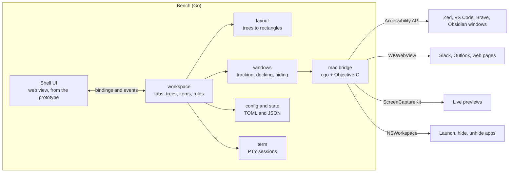

# Bench: build spec

Bench is a working name for a macOS app, written in Go, that gathers any set of apps into one window with tabs. Each tab holds a layout of panes, and each pane holds windows as sub-tabs. You can move any window to another pane, beside another window, or to another tab. Layouts adapt to the screen: wide on a monitor, compact on a laptop.

This document is the brief for building it. It goes with `bench-ui-prototype.html`, a clickable prototype of the interface.

## Contents

- [Files in this handoff](#files-in-this-handoff)
- [Goals and non-goals](#goals-and-non-goals)
- [Concepts](#concepts)
- [Embedding, mirroring, and moving](#embedding-mirroring-and-moving)
- [Screens and behaviour](#screens-and-behaviour)
- [Windows: tracking and rules](#windows-tracking-and-rules)
- [Keyboard shortcuts](#keyboard-shortcuts)
- [Architecture](#architecture)
- [Config file](#config-file)
- [Layout maths](#layout-maths)
- [Repository layout](#repository-layout)
- [Milestones](#milestones)
- [Testing](#testing)
- [Risks](#risks)
- [Open questions](#open-questions)
- [References](#references)

## Files in this handoff

| File | What it is |
| --- | --- |
| `bench-spec.md` | This brief. |
| `bench-ui-prototype.html` | A single-file, clickable prototype. Open it in a browser. It's the reference for the look, the layout behaviour, and the interactions. |

In the prototype you can:

- Switch tabs, add tabs, and see that only the first nine get shortcuts.
- Click sub-tabs to show different windows in a pane.
- Drag a sub-tab onto another pane (joins it), onto a pane's edge (splits it, for side by side), or onto a tab in the title bar (moves the window to that tab). The split button and the **⋯** menu do the same without a mouse.
- Add a window that isn't in a tab, a new window of an app, any installed app, a terminal, or a web page, with a pane's **+** button.
- Simulate a monitor (2,560 pt) or a laptop (1,512 pt) to see Auto switch between wide and compact.
- Hover a sub-tab to see a live preview. Previews are on in the prototype. In the app they're off until the user turns them on, because they need Screen Recording permission.

Window contents are placeholders: grey shapes stand in for Slack, Outlook, Brave, and Obsidian, and the code and terminal text is illustrative.

To reuse the prototype as the app's frontend:

- Keep the design tokens. They're CSS custom properties in `:root`.
- Keep the markup and class names for the title bar, tabs, panes, sub-tabs, menus, status bar, jump palette, add dialog, and layout editor, which became the app's Tab properties.
- Replace the prototype's `state` with data from Go. Its shape (`tabs[].root` as a tree of splits and panes, and `items` by ID) matches the model in this spec.
- Position panes from the rectangles Go sends (see [Window model](#window-model)). The prototype uses CSS flexbox for convenience; the app shouldn't, so that Go has one source of truth for geometry.

## Goals and non-goals

### Goals

- Any number of tabs, each holding any apps: Slack, Outlook on the web, Zed, VS Code, a terminal, Brave, Obsidian, or anything else installed.
- Panes that understand windows: every window gets a sub-tab, and any window can move to another pane, beside another window, or to another tab.
- Layouts that adapt automatically to the screen the window is on, with a manual override.
- A keyboard-first jump palette for tabs, windows, and actions.
- Tab properties and Settings in the app, so the config file is optional.

### Non-goals for version 1

- Windows or Linux. The window management is macOS-specific.
- Putting other apps' windows inside Bench's own window. macOS doesn't allow it; see [Embedding, mirroring, and moving](#embedding-mirroring-and-moving).
- Splitting individual browser tabs. Bench works with windows, so to show two Brave tabs side by side, drag one out of Brave into its own window first.
- Syncing settings across Macs.

## Concepts

**Tab.** A named workspace with a layout. There's no limit on the number of tabs; the first nine get Control+Option+1 to 9, and the rest are reachable with Control+Option+] and [, the tab strip (which scrolls), and the jump palette. The default config starts with one, Research, holding the default browser, since a Mac may not have any other app Bench could name. The example config, which the browser preview starts with, has three: Comms (Slack, Outlook), Code (Zed, VS Code, terminals), and Research (Brave, Obsidian).

**Layout tree.** Each tab's layout is a tree. A split divides its space in a row or a column, with a size for each child as a percentage. Its children are panes or further splits. Presets create the starting tree; dragging and splitting edit it.

**Pane.** A leaf of the tree. It holds an ordered list of items, shows one at a time, and has a header with a sub-tab for each item.

**Item.** Something a pane can show. There are three kinds:

| Kind | Badge | What it is | Examples |
| --- | --- | --- | --- |
| Web | `WEB` | A web view that Bench owns, drawn inside Bench's window | Slack, Outlook on the web, any web page, VS Code for the Web |
| App | `APP` | Another app's real window, moved and sized to fit the pane | Zed, VS Code, Brave, Obsidian, web apps such as Gmail or Slack, any app |
| Built-in | `BUILT-IN` | A view that Bench draws itself | Terminal sessions |

One pane can hold items of different kinds and from different apps. For example, the Code tab starts with Zed and VS Code as sub-tabs of one pane.

A website can be an App item too, as a **web app**: a site that the user's browser has made into an app of its own, with its own windows. That's how the add dialog adds websites where it can, because the browser runs the site with its own protections and sign-in (see [Adding to a pane](#adding-to-a-pane)). Web items are for the rest, and for the example config's Slack and Outlook, whose menus switch them to web apps with one click (see [Switching a web page to a web app](#switching-a-web-page-to-a-web-app)).

**Sub-tab.** A button in a pane's header for one item, showing the app's monogram and the window's title, or a name the user has given a terminal or web page. Clicking it shows that item. Dragging it moves the item.

**Presets.** Starting trees, used for new tabs and in Tab properties:

| Preset | Tree | Default sizes |
| --- | --- | --- |
| `single` | One pane | — |
| `side` (Side by side) | Row of two | 50, 50 |
| `main-side` (Main and side) | Row of two | 65, 35 |
| `three` (Three columns) | Row of three | 40, 30, 30 |
| `top-bottom` (Top and bottom) | Column of two | 65, 35 |
| `grid` (Grid of four) | Column of two rows of two, filled in reading order | 50, 50 each |

When a preset replaces a tree, the existing panes' items keep their order: pane 1's items go into the new pane 1, and so on. If the new tree has fewer panes, the extra panes' items join the last one. No item is lost.

**Small-screen behaviour.** Each tab chooses what happens on a small screen:

| Setting | Effect |
| --- | --- |
| `stack` | The top-level row becomes a column, so side by side becomes top and bottom. |
| `tabs` | The tab shows one pane containing every item as a sub-tab. The tree is kept and comes back on a large screen. |
| `same` | No change. |

**Size class.** `wide` or `compact`. In Auto mode, Bench compares the width of the screen the window is on with `compact_below` (default 1,800 pt). The user can force Wide or Compact from the title bar until they pick Auto again.

## Embedding, mirroring, and moving

macOS gives an app three ways to show another app's content. Bench uses all three, each where it fits.

| Approach | What you get | Limits | Where Bench uses it |
| --- | --- | --- | --- |
| **Embed** content Bench owns | Fully native inside Bench's window. Real embedding. | Only for things Bench can host itself: web pages and terminals. | Slack and Outlook as web views in the example config, web pages that the user's browser can't make into web apps, VS Code for the Web, and terminals. |
| **Move** the real window | Any app, fully usable: typing, drag and drop, menus, and shortcuts all work as normal. | It's still a separate window, so Bench must manage stacking and hiding carefully. | Every App item: Zed, VS Code, Brave, Obsidian, web apps, and anything else. |
| **Mirror** with ScreenCaptureKit | A live picture of any single window, smooth up to the display's refresh rate, even when the window is covered or off-screen. | Display only. Passing clicks and typing on to the real window isn't reliable enough for everyday use; text input, menus, and drag and drop are the usual problems. Needs Screen Recording permission, which macOS asks users to re-approve from time to time. Chromium-based apps (Brave, VS Code, Slack, Obsidian) can stop drawing windows that are covered, so a mirror may show a frozen frame. | Live previews: hovering a sub-tab, and window thumbnails in the jump palette. Optional. |

The fourth idea, putting another app's actual window inside Bench's window, isn't available. macOS has no public API for it, and sharing rendered content between processes (for example, with IOSurface) needs the other app's cooperation.

Two practical consequences:

- **VS Code can be embedded for real.** `code serve-web` (VS Code 1.82 or later) runs a local server for VS Code for the Web, which works on the Mac's own files and terminals. Bench can start it and show it in a Web item. Check that the extensions you rely on work there before switching; if not, use the desktop app as an App item.
- **Moving done well looks like embedding.** Bench draws the pane chrome, sizes the window to fit the pane body exactly, keeps it in place when Bench moves, and hides it when its tab or sub-tab isn't shown. Contain, a Mac app that groups windows into tabs, takes the same approach: it doesn't copy or mirror windows, and the originals stay fully usable.

## Screens and behaviour

The prototype shows all of these. Where the app must behave differently from the prototype, this section says so.

### Main window

- **Title bar.** Traffic lights, then the tab strip. Each tab shows its name and, for the first nine, its shortcut, at its right end, except in the compact size class, where the tabs need the room (`tab_shortcut_hints`: `auto`, `always`, or `never`); its tooltip has the shortcut either way. The current tab, and a tab under the pointer, show a × in the shortcut's place, which closes the tab (see [Closing tabs and windows](#closing-tabs-and-windows)); a tab that doesn't show its shortcut has an empty slot for it instead, the same width as the ×. The current tab has a raised background and a 2 pt accent underline. A tab is at most 200 pt wide: a longer name is cut short with an ellipsis, keeping the shortcut, and the tooltip has the whole name. The strip scrolls sideways when tabs don't fit (see **Strips that don't fit**). A **+** right after the last tab, which stays at the end of the strip when it scrolls, opens Tab properties for a new tab. In the `tabs` small-screen view, the one pane's sub-tabs, **+**, and other header controls follow, after a divider (see **Density and pane headers**). The rest of the title bar's width is empty, and moves and zooms the window.
- **Tab menu.** Right-clicking (or Control-clicking) a tab opens its menu at the pointer, without switching to it: **Tab properties…**, which opens Tab properties for that tab, whichever is current, and **Rename…**, which renames it in place, as double-clicking it does (see **Renaming in place**), and **Move left** and **Move right** (disabled at either end); then **Rearrange**, which switches to the tab first if it isn't current, and **Reset layout**, which doesn't ask first, as in Tab properties; then **Close tab…** (**Close all windows…** on the only tab) and **Delete tab (keep windows)**, which isn't there on the only tab (see [Closing tabs and windows](#closing-tabs-and-windows)); then **New tab…**, and, once a tab has been deleted or closed, **Reopen closed tab** with that tab's name below it (see [Undo and closed tabs](#undo-and-closed-tabs)). The menu follows its tab by name when other tabs are added or deleted, and closes if its tab is deleted. A menu asked for from the keyboard opens below the tab. The prototype has no tab menu.
- **Title bar, right side.** A segmented control for **Auto**, **Wide**, and **Compact**; a **Jump to…** button; and a gear button that opens **Settings**, where the prototype has a button that opens its layout editor for the current tab. When the title bar is narrower than 1,200 pt, or in the compact size class, it slims to leave the tabs more room: the segmented control becomes one button that names the mode (**Auto ▾**) and opens a menu of the three, with the one in use ticked and why the layout is in use, and **Jump to…** becomes its magnifying glass, whose tooltip and accessible name include its shortcut. The View menu also has **Auto Layout**, **Wide Layout**, and **Compact Layout**, ticked to match, without shortcuts.
- **Panes.** Laid out by the tab's tree, with a gap and padding of 4 pt by default (`gap`; Settings offers 8, 4, and 2 pt, never 0, which would leave no divider to grab). The focused pane has an accent border. Clicking anywhere in a pane focuses it. Double-clicking a divider, or Return on one selected from the keyboard, gives its split's children equal sizes (`EvenSizes`), with **Undo**; a split whose children are already equal stays as it is.
- **Zoom pane.** The `zoom_pane` shortcut, **Zoom this pane** in the jump palette, **View ▸ Zoom Pane**, or **Zoom pane** in an item's **⋯** menu or an empty pane's menu shows one pane alone (`ZoomPane`): it fills the pane area, with its own sub-tabs, and the tab's other panes' App windows go out of sight, as in the compact size class. Its header stays, even with `pane_headers = "auto"`, with an accent **Zoomed** chip that shows every pane again (`ShowAllPanes`), as do the shortcut again, **Show all panes** in the palette and the menus, and **View ▸ Show All Panes**, which **Zoom Pane** becomes. The status bar says **One pane zoomed**, as a button that does the same. The zoom ends when the tab changes, another pane is focused, or the zoomed pane's shown item moves to another pane; Control+Option+arrow focuses and moves across the tab's whole layout. The tab keeps its panes, sizes, and items, and the zoom isn't saved: Bench starts with every pane shown. A tab with one pane, or in the `tabs` view, has nothing to zoom.
- **Pane header.** 40 pt tall, or 32 pt in the compact density, with a 1 pt divider below. Sub-tabs for the pane's items; a **+** to add to the pane; the shown item's badge, or for a web page, its host (see [Web items](#web-items)); a **Show side by side** button (split right); and a **⋯** menu. Each sub-tab has a × at its right end that closes its item, shown on the pane's shown sub-tab and on others under the pointer (see [Closing tabs and windows](#closing-tabs-and-windows)). Right-clicking a sub-tab opens its item's **⋯** menu at the pointer, and right-clicking the header's empty space opens the shown item's. The **⋯** button's own menu opens below it. An empty pane has no **⋯**: right-clicking its header or body opens a menu at the pointer with **Add a window or app…** and, in a tab with more than one pane, other than in the `tabs` view, **Close this pane**, as its body's buttons do, and **Zoom pane** (see **Zoom pane**).
- **Density and pane headers.** **Density** (`density`: `auto`, `standard`, or `compact`; `auto` is compact in the compact size class) sizes Bench's chrome for a 13- or 14-inch MacBook with a trackpad. Standard: a title bar of 52 pt and a 1 pt line, tabs 36 pt, title bar buttons 32 pt, pane headers 40 pt, sub-tabs 30 pt, and header buttons 28 pt. Compact: a title bar of 38 pt and a 1 pt line, tabs 30 pt, title bar buttons 28 pt, pane headers 32 pt, sub-tabs 26 pt, and header buttons 24 pt. Go sets each pane's header height, docks its window below it, and sends it in the View; the UI draws that height. In the app, the title bar keeps the density it had at launch, matching the native title bar (see [Window model](#window-model)), and Settings says that it changes when Bench next opens, for a density that would change it; the panes change at once. The browser preview's title bar follows the density at once.
  - In the `tabs` small-screen view, the one pane has no header (0 pt): its sub-tabs, **+**, and other header controls are in the title bar, after the tabs' **+**, and the pane's frame reaches up to the top of the pane area, over the gap there. The tab strip and the sub-tabs each take the room there is, up to their whole width, and scroll on their own; a sub-tab there is at most 220 pt wide. The sub-tabs keep everything a header's have: clicking, dragging, right-clicking, markers, and tooltips. Right-clicking the empty part of the pane's controls opens the shown item's menu, or for an empty pane, the pane's.
  - With **Hide the sub-tab row when a pane holds one app window** (`pane_headers = "auto"`; `"always"`, the default, keeps every header), a pane that holds one App item with a window, while Bench can dock windows, and that has nothing to report, has no header, so that the app's own title bar stands in for it: its window is docked just inside the pane's border. A window that needs more room is judged against that taller body. A second item brings the header back at once; a status brings it back once it has lasted 1 second, so that a status that comes and goes doesn't move the window down and up; and once back, the header goes again only after 2 seconds with nothing to report. A pane seen for the first time since its tab was shown decides at once. Web pages and terminals always keep their headers. The jump palette's **Add to this pane…**, **Show side by side**, and **Window options…** stand in for the missing header's buttons.
- **Strips that don't fit.** The tab strip and each pane's sub-tabs scroll sideways rather than squash. A sub-tab is at least 96 pt wide and at most `clamp(220pt, 30% of the pane, 360pt)`, with its whole title in its tooltip. Over a strip that doesn't fit, a mainly vertical wheel scrolls it sideways (a wheel that counts in lines moves 40 pt a line), and a sideways swipe scrolls it as usual; turning the wheel over a strip hides any live preview. An end with more to show fades out over 24 pt. After every redraw, and as the window is resized, each strip scrolls to keep the current tab, or the pane's shown sub-tab, in view, clear of the fades; a strip the user has scrolled by hand, or moved the keyboard along to another tab or sub-tab, stays where it is until it shows another tab or sub-tab, gets another one, or the window is resized. Dragging a tab or sub-tab within 24 pt of either end of a strip scrolls it, faster nearer the end, so that a tab out of view can take the drop, or a place between tabs or sub-tabs out of view. Scroll bars follow **Show scroll bars** (`scroll_bars`): `auto` shows them when macOS shows scroll bars all the time (`NSScroller.preferredScrollerStyle` is legacy, as with Show scroll bars set to Always, or a mouse and no trackpad), which Bench follows as it changes; `always` and `never` override it. A shown bar is 4 pt thin (3 pt in the compact density) and sits in the title bar's bottom padding, or the pane header's below the sub-tabs, so no height changes and no docked window moves, and pressing the tab strip's bar scrolls it rather than moving the window. The browser preview reports scroll bars shown only while scrolling.
- **Status bar.** One line: the current tab's window and pane counts as drawn ("shown as one pane" in the `tabs` small-screen view, and every pane while one is zoomed); **One pane zoomed** while one is; a note of how many windows have a problem and need attention, which opens a list of them; the size class in short (**Wide**, **Compact**, or **Auto: wide**), with why in its tooltip and in a message when it's clicked (for example "Wide layout, chosen for a 2,560-pt screen"); notices; and shortcut hints. It doesn't repeat the tab's name, which the title bar shows. When there's no room, the notice and then the size class are cut short, and the shortcut hints go. The prototype's dot before the tab's name meant nothing, and is gone. It can be hidden (`show_status_bar`), and the panes then take its height: the windows that need attention and the notices become amber buttons in the title bar, beside **Jump to…**, that open the same lists below them, and messages show on one line in the middle of the title bar's empty space for at most 4 seconds. If that space is under 240 pt, a message goes over the tabs instead, and only failing that over the controls at the right; never over the traffic lights. Messages let clicks through to the title bar, except on any buttons they carry. The browser preview does the same.
- **Renaming in place.** Double-clicking a tab, or **Rename…** in its menu, turns its name into a text field, with the name selected; for a tab that isn't current, the first click switches to it, and the second doesn't again, and on the current tab, neither click gives the tab's window the keyboard, which a single click does after a moment. The field then takes the keyboard back from whatever the switch, or Bench lowered after a menu, gave it to (`FocusUI`). Return saves the name with `SaveTab`, keeping the tab's layout (preset `custom`, which keeps the tab's panes and its `config.toml` layout) and small-screen setting; a name that another tab has is numbered as Tab properties numbers it, and an arrow and the numbered name after the field say so first. An unchanged or empty name keeps the tab's. Escape, or the field losing the focus, cancels. A double-click on a tab never zooms the window, as one on the title bar's own space does: tabs, and the field, don't move the window. **Rename…** in the menu of a terminal's or web page's sub-tab does the same for its title, with `RenameItem`: the name is the item's own (`label` in `state.json`), shown on its sub-tab and in the jump palette in place of the title its shell or page sets, which keeps changing underneath. **Use automatic title**, which shows that title, or an empty name, takes the name away. App items take their title from the app and can't be renamed. Renaming doesn't raise Bench.
- **Markers and tooltips.** A sub-tab whose window isn't ready has a marker on its monogram, a different shape for each kind of status: a warning sign for a problem, a ring while it opens, and an i for information (full screen, another desktop). Its menu's first line says why. A sub-tab's tooltip has its whole title with its app, the title its shell or page sets if the user has named it, why it isn't ready, and the other tabs it's in. Every icon button, tab, and sub-tab has a tooltip, and controls change under the pointer and when pressed; nothing depends on hovering alone.
- **Dialogs.** Tab properties, Settings, the add dialog, the jump palette, and the welcome guide are sheets inside the window, and never taller than it: their headers and buttons stay in view, and only their middles scroll. On a window less than 760 points tall they start nearer the top, clear of the traffic lights, and Tab properties' layout preview is shorter. Each moves when the user drags its header (not a field or button in it) and resizes from a grip in its bottom-right corner, down to 420 by 300 points (200 points tall for the palette and the add dialog), staying inside the window and clear of the traffic lights; the layout preview and the lists grow with it. A double-click on the header puts it back in the middle. Moving a dialog doesn't size it: one the user hasn't resized stays as tall as its contents, cut short above the window's bottom edge. Bench remembers each dialog's size in `state.json`, and where it was while Bench runs; a dialog that a smaller window cut short gets its place and size back when the window grows. Menus don't move.

### Moving windows

Three ways, all doing the same thing:

1. **Drag a sub-tab.**
   - Onto a strip of sub-tabs, which is a pane's header, buttons and all, or in the `tabs` view the title bar's part with the pane's sub-tabs: the item goes between the two sub-tabs either side of the pointer, before the first whose middle is right of it, or after the last, in that pane (`MoveItemAt`). Along its own pane, this only puts the sub-tabs in another order. A strip never splits.
   - Onto the middle of a pane's body: the item joins that pane and is shown.
   - Onto the outer quarter of a pane's body, on any side: the pane splits in that direction, and the item goes into the new half. If the pane's parent split already runs in that direction, the new pane becomes a sibling, sharing the old pane's size equally; otherwise the pane is replaced by a new split.
   - Onto a tab in the title bar: the item moves to that tab's focused pane.
   - Onto the tabs' **+**, or the title bar's own space just after it, for as far again as the **+** is wide: the item moves to a new tab of its own, as **Move to new tab** does. With Option held, it's shown there as well, as **Also show in new tab** does. A drop on the rest of the title bar's own space does nothing, so it still cancels the drag. The title bar's space still moves the window when pressed; a tab dragged there goes to the end of the tabs, as before.
   - While dragging, show where it will land: a line between two sub-tabs, a highlighted half of the pane's body for an edge, the whole body for the middle, or a tinted tab or **+**. The **+** has a dashed outline while a sub-tab is dragged. No line shows where the drop would change nothing, next to the dragged sub-tab.
   - Go holds the same rule (`layout.DropAt`), for when it finds drop targets itself: a header or the title bar's strip inserts at a place, a body's edges split.
2. **Use the pane's buttons.** **Show side by side** splits right with the shown item. The **⋯** menu has **Show side by side (split right)**, **Split down**, **Split right with an empty pane** and **Split down with an empty pane**, which put an empty pane on that side (`SplitPane`) and open the add dialog for it at once, taking the pane away again (`CancelSplit`) if the dialog closes without adding anything, **Zoom pane** (see **Zoom pane**), **Move left** and **Move right** along the strip the sub-tab is drawn in (disabled at its ends), **Move to pane** (each other pane, named by its shown item), **Move to tab** (each other tab, then **Move to new tab**), **Also show in** each tab the item isn't in, then **Also show in new tab**, **Rename…** and, for one the user has named, **Use automatic title**, for a terminal or web page (see **Renaming in place**), **Open** *app* and **Remove** *app* **from this pane** under **Closed windows**, for each app the pane is waiting for (see [Closing](#closing)), and **Pop out of Bench** (**Remove from Bench** for an App item with no window), then **Close window**, **Close page**, or **Close terminal**, or for an item in other tabs too, **Remove from this tab** and **Close everywhere** (see [Closing tabs and windows](#closing-tabs-and-windows)), and for a web page, **Use the** *name* **web app from** *browser* or **Make a web app in** *browser*… (see [Switching a web page to a web app](#switching-a-web-page-to-a-web-app)).
3. **Use the keyboard.** Control+Option+Shift+arrow moves the shown item of the focused pane into the neighbouring pane in that direction, or splits at that edge if there's no neighbour.

Rules:

- A pane can't be split by the only item it shows; the menu and keyboard explain why instead of doing nothing.
- When a pane loses its last item, it's removed and its parent split closes up. The last pane in a tab stays, empty, with an **Add a window or app** button. A pane that holds only hidden items stays (see [Closing](#closing)).
- Moving an item to another pane marks the tab's layout as custom. Tab properties says so, and choosing a preset starts again from that preset (keeping items in order). Putting a pane's sub-tabs in another order doesn't.
- In the `tabs` view, the one strip holds the whole tab in reading order. An item moved along it stays in its own pane if a sub-tab beside its new place is in that pane, and otherwise joins the pane of the sub-tab it goes before, or after. Its own pane stays, even if that leaves it empty, so the wide layout keeps its panes and their sizes; the message says so.

#### Moving tabs

- Drag a tab along the title bar: a caret between two tabs, thicker than a sub-tab's and with a dot at each end, shows where it goes. Only a press on a tab starts the drag, after 4 pt, never a press on its × or on the title bar's own space, which moves the window, and not with one tab. A drop anywhere in the title bar counts, by the pointer's place along the strip; elsewhere, or with Escape, the tab stays. The release isn't a click on the tab.
- **Move left** and **Move right** in a tab's menu (disabled at either end), **Move tab left** and **Move tab right** in the jump palette for the current tab, **View ▸ Move Tab Left** and **Move Tab Right** (disabled at either end), and **Position** in Tab properties.
- `MoveTab` moves the tab in the model and in `config.toml` together, saved with a `.bak` as Tab properties saves it. The current tab stays current, each window stays in its tabs, and each tab keeps its arrangement. Shortcuts follow the order. The toast, such as "Moved Comms to 3rd place (⌃⌥3).", has **Undo**, which puts the tab back in `config.toml` too.
- **Move to new tab** and **Also show in new tab**, in the **⋯** menu, a sub-tab's menu, and the jump palette's Actions for the focused pane's shown item, and a drop on the tabs' **+**, call `MoveItemToNewTab(item, also)`. In one step, Go adds a tab after the others with the single layout, named after the item's app and numbered as Tab properties numbers a taken name ("Code (1)", then "Code (2)"), moves the item there from the tab it's shown in, which becomes custom, or with `also` adds it there as well, switches to the new tab, and saves `config.toml` with a `.bak`. Its toast says what happened, such as "Moved Terminal — zsh to a new tab, Terminal.", with **Undo**, which takes the new tab away again, from `config.toml` too, and puts the item back where it was.
- On a small screen with the `tabs` setting, there are no visible splits, so the split actions are disabled with the reason shown. Moving to another tab still works.
- **Pop out of Bench** returns an App item's window to a normal, free-floating window, and gives a Web or Built-in item a window of its own. The item then appears under **Not in a tab** in the jump palette, and under **Windows not in a tab** in the add dialog.
- **Remove from Bench**, in place of **Pop out of Bench** for an App item with no window (its app has quit, isn't installed, or has no window for it), removes the item from every tab, so Bench stops opening the app for it. The pane's status message offers it as a button too. Such an item shows only while Bench opens its app for it, or lacks Accessibility permission (see [Closing](#closing)).

### Adding to a pane

The pane's **+** opens a searchable dialog with these groups, in order:

- **Windows not in a tab**: open windows Bench isn't managing, and items popped out of Bench.
- **Windows in other tabs**: items in other tabs, to show in this pane as well.
- **New window**: a new window of each app already in this tab.
- **Built in**: **New terminal**, and **Web page…**, which asks for an address (see below).
- **Apps**: every installed app other than a web app, from /Applications, ~/Applications, and /System/Applications, including their Utilities folders. Choosing one opens it if needed and adds its windows that aren't already in a tab. If it has none, Bench opens a new window (see [Docking with the Accessibility API](#docking-with-the-accessibility-api)).
- **Web apps**: the web apps that browsers have made, with the browser that made each: Safari's in ~/Applications, Chromium browsers' in folders there such as `Chrome Apps.localized`, and Orion's in ~/Applications/Orion/WebApps. Choosing one works as for any other app. They come after **Apps** because the dialog chooses the first row that matches, and a web app's hint names its browser: typing "chrome" should choose Chrome.

**Web page…** adds a website as a web app where it can, since a web app runs in the browser, with the browser's protections and sign-in, which Web items don't have (Google blocks sign-in in embedded web views). Return:

1. Adds the installed web app whose address is on the same host as the one typed, ignoring case, a leading `www.`, and default ports, if there's one: the default browser's, else Safari's, else the first by name. A Chromium web app's address is its Info.plist's `CrAppModeShortcutURL`; a Safari web app's is its `Manifest` dictionary's `start_url`, or else its `WKPushBundleMetadata` dictionary's `manifestId`. Orion's isn't known.
2. Else, without Accessibility permission, which App items need, adds a Web item, and says why.
3. Else, if the default browser (the app that opens `https` links) can make web apps, opens the site in it and shows the browser's steps to make one: Safari, Chrome, Edge, Brave, Vivaldi, Chromium, Chrome for Testing, and Orion can. The dialog then asks Go every 1.5 seconds whether the web app is installed, and adds it as soon as it is: the web app on the site's host, or else the one web app installed since the site was opened, whatever its address, since a browser records the address the site ended on, which may be on another host (slack.com sends a signed-in user to app.slack.com), and Orion records none. Meanwhile, the dialog stays open while the user is in the browser, focus in the browser's windows doesn't switch tabs, Bench doesn't hide the browser, when Bench becomes active or by `hide_other_apps` or `hide_other_tabs`, and leaves its windows in other tabs where they are, since it may have opened the site in one, and a new window of the browser stays out of the tab, under **Windows not in a tab**. **Show in Bench instead** adds a Web item; **Cancel** and Escape go back to the list. If Go is looking for the web app just then, the dialog waits for its answer first, and closes if it added the web app.
4. Else, as for Firefox, Arc, Opera, DuckDuckGo, Zen, an app that chooses a browser for each link, or a browser that Bench doesn't know, such as another browser built on Chromium, adds a Web item, and says why.

Option-Return, or **Show in Bench**, adds a Web item instead.

### Switching a web page to a web app

A Web item that the user has, such as the example config's Slack and Outlook, switches to a web app of its site from its **⋯** menu, or its sub-tab's right-click menu, with one click, never by itself. When the menu opens, it asks Go what to offer, worked out afresh each time from the installed apps and the item's given address (not the page it has gone to since):

1. If a web app of the site is installed, found as **Web page…** finds it, **Use the** *name* **web app from** *browser*.
2. Else, if Bench has Accessibility permission and the default browser can make web apps, **Make a web app in** *browser*….
3. Else, and for VS Code for the Web, nothing.

Scanning the installed apps can take a moment, so the menu opens at once, and the entry joins its end, after a separator, when the answer comes: nothing above it moves. For that, a web page's menu opens as wide as menus get, with room below it for the entry (it opens higher near the bottom of the window), and stays where it opened; an entry whose names don't fit on one line wraps, and if the menu then runs past the bottom of the window, it scrolls.

**Use** puts an App item for the web app in the Web item's place, in every tab that shows it: the same pane, the same place among the sub-tabs, and shown if the Web item was. The Web item and its web view close. The web app's window comes to the item as the add dialog finds one: a window that's popped out of Bench or that Bench doesn't manage; else, for a web app that's running without a window, its first window, or a new one if none comes soon; else a new window, opening the web app if it isn't running, with the launch timeout as for the add dialog. Until then, the item says Bench is opening the web app. Other windows that the web app opens meanwhile, such as the ones it restores as it starts, join the same pane without being shown. The menu then says what it did, as a toast.

**Make** opens the item's address in the default browser and opens the add dialog's make step, titled **Make a web app in** *browser*, with the browser's steps and a note that Bench puts the web app in place of this page as soon as it's ready. Bench waits as for **Web page…**: the dialog asks Go every 1.5 seconds, the browser stays on screen, and its new windows stay out of the tab. Once the web app is installed (the site's, or the only one installed since), it takes the Web item's place as for **Use**, and a window that Bench put in the tab by `new_windows` meanwhile, as a Chromium browser opens the web app it makes, moves there. The dialog's only button is **Cancel**, which, like Escape, closes it and leaves the Web item as it is. It closes by itself if the Web item goes.

If the Web item came from `config.toml`, its entry there becomes an `app` entry for the web app, in the same place, and Bench saves the file as Tab properties does, keeping `config.toml.bak`. `state.json` alone would keep the switch when Bench restarts, but resetting the tab's layout, or a tab whose arrangement isn't kept from `state.json`, would bring the page back.

### Live previews

When live previews are on (`live_previews`), hovering an inactive sub-tab for 450 ms shows a small live preview of that window under it, with its title. The jump palette can show the same thumbnails beside windows. Previews come from ScreenCaptureKit and need Screen Recording permission, so they're off until the user turns them on in Settings.

### On a laptop

The same window in the compact size class, using each tab's small-screen setting, in the compact density by default. In the example config, Code stacks its panes, and Comms and Research show one pane with every window as a sub-tab, in the title bar.

### Jump palette

Opens with the shortcut or **Jump to…**.

- A search field, focused on open, that filters by label and hint.
- Groups: **Tabs** (with each tab's apps and shortcut), **Windows** (every item in every tab, by title, with its tab and app), **Not in a tab**, and **Actions** (Rearrange this tab, Zoom this pane, or Show all panes while one is zoomed, with the `zoom_pane` shortcut, Add to this pane… for the focused pane, Show side by side for the focused pane's shown item when splits aren't hidden, with the move shortcut's right arrow, Window options… for the focused pane's shown item, which opens its **⋯** menu in the palette's place (below the pane's **⋯** button, or inside the top right corner of a pane with no header), Move to new tab and Also show in new tab for that item, Fill the screen except in the browser preview, Tab properties of the current tab, New tab, Settings, and switching between Auto, Wide, and Compact).
- Up and Down arrows move the selection; Return runs it; Escape, clicking the backdrop, or the shortcut again closes it. If the shortcut opened it while a docked App window had the keyboard, the window gets the keyboard back when it closes, unless what was chosen focused something else.
- Choosing a window switches to its tab, focuses its pane, and shows it. Choosing a window that's not in a tab adds it to the current tab's focused pane.

### Tab properties

A sheet over the window for one tab's own properties, titled **Tab properties**, or **New tab** for a new one. It opens for any tab from the tab's menu (right-click the tab), for the current tab from the jump palette and **View ▸ Tab Properties…**, and for a new tab from **+** and **New tab…**. When it closes, the focus goes back to what opened it: for the tab's menu, the tab, wherever it has moved to; if the tab has been deleted, the current tab. Unlike the prototype's layout editor, it doesn't hold the settings that apply to every tab: those are in [Settings](#settings).

- **Name** and **Position**. Names are unique, ignoring case: a name that another tab has is numbered when it's saved, "Code" becoming "Code (1)", then "Code (2)", and a line under the field says so first. A new tab starts with a name that's free. Shortcuts follow tab order; tabs after the ninth have none. **Position** lists the places among the tabs, each with the shortcut a tab there has, such as "1st (⌃⌥1)", or "10th" alone; a line under it says how to reach a tab with no shortcut. A new tab's is last until another is chosen.
- **Layout**: the six presets, with a preview showing which items will land in which pane. For a custom layout, no preset is selected and Tab properties explains that choosing one starts again.
- **On small screens**: **Stack panes**, **One pane with sub-tabs**, or **Keep the layout**, with a line saying which screens are small, from the threshold in Settings.
- **Delete tab** (not for the last tab or a new one), **Reset layout** (not for a new one), **Cancel**, and **Save**. Deleting a tab doesn't close its windows; they move to **Not in a tab**. The tab's menu has it too, as **Delete tab (keep windows)**, beside **Close tab…**, which closes them. The toasts after **Delete tab** and **Reset layout** have **Undo** (see [Undo and closed tabs](#undo-and-closed-tabs)). **Save** calls `SaveTab` with the tab's name, preset, and small-screen setting, and its place if one was chosen.

### Settings

A sheet over the window for the settings that apply to every tab. It opens from the gear button at the right of the title bar, **Bench ▸ Settings…**, and **Settings…** in the jump palette, and says that a tab's own name, layout, and small-screen setting are in its Tab properties, and how to open them. Its settings are in groups:

- **General**: **Open Bench at login**, **Open Bench filling the screen** (`fill_screen`), **Bring back a hidden Bench with tab shortcuts** (`show_on_tab_shortcut`), **Ask before quitting while a terminal is running something** (`confirm_quit_busy_terminals`, see [Terminal items](#terminal-items)), **Ask before closing a tab's windows** (`confirm_close`, see [Closing tabs and windows](#closing-tabs-and-windows)), and **Menu bar item**: **Icon and tab name**, **Icon only**, or **Hidden** (`menu_bar`). With **Hidden** chosen, a line says that the jump shortcut and Bench's icon in the Dock still bring Bench back.
- **Appearance**: **Show status bar** (`show_status_bar`), with a line saying what moves to the title bar without it; **Hide the sub-tab row when a pane holds one app window** (`pane_headers`: ticked is `auto`), with a line saying what takes the row's place and where its buttons are then; **Density**: **Automatic**, **Standard**, or **Compact** (`density`), with a line saying what the choice does and, in the app, if the choice would change the title bar, that it changes when Bench next opens; **Space between panes**: **8 pt**, **4 pt**, or **2 pt** (`gap`), plus the config file's value if it's another; **Show shortcuts on tabs**: **Automatic**, **Always**, or **Never** (`tab_shortcut_hints`); and **Show scroll bars**: **Automatic**, **Always**, or **Never** (`scroll_bars`), with a line saying what the choice does, and for **Automatic**, whether macOS shows scroll bars all the time now.
- **Windows**: **Open apps that aren't running**, **Hide windows that belong to other tabs**, **Switch tabs when another tab's window comes forward**, and **Show live previews of windows (needs Screen Recording)**. Turning on live previews without Screen Recording permission asks for it at once, and a note explains how to grant it.
- **Small screens**: **Small screens are narrower than** [number] **points** (`compact_below`), with a line explaining what Bench compares it with.
- **Cancel** and **Save**. **Save** calls `SaveSettings` with the whole `[settings]` table, keeping the settings that only the config file sets, such as `new_windows`, then `SetOpenAtLogin` if that changed. Settings closes once Go has accepted the settings; if Go refuses them, it stays open and shows why. If Go can't change Open at login, Bench says why.

### Behaviour when switching tabs

1. Hide what belongs only to other tabs (see [Hiding windows](#hiding-windows)).
2. For each item in the new tab:
   - App item: if its app isn't running, or the item's window no longer exists, open the app (`open_missing_apps`) and wait for a window that matches. While Bench waits, the item shows, saying that Bench is opening its app (see [Closing](#closing)). Until an app launches again, by any means, or the user clicks **Open** for it, don't ask it again if macOS said it isn't installed (its item says *App* isn't installed), if the user quit it (see [Closing](#closing)), or if it was running and gave no window for the item's `url` within `launch_timeout` the last time Bench asked: asking again on every switch would only bring it forward. A switch that comes before `launch_timeout` has passed since a switch asked the app, when none of the items it asked for has a window yet, waits for that window without asking again; one that comes later, with the app running, takes it that the app gave no window. An app's launch forgets these asks, apart from those of the last `launch_timeout`, which it may be answering.
   - Web item: show its web view, creating it on first use.
   - Built-in item: show its view, starting the session on first use.
3. Arrange what's ready straight away, then check every 250 ms. When everything is ready, wait a further 750 ms (apps often resize their own windows on launch), then arrange again. Stop waiting after `launch_timeout` (default 15 s).
4. Focus the tab's focused pane.

### Behaviour when the screen changes

When a display is connected or disconnected, or Bench's window moves to another screen, wait 1.5 s for macOS to settle, then work out the size class again and rearrange the current tab without changing focus.

## Windows: tracking and rules

### Identity

Track each window by its `CGWindowID`, which stays the same while the window exists, even as its title changes. The Accessibility API doesn't expose it publicly; window managers use one private call for it (usually `_AXUIElementGetWindow`). AeroSpace, which otherwise uses only public APIs, does the same. If the call is unavailable, fall back to comparing `AXUIElement` references.

### Which windows become items

- Only standard windows (`kAXSubroleAttribute` is `kAXStandardWindowSubrole`) become items.
- Dialogs, sheets, floating panels, and system dialogs stay floating above Bench, centred on their parent window. Don't dock them.
- `[[rule]]` entries in the config can float any window by app and title, for example a browser's picture-in-picture window.

### New windows

When an app opens a standard window, Bench places it in the first matching case:

1. A `[[rule]]` with `float = true` matches: leave it floating.
2. A `[[rule]]` with `tab = "…"` matches: add it to that tab, in the pane holding the app's most recently used window, or else that tab's focused pane.
3. The add dialog's **Web page…**, or a Web item's make step (**Make a web app in** *browser*), waits for the default browser to make a web app, and the window is the browser's: leave it floating, under **Windows not in a tab** (see [Adding to a pane](#adding-to-a-pane) and [Switching a web page to a web app](#switching-a-web-page-to-a-web-app)).
4. Otherwise, follow `new_windows`:
   - `app-pane` (default): add it to the pane holding the app's most recently used window, looking in the current tab first, then other tabs, then the pane the config gives the app. If there's none, use the current tab's focused pane.
   - `focused-pane`: add it to the current tab's focused pane.
   - `float`: leave it floating, for the user to add.

Bench shows the new window in its pane. If that pane is in another tab, [focus following](#focus-following) decides whether to switch.

### Focus following

Links and notifications often bring another tab's window forward: a link clicked in Slack opens in a Brave window that lives in Research, for example. When a window that belongs to another tab becomes focused, Bench follows `follow_focus`:

- `switch-tab` (default): switch to that tab.
- `bring-here`: move the window into the current tab's focused pane.
- `off`: do nothing.

### Closing

When a window closes and its app keeps running, remove its item. If that empties a pane, remove the pane as described in [Moving windows](#moving-windows).

When an app quits, keep its App items, without windows, as remembered places, so that its windows go back to them when it opens again (see [Remembering the arrangement](#remembering-the-arrangement)):

- **Hidden.** An App item without a window isn't drawn as a sub-tab, unless Bench lacks Accessibility permission, when it can't tell which windows are open, or Bench is opening its app for it right now: a tab switch or **Open** waits for its window while the app launches, or a placement that hasn't expired is to give it the app's next window. Leave hidden items out of the pane's sub-tabs, the tab's window count and app list, the jump palette, Tab properties' preview, the add dialog's **Windows in other tabs** and **New window**, keyboard moves, sub-tab cycling, and the rule that a pane can't be split by its only item. An item whose window disappeared without an event still shows until Bench checks again.
- **In place.** Hiding never changes the model: the item keeps its place in its pane and tab, and when its window comes back, it shows there again, as the pane's shown item if it was. A pane whose shown item is hidden shows its most recently used other item. When an item leaves a pane, or the tab, the pane keeps showing what it showed: if the item was its shown item, the nearest item that isn't hidden takes its place; if the item was hidden, the most recently used item that isn't. The `tabs` view's pane does the same.
- **Panes stay.** A pane stays even if all its items are hidden. It lists the apps it's waiting for, one for each app with hidden items in it (in the whole tab, for the `tabs` view's one pane), in reading order, each with its status text, such as *App* isn't running. A pane with nothing to show lists them in its body, each with **Open** *app* (unless the app isn't installed) and **Remove from this pane**, above its **Add a window or app** button and, in a tab with more than one pane, **Close this pane**. A pane that shows something lists them in its **⋯** menu, under **Closed windows**.
- **Open** (`OpenItem`) fills one of the app's hidden items in the pane: the item the pane last showed, if it's the app's, or else the app's most recently used. Refuse an unknown item, or one that isn't an App item in a pane of the current tab. Show the item, and if it has a window, just arrange and focus it. Otherwise, clear the app's quit, not-installed, open-failure, and no-window records. Without Accessibility permission, just open the app: the item's pane, which then shows it saying that its app isn't running, offers **Open** *app* as a button beside **Remove from Bench**. If the app is running, ask it for a new window (open the item's `url` in it, or press **New Window**); otherwise launch it. Either way, its next window goes to the item, ahead of the app's other remembered items by creation order, and the item shows, saying that Bench is opening the app, until the window comes or the launch timeout passes. Refusals: "Bench couldn't open a new *App* window." if asking fails, "Bench couldn't open *App*, because it isn't installed." if macOS says so (record the app as not installed), and "Bench couldn't open *App*." otherwise.
- **Remove from this pane** (`RemoveRemembered`) forgets the app's hidden items in the pane of the current tab (in the whole tab, for the `tabs` view's pane). An item that's in other tabs too only leaves this tab. A pane left empty closes up. Toast "Removed *App* from this pane.", or refuse with "This pane isn't waiting for *App*." if there are none.
- **Close this pane** (`ClosePane`) forgets the pane's hidden items in this tab, removes the pane so that the rest of the tab closes up, and marks the tab's layout custom. Refuse in the `tabs` view, for the tab's only pane ("This is the tab's only pane."), and for a pane that shows something ("This pane has windows in it. Move them to another pane first.").

When the user quits an app that has items (`AppTerminated`), record it, and save it in `state.json`. Tab switches don't open an app the user quit (see [Behaviour when switching tabs](#behaviour-when-switching-tabs)) until it launches again, by any means, or the user clicks **Open**. These quits aren't the user's, and aren't recorded:

- Quits within 5 minutes after the user chooses Log Out, Restart, or Shut Down (`NSWorkspaceWillPowerOffNotification`). If an app cancels the log-out, nothing says so.
- A quit of a copy of the app other than the running one, by its process ID, as when an updater starts the new version before the old one has quit. Only that copy's windows go, and the app stays running.

### Closing tabs and windows

The user closes items and tabs from Bench; closing an App window is the same as pressing its close button, so its app can ask about unsaved changes.

- **The × on a sub-tab.** At the sub-tab's right end, over the end of its title, which fades into it, so that the sub-tab is no wider. Under it, the title is cut off rather than ended with an ellipsis. It shows on the pane's shown sub-tab, and on the others under the pointer; hidden, it takes no clicks (`visibility: hidden`). It isn't a separate control for screen readers: the **⋯** menu closes from the keyboard. Pressing it hides and cancels live previews, never starts a drag, and doesn't show the item or focus its pane. Status markers stay where they are. A middle-click on a sub-tab does the same, on `auxclick` or the `mouseup` before it, whichever comes first, since WebKit may not send `auxclick`; not while a menu or dialog is open, or a sub-tab is dragged.
- **The × on a tab.** In the slot of the tab's shortcut: the current tab shows it instead of its shortcut, and other tabs under the pointer. A tab that doesn't show its shortcut (after the ninth tab, in the compact size class with `tab_shortcut_hints = "auto"`, or with `"never"`) has an empty 18 pt slot for the × in its place, so the × never covers the tab's name, and the tab is as wide with it as without. A middle-click on a tab does the same.
- **Menus.** The **⋯** menu (and a sub-tab's right-click menu) ends with **Close window**, **Close page**, or **Close terminal**. For an item that's in other tabs too, it has **Remove from this tab** and **Close everywhere** instead. Without Accessibility permission, an App item's entry is disabled, with a note: "Closing an app's window needs Accessibility permission." A tab's menu has **Close tab…**, and the jump palette's actions have **Close tab…** for the current tab and **Close window** (or **Remove from this tab**) for the focused pane's shown item. The View menu has **Close Tab…** (**Close All Windows…** while there's one tab) and **Close Window**, for the same, without shortcuts; they're grouped so that a Tab menu can take them later. No shortcut closes anything.
- **Items in other tabs too.** The ×, a middle-click, the palette's entry, and **View ▸ Close Window** take such an item out of this tab only (`RemoveItemFromTab`), and the ×'s tooltip says **Remove from this tab**. **Close everywhere** closes it. On a sub-tab with no window, which only remembers a place, the ×'s tooltip says **Remove from Bench**, as its menu does: `CloseItem` forgets it.
- **`CloseItem(itemID, sure, dontAsk)`.** A Web item's view closes, and a Built-in item's session ends, at once, and the item goes from every tab. A busy terminal (see [Terminal items](#terminal-items)) with `confirm_quit_busy_terminals` on and `sure` false isn't closed: Go returns the question instead (`ask`, with the terminal in `busy`), which the UI shows as "Close terminal?", "“npm run dev” is still running in “zsh — ~/code”. Close the terminal and end it?", with **Close**, **Cancel**, and **Don't ask again**. **Close** calls again with `sure`, and with `dontAsk` if ticked, which turns the setting off as the quit question's does. An App item with a window is closed with `Platform.PressClose`: the window's AX close button, or, for a window without one, focusing it and pressing its app's **Close Window** or **Close** menu item. Its item stays until the window goes. A second Close on a window that Bench has asked already, as from a double click on the ×, does nothing until the check below finds the window still open: its app may be asking about unsaved changes, with its close button off.
- **`CloseTab(index, sure, dontAsk)`.** Closes the tab's App windows, web pages, and terminals, other than items that are in another tab too, which stay there, and deletes the tab at once, as `DeleteTab` does: from the model and from `config.toml`, with the rules that name it. With `sure` false, it closes nothing and returns the question when `confirm_close` is on and it would close two or more things, or a busy terminal, and, with `confirm_close` off, still when it would end a busy terminal and `confirm_quit_busy_terminals` is on (`busyOnly`), as closing the terminal alone would. The question has the number of windows, pages, and terminals it would close, how many stay, the busy terminals, how many rules name the tab, how many of the tab's items `config.toml` lists, and whether it's the only tab. The UI shows "Close Code?" with, for example, "This closes 2 windows, 1 page, and 1 terminal. “claude” is still running in a terminal, and closing ends it. Apps can still ask about unsaved changes. The tab goes from config.toml, with the rule that names it, so it won't come back when Bench next opens. Undo brings back the tab, but not what closes.", **Close tab**, **Cancel**, and **Don't ask again**, which turns `confirm_close` off and saves `config.toml` (Settings: **Ask before closing a tab's windows**), or, for a `busyOnly` question, `confirm_quit_busy_terminals` (Settings: **Ask before quitting while a terminal is running something**). Afterwards, a toast: "Closed Code.", plus "What's also in other tabs is still there." if anything stayed, and "Undo brings back the tab, not what closed.", with **Undo** (see [Undo and closed tabs](#undo-and-closed-tabs)).
- **The only tab.** Its entry reads **Close all windows…** (the × tooltip, **Close all windows**): `CloseTab` closes the same things, forgets the places of apps that have quit, and leaves the tab, with one empty pane. Its question, "Close all windows in Code?" with **Close all**, says that what `config.toml` lists for the tab won't open again when Bench next opens, that **Reset layout** brings it back, and that "Undo brings back the layout, but not what closes." The toast says "Closed everything in Code.", with **Undo**, which puts back the layout, with what's still open and the places it forgot; with nothing in the tab, it says "There's nothing to close in Code.", without. The tab's menu has no **Delete tab (keep windows)** then.
- **Pressing close.** A closed tab's App windows are not in a tab while they close, so, as for any floating window, their apps are shown first, so that a save sheet can be seen. A window that Bench had parked stays parked until the check below finds it still open, which puts it back on screen (`releaseWindowLocked`). Bench presses only once it's lowered (`SetOverlay(false)`), as the question or menu that asked raised it over docked windows. A window that has gone already at the press has closed, before `WindowDestroyed` came: its item goes, and its pane shows, docks, and focuses what's next, as `WindowDestroyed` would. 1.5 seconds after pressing, after macOS's `WindowDestroyed`, which comes 1 second after a window closes, Bench checks each window. One that has gone has closed, and its item goes, without being remembered as when an app quits, even if its app quit with it. One that's now on another desktop, by the presence check, when it wasn't before the press, was hidden by its app rather than closed, as Slack and Music do, and counts as closed too; if Bench had parked it, it stays parked, so that quitting Bench (`RestoreAll`) or `bench restore` puts it back on screen rather than the app showing it again off screen. One that's still there is given back: from a closed tab, released to **Not in a tab** (on screen, its app shown); in the current tab, shown in its pane. The first gets the keyboard, and a toast says "TextEdit may be asking about unsaved changes.", plus, for windows from a closed tab, "Windows that are still open are in Jump to… under “Not in a tab”." A press that fails says why: "Zed — main.go is on another desktop, so Bench couldn't close it.", "Bench needs Accessibility permission to close …", or "Bench couldn't close …. Close it in Zed."

### Undo and closed tabs

- **Undo.** The toast after **Delete tab**, **Close tab…** (and **Close all windows…**), **Reset layout**, **Close this pane**, a move of a window or a tab by dragging or from a menu, **Also show in**, **Move to new tab** and **Also show in new tab**, **Remove from this tab**, and equal sizes from a double-click on a divider has an **Undo** button, and shows for 10 seconds, over the status bar or, while it's hidden, in the title bar, where the button takes clicks and the rest of the toast still lets them through. Before each of these changes, the engine notes the arrangement as `state.json` saves it: the tabs in order, their trees, sizes, and items, and what's "Not in a tab". `Undo(step)` puts it back, taking back the changes since too, latest first, and says so in a toast, such as "Brought back Code." Windows, pages, and terminals that have closed since stay closed, so Undo after **Close tab…** brings back the tab and what's still open, which its toast says; items that have come since stay where they are. A deleted tab comes back where it was, with its `config.toml` entry and rules, which Bench saves, and its windows dock in it again. A tab that **Move to new tab** added goes, from `config.toml` too. The engine keeps the last 10 changes, in memory, and forgets them when the tabs change otherwise: a tab added in Tab properties, a renamed tab, a reloaded `config.toml`, **Restore previous arrangement**, or **Reopen closed tab**. There's no shortcut: Command-Z belongs to the pages and terminals.
- **Reopen closed tab.** Bench keeps the last 5 tabs deleted or closed, latest first, in `state.json` (`closed`), so they outlast a restart. A tab's menu offers the latest; the jump palette's Actions list them all. `ReopenTab(name)` puts the tab back where it was, with its `config.toml` entry and rules, numbered if another tab has its name now, and switches to it. Its arrangement comes back as **Restore previous arrangement** brings one back: windows that are "Not in a tab" dock in it, pages and terminals open again, places wait for windows that closed, and what another tab has now stays there.

### Hiding windows

- **Inactive sub-tabs.** Keep a pane's other windows in the same frame, directly behind the shown one. Switching sub-tabs then only raises a window, which is instant. If a window can't shrink to the pane (its minimum size is too big), park it instead (below). When the shown item is a Web or Built-in item, which Bench draws inside its own window, park the pane's App windows too, or they'd cover it.
- **Other tabs** (`hide_other_tabs`). If all of an app's items are in other tabs, hide the app with `NSRunningApplication` `hide`. If the app also has items in the current tab, park its other windows: move them to a bottom corner of the screen, outside the visible area. macOS doesn't allow a window fully off-screen, so a 1-pixel line stays visible in the corner. AeroSpace hides windows the same way, and its guide suggests putting the Dock at the bottom with automatic hiding on, to make the line less noticeable. With more than one display, use a corner that doesn't touch another display. Minimising is the fallback, but its animation makes switching slow.
- **Other apps** (`hide_other_apps`). When this is on, switching tabs also hides apps that Bench doesn't manage.
- **On quit or crash.** Put every parked window back on screen. Install a signal handler and a crash handler for this.

### Desktops (Spaces)

The Accessibility API only reports windows on the current desktop, so Bench and the apps it manages should stay on one desktop. If a managed window moves to another desktop, mark its item as unavailable rather than removing it.

### Remembering the arrangement

Save the live arrangement to `state.json` whenever it changes: each tab's tree and sizes, and for each item its kind, the app's bundle ID, `CGWindowID`, last title, and creation order. Also save, for each app with items, by lower-case bundle ID (`apps`), whether the user quit it (`quit`, see [Closing](#closing)) and when Bench last saw it running (`seen`), and when Bench last ran (`ran`), the display Bench's window was on (`screen`: its ID, name, and frame), and the sizes the user gave dialogs (`dialogs`). Older builds ignore them. Window IDs change when an app restarts, so after a restart, match windows to items by bundle ID and exact title first, then by creation order, then put what's left in the pane that holds that app (or the config's pane for it). **Reset layout** in Tab properties returns a tab to its config layout.

A remembered item is an App item without a window that had one; the config's placeholders, which never had a window, aren't. Bench places a window it hasn't seen in the first of these that applies:

1. A `[[rule]]` with `float = true` matches: leave it floating.
2. The add dialog's **New window**, or **Open** on a running app, asked for one window: it goes there.
3. A remembered item of the app has the window's exact title.
4. A tab switch or **Open** opened the app for an item and waits for it: the window goes to that item, preferring one whose `title` the window's title contains, then the one that had a window first.
5. At Bench's scan of the windows already open (at startup, or when Accessibility permission arrives), or while the app is opening again (below), the app's remembered items, by creation order.
6. The add dialog, or **Open**, launched the app: the window goes to that pane.
7. At the scan, the config's claims; otherwise, [New windows](#new-windows).

The place that Bench opened an app for comes before the app's other remembered items, which may be in other tabs, out of sight. Those take windows by creation order only while the app is opening again: for at least 2 × `launch_timeout` after it launches, until at least 4 × `launch_timeout` after Bench's scan, whenever the app launched, and for at least 2 × `launch_timeout` after each of its new windows. These periods take `launch_timeout` to be at least 15 s. A period starts only if the app has remembered items and Bench has Accessibility permission. When it ends:

- If the app isn't running, forget nothing: its items wait for it to open again.
- If Bench is launching it, check again after `launch_timeout`.
- If the user hid the app, or Bench knows none of its windows (they may be on another desktop), forget nothing, and let the next window Bench sees start a new period.
- Otherwise, forget the app's remembered items that no window filled, in every tab, except one for each App entry in each config pane (an item without a window in the pane the entry maps to, unless a window there stands for the entry; or else, if the tab has no window for the entry, the tab's first such item), and except items Bench is filling right now. Never forget the config's placeholders. Leave each pane in place, even if it's empty, and don't mark the tab's layout custom.

After the period, a new window of the app, such as one from Command+N, follows rules and `new_windows` rather than filling an old place by creation order. Forget the remembered items of an app that hasn't run for 30 days while Bench was running in the same way, checking 4 × `launch_timeout` after startup, so that the apps macOS reopens at login open first, and then every hour. The time Bench was off doesn't count: `state.json` says when Bench last ran (`ran`, saved at least every hour). An app with no record of when Bench last saw it counts as seen now.

## Keyboard shortcuts

Global shortcuts work from any app. Every shortcut is configurable.

| Shortcut | Action |
| --- | --- |
| Control+Option+1 to 9 | Switch to tab 1 to 9 |
| Control+Option+] and [ | Next and previous tab |
| Control+Option+Space | Open the jump palette |
| Control+Option+0 | Rearrange the current tab |
| Control+Option+arrow | Focus the pane in that direction |
| Control+Option+Shift+arrow | Move the shown window to the pane in that direction, or split there |
| Control+Option+Tab, and with Shift | Next and previous sub-tab in the focused pane |
| Control+Option+Return | Zoom the focused pane, or show every pane again (see **Zoom pane**) |

Control+Option+Space is also macOS's default shortcut for switching input sources when more than one is set up, and window tools such as Rectangle use Control+Option+arrow by default. If registering a shortcut fails, say so in the status bar and suggest another.

While Bench's window is hidden, minimised, or closed, the tab shortcuts (a tab's, and the next and previous tab's) switch tabs and bring Bench forward on that tab, as choosing a tab from the menu bar item does, unless `show_on_tab_shortcut` is off. The jump palette's shortcut brings Bench forward too. The other shortcuts change the focused pane and the sub-tabs, but windows stay where they are until Bench is back.

### Menu bar item

Bench's icon, a template image, with the current tab's name beside it, cut to 16 characters with an ellipsis. `menu_bar` can show the icon alone (`icon`) or no item at all (`hidden`). Its menu lists the tabs, the current one ticked, each with its shortcut; then **Jump to…**, with its shortcut, and **Settings…**; then **Show Bench** and **Quit Bench**. Choosing a tab switches to it and shows Bench. Clicking Bench's icon in the Dock brings back its window if it's closed or minimised, even while another of Bench's windows is open.

## Architecture

### Overview



### Recommended stack

| Need | Choice | Notes |
| --- | --- | --- |
| Language | Go (current release) with cgo | macOS 14 or later. |
| Window and UI | Wails v3 | Go backend with a web frontend in WKWebView. v3 supports multiple windows, events, and frameless windows. It's still a pre-release beta (the maintainers describe the API as stable), so pin the version. |
| Native macOS calls | A small Objective-C layer, built with cgo | Window levels, web views, the Accessibility API, ScreenCaptureKit, launching and hiding apps, and screen notifications. Keep it in one package so the UI layer can be swapped. DarwinKit's authors don't recommend it for large or complex programs, so prefer hand-written Objective-C for these calls. |
| Global shortcuts | `golang.design/x/hotkey` | Supports macOS. It needs Accessibility trust, which Bench needs anyway. Hotkey events must be handled on the main thread; if they don't arrive under Wails, register them through the bridge with Carbon's `RegisterEventHotKey` instead. |
| Terminal | `@xterm/xterm` in the frontend, `github.com/creack/pty` in Go | One PTY session per terminal item. |
| Config and state | TOML with `github.com/BurntSushi/toml` or `github.com/pelletier/go-toml/v2`; JSON for state | In `~/Library/Application Support/Bench/`. |

If Wails v3 causes problems, the fallback is the same split without Wails: an Objective-C window hosting one WKWebView for the UI, with a JavaScript message handler for UI-to-Go calls.

### Window model

The hard part is keeping other apps' windows visible inside Bench's panes. They're separate windows, so if Bench's window comes to the front, it covers them.

**Approach A (start here).** Bench's window sits one level below normal windows (`NSNormalWindowLevel - 1`). Docked windows stay at the normal level, so they're always above Bench's window, inside their pane bodies. Clicking Bench's tabs, sub-tabs, or pane headers makes Bench active without covering the docked windows. Web items and terminals are views inside Bench's own window, so they need no special handling.

```text
┌ Bench window (level: normal - 1) ───────────────────────────┐
│  Comms   Code   Research   +       Auto Wide Compact  Jump… │
├─────────────────────────────────────┬───────────────────────┤
│ [Zed: bench] [VS Code: ui] +   APP  │ [zsh] [go test] +     │
├─────────────────────────────────────┼───────────────────────┤
│                                     │                       │
│  Zed's own window, docked here      │  Bench's terminal     │
│  (normal level, so it's on top);    │  view (inside Bench)  │
│  VS Code's window waits behind it   │                       │
│                                     │                       │
├─────────────────────────────────────┴───────────────────────┤
│ 4 windows in 2 panes   Auto: wide                           │
└─────────────────────────────────────────────────────────────┘
```

The catch: unrelated windows (a Finder window, say) can also sit above Bench, and Bench can't come in front of them. When Bench becomes active with an unrelated window overlapping it, hide that app, or briefly raise Bench to the normal level and then re-raise the docked windows. Decide during the milestone 4 spike.

**Approach B (fallback).** Split Bench's chrome into windows that never overlap a docked window: one for the title bar, one for the status bar, and one strip per pane header, with a decorative backdrop below normal level to fill the gaps. Nothing interactive overlaps a docked window, so ordering stops mattering. It costs more windows to keep in sync.

Whichever approach wins:

- Don't use macOS full screen for Bench's window. Docked windows can't follow it into a full-screen Space. Offer **Fill the screen** (zoom) instead, in the View menu and the jump palette: it zooms the window to the screen's visible area, and leaves a window that fills it already as it is.
- Open Bench's window on the display it was on when Bench last ran, found by its ID, or else its name, or else its frame, or else on the primary display. With `fill_screen` on, the default, fill that display's visible area before the window first shows; otherwise open at 1440 × 900 points, or the visible area if that's smaller, in its middle. Keep the minimum size of 900 × 600 points however the window is zoomed and un-zoomed.
- After the displays change, once they settle, fill the screen Bench's window is on again if it filled its screen before the change, and leave it alone otherwise. Filling it doesn't wait for the displays to settle again.
- When Bench's window moves or resizes, re-dock every shown App item, on `NSWindowDidMoveNotification` and `NSWindowDidResizeNotification`, throttled to one update per frame.
- The window has a hidden, inset title bar with a unified toolbar, so that the traffic lights sit in Bench's own title bar, centred in its height. In the compact density at launch (`density`, with `auto` judged by the screen the window opens on), the toolbar's style is unified compact, a band about 38 pt tall to match Bench's compact title bar; otherwise it's unified, about 52 pt. The style is set only as the window is made: changing it later would move the traffic lights under views that pass clicks through, so the title bar keeps its launch density until Bench opens again.
- Go owns the geometry. The `layout` package computes each pane's rectangle in window content coordinates (top-left origin, points). Go sends the rectangles to the UI, which draws the pane chrome at those positions. Go then docks each shown App item's window into its pane body: the pane rectangle inset by its 1 pt border, below its header (40 pt, 32 pt in the compact density, or none) and the header's 1 pt divider. See [Layout maths](#layout-maths).

### Docking with the Accessibility API

- Check trust with `AXIsProcessTrustedWithOptions`, passing `kAXTrustedCheckOptionPrompt` on first run.
- Find an app's windows with `AXUIElementCreateApplication(pid)` and `kAXWindowsAttribute`.
- Move and size with `kAXPositionAttribute` and `kAXSizeAttribute`, using `AXValueCreate` with `kAXValueTypeCGPoint` and `kAXValueTypeCGSize`. Set the size, then the position, then the size again: some apps clamp the size to fit the screen at the old position.
- Bring a window to the front of its app with `kAXRaiseAction`.
- Watch each app with an `AXObserver` for `kAXWindowCreatedNotification`, `kAXFocusedWindowChangedNotification`, and `kAXTitleChangedNotification`, and each docked window for `kAXWindowMovedNotification`, `kAXWindowResizedNotification`, and `kAXUIElementDestroyedNotification`.
  - If the user drags a docked window away, mark the item as undocked and show **Dock again** in the pane, rather than snapping it back.
  - Ignore notifications caused by Bench's own moves.
- Restore a minimised window by setting `kAXMinimizedAttribute` to false. Leave windows in native full screen alone, and show "In full screen" on the item.
- Hide and show apps with `NSRunningApplication` `hide` and `unhide`. Launch with `NSWorkspace`, using `URLForApplicationWithBundleIdentifier:` and `openApplicationAtURL:configuration:completionHandler:`.
- If a window's minimum size is bigger than its pane, place it at the pane's top-left and show "Needs more room" on the item.
- To open a new window of a running app (the add dialog's **New window**), press the app's **New Window** menu item through the Accessibility API. If it has none, activate the app and open it again with `NSWorkspace`; most apps then open a window if they have none showing.

**Coordinates.** The Accessibility API uses global coordinates with the origin at the top-left of the primary display and y increasing downwards. AppKit uses the bottom-left of the primary display, with y increasing upwards. Convert with `y_ax = primaryHeight - (y_appkit + height)`. Everything is in points, not pixels.

To find a bundle ID, run `osascript -e 'id of app "Brave Browser"'`.

### Web items

- One `WKWebView` per Web item, as a subview of Bench's window, positioned in its pane body and hidden when its sub-tab isn't shown.
- Give each profile its own persistent data store with `+[WKWebsiteDataStore dataStoreForIdentifier:]` (`WKWebsiteDataStore(forIdentifier:)` in Swift; macOS 14 or later). It takes a UUID, so derive a stable, name-based UUID from the item's `profile`. Logins then persist and stay separate per profile.
- **Other sites.** Open links to other sites in the user's default browser, through `WKNavigationDelegate`; keep pages on the item's site, and sign-in pages, in the item. Decide in Go, by what came before, since each navigation alone doesn't say enough:
  - **Sites.** A site is a registrable domain on the whole Public Suffix List, private domains included (`golang.org/x/net/publicsuffix`), so `alice.github.io` and `bob.github.io` are different sites. Some shared domains that the list leaves out give each customer a name, which is then the site: `atlassian.net`, `service-now.com`, `zendesk.com`, `freshdesk.com`, `freshservice.com`, `sharepoint.com`, and the identity providers that give anyone a sign-in page (Okta, OneLogin, Auth0, Cloudflare Access). Not domains whose own apps move between names, such as `slack.com` or `google.com`. Pages that anyone can make on an app's site are sites of their own: Microsoft Forms and Sway, Google Sites and Apps Script web apps, and Google Forms and documents published to the web on `docs.google.com`. Sign-in pages, notifications, downloads, blank popups, and the host chip's site and **Other site** all use this rule.
  - **Clicked.** A navigation counts as clicked when the user clicked it (a link activated within 2 seconds of their mouse-up or key-down in the web view), when something other than the item started it, and when a page on the item's site that a click brought into view starts it within 5 seconds, as client-side redirectors do. Something other than the item is a `WKNavigationAction.sourceFrame` inside the page, such as embedded content, or in another web view, such as a popup navigating its opener, or a page on another site that the user clicked through to. A page on another site that the item went to by itself, such as its identity provider's, is the item's, so that sign-in through an organisation's own server keeps working. Bench's own loads, a navigation with no source frame, and going back, forward, or reloading are the item's. A navigation's redirects are decided as it was, however long its server takes. A page on another site that counts as clicked goes to the browser; the page's own content, such as `about:blank` or `blob:`, and other apps' addresses don't load unless the item started them, or the user clicked them.
  - **Clicked through.** A sign-in page on another site that a navigation that counts as clicked brings into view may be anyone's, as may a page on another site that going back, forward, or reloading brings back. When such a page sends the user on without a click to a page that's neither the item's site nor a sign-in page, open that page in the browser, once for each page clicked through to, and load the item's own address. Until that load's page is in view, cancel every navigation of the main frame but that load and its redirects, unless the user clicks it, even once the load has failed by itself. If the page in view replaces the load, load it again, a few times at most. The load's redirects are the item's own, wherever they go: tell them from the page's navigations by the navigation that WebKit asks about them for (`WKNavigationAction`'s private `_mainFrameNavigation`), and where WebKit doesn't say, cancel one to another site that isn't a sign-in page.
  - **One open per event.** Each mouse-up or key-down in the web view, or in one of its popups, lets the page open the browser or another app once, for a navigation or a popup, so that one click can't open any number of tabs or compose windows. A navigation that something other than the item started may use only an event from the last 2 seconds.
  - **Blank popups.** Open a blank popup (`window.open('')` or `about:blank`), which the frame that asked fills, only for a frame in the item's own web view whose origin is on the item's site.
- **Where the page is.** A web view has no address bar, and its page can still reach another site without a click: a redirect, a script, another tenant of a sign-in site, or a plain `http` page. So the pane header shows the host of the page in view in place of the badge, following Chromium's URL display guidelines: emphasise the site (see **Other sites**), shorten a long host from its start and never cut the site short, and show no padlock for `https`, since phishing pages use it too. In a narrow pane, a warning's words give way to its icon, and then the host goes, rather than the sub-tabs or buttons. Take the host from the parsed address of the committed page (read in `webView:didCommitNavigation:`, and the page's own changes with pushState or a link to a part of the page), not from whatever `WKWebView.URL` names at other times, which can be a page that's still loading, or at a commit, a load the app asked for that hasn't started. Show **Not secure:** *host* for a page that isn't `https` with only secure content (`hasOnlySecureContent`, which can turn false after the page loads), and **Other site:** *host* for one on another site than the item's address; **Not secure** wins. Local pages, such as VS Code for the Web's, count as secure. A `blob:` page is its inner origin's, as browsers show it: `blob:https://evil.example/<uuid>` is on evil.example, and is secure only if it's local, or WebKit says all its content is, which it doesn't for an address that isn't `https`: so it shows **Not secure:** *host*, unless it's local. Any other page with no web address (`about:blank` or `about:srcdoc` after a page, `data:`, or a `blob:` without an `http` or `https` origin inside), which the item's own page can move to without a click and which can hold anything, mustn't look like an item whose page is still to load: show **Other site: page with no address**, or **Not secure: page with no address** if it isn't secure in WebKit's view. Until a page is in view, the item shows its badge. The **⋯** menu's **Open in browser** opens the page in the default browser: for a page that isn't `http` or `https`, a `blob:` page's inner origin if that is, or else the item's own address. Popped-out Web items and sign-in popups show the host as their window's subtitle, or **Page with no address**. This changes nothing about where pages may go.
- **Notifications.** Web Push isn't available in WKWebView. For notifications while an item is loaded, inject a user script that replaces `window.Notification` and forwards each notification through a `WKScriptMessageHandler` to Go, which posts it with `UNUserNotificationCenter`. Clicking the notification shows the item.
- **Alerts and the camera.** Show a page's `alert()` and `confirm()`, and its requests for the camera or microphone (`webView:requestMediaCapturePermissionForOrigin:initiatedByFrame:type:decisionHandler:`, for items and their popups), as app-modal alerts, not sheets, which docked windows would cover, and only while the page can be seen with Bench active, one of each at a time per item. Answer every one exactly once, including when the item closes. Decide in Go:
  - **Who's asking.** Name the page's host for its main frame. Name a frame inside the page by its own host, and when it's on another site than the page, as embedded: "*frame host*, embedded in *page host*, says". A frame inside the page with no host (a `data:` frame, or a sandboxed one) gets its answer at once, OK for an alert and Cancel for a confirmation, with nothing shown.
  - **Text.** Show at most 2,000 characters, and at most 8 combining marks or other characters that extend the one before in a row. Cut before the character that the limit falls in, or at the limit itself when that character starts the text or is longer than 32 code points, so that one long character can't carry megabytes of text into an alert. Read at most 32,000 UTF-16 code units of the page's text.
  - **Stopping a page.** Offer to stop a page's dialogs when one comes within 5 seconds of the last prompt closing, and its camera requests on each one. A stop lasts until a navigation that the user clicked to another site, or Bench's own load of the item's address, comes into view, not just until the page reloads. Once 3 of an item's prompts of one kind, dialogs or camera requests, have closed within 10 seconds, answer its pages' prompts of that kind at once, without showing them, until 10 seconds pass with no request of that kind, or a clicked navigation or Bench's load comes into view. A page in a loop keeps asking, so it stays held back; a single-page app, which changes views without a new page coming into view, can ask again after a pause.
  - **The camera and microphone.** Ask naming the item and the host asking, with **Don't Allow** as the default button and **Allow** enabled after a second. Refuse at once for a frame inside the page that isn't on the item's site, a frame with no host, and when the page that asked has gone, or its window has closed.
- **Sign-in.** Google blocks its sign-in pages in embedded web views (the error is `disallowed_useragent`), and Web items are embedded web views. If the user signs in to Slack with Google, use a web app of Slack, which the add dialog's **Web page…** and the Slack item's menu make where the browser can, or the Slack desktop app, as an App item instead.
- **VS Code for the Web.** For a `vscode` item, pick a free port and write a random token to a file only the user can read. Start `code serve-web --host 127.0.0.1 --port <port> --connection-token-file <file> --accept-server-license-terms`, and load the address it prints (`http://127.0.0.1:<port>/?tkn=<token>`) with `&folder=<path>` added. Never load it at `localhost`: macOS looks that up as `::1` first, where the server isn't listening, so another process could listen there and receive the token. Don't use `--without-connection-token`: the server gives full access to files and terminals, so anything that can reach the port could use it. Stop the server when Bench quits.
- **Keyboard.** When a Web item has focus, make sure Command shortcuts reach the page. VS Code for the Web relies on Command+P, Command+W, and many others, so keep Bench's own menu shortcuts out of their way.

### Terminal items

- The frontend draws each session with `@xterm/xterm` and its fit add-on, inside the pane body.
- Go starts the user's `$SHELL` as a login shell with `creack/pty`, in the item's folder, streams output to the frontend as events, and writes keystrokes from the frontend to the PTY.
- When the pane resizes, the frontend sends the new columns and rows, and Go calls `pty.Setsize`.
- Sessions keep running when hidden. The sub-tab title is the running command and the folder. Use the title the shell sets with an escape sequence if it sets one; otherwise read the PTY's foreground process. On quit, send `SIGHUP` to each session.
- A terminal is busy while it runs something that ending it would stop: its PTY's foreground process group isn't its shell's, or its item's `command` is still running (Bench runs it with `$SHELL -l -c`, which becomes the command). With `confirm_quit_busy_terminals` on, the default, quitting Bench while a terminal is busy asks first, without blocking: Wails' `ShouldQuit` refuses the quit, and Bench comes forward with a question in its own window that names the busy terminals by sub-tab title and tab, such as "2 terminals are still running: “claude” (Code), “npm run dev” (Web). Quit Bench and end them?", with **Quit**, **Cancel**, and a **Don't ask again** tick box that turns the setting off. Closing a popped-out terminal's window while it's busy asks the same in that window, with **Close**, and closing its sub-tab, or a tab with it in, asks in Bench's window, even with `confirm_close` off (see [Closing tabs and windows](#closing-tabs-and-windows)). Never ask while the user is logging out, restarting, or shutting down, on `SIGHUP`, `SIGINT`, or `SIGTERM`, or for a quit that Bench makes itself.
- Open the `http` and `https` links that programs print with OSC 8 in the default browser, on Command-click only. The output chooses both a link's address and the text it covers, which can fill the screen, so a plain click, made to focus the terminal or select text, must open nothing. While the pointer is over a link, show the address it opens in a tooltip near the pointer and within the terminal, as text: written as the URL parser writes it, which is ASCII with the host in punycode, with the host in bold, and with each part cut to a bounded length (the part before the host keeps the `@` that ends a user name, and the host keeps its end), so the host stays in view however long the address is.

### Live previews

- Capture with ScreenCaptureKit: `SCContentFilter(desktopIndependentWindow:)` for the hovered window, at a low frame rate (around 10 fps) and small size.
- Show previews in a small native panel fed directly with the captured frames, rather than sending frames through the web view.
- Only start capturing on hover, and stop when the preview closes. If Screen Recording isn't granted, hide the setting's effect and explain how to grant it.

### Frontend and Go

Expose a `Workspace` service to the frontend through Wails bindings for actions, and push state with events.

UI to Go (bound methods):

| Method | Effect |
| --- | --- |
| `SwitchTab(index)` | Switch tabs. |
| `SetMode(mode)` | `auto`, `wide`, or `compact`. |
| `FocusPane(paneID)` | Focus a pane. |
| `FocusUI()` | Give Bench's own UI the keyboard, for the field that renames a tab or sub-tab in place (see **Renaming in place**). |
| `ShowItem(paneID, itemID)` | Show an item in its pane. |
| `MoveItem(itemID, tab, paneID, zone)` | `zone` is `center`, `left`, `right`, `top`, or `bottom`. |
| `MoveItemToTab(itemID, tab)` | Into that tab's focused pane. |
| `MoveItemAt(itemID, tab, paneID, index)` | A drop on a pane's sub-tabs, or **Move left** and **Move right**: into the pane at that place among its sub-tabs, never splitting it. |
| `MoveItemToNewTab(itemID, also)` | **Move to new tab**, or with `also`, **Also show in new tab**: a new tab named after the item's app, with the item in it, saved in `config.toml`, with **Undo**. |
| `MoveTab(from, to)` | Move a tab to another place, with its `config.toml` entry, and with **Undo**. |
| `RenameItem(itemID, label)` | A terminal's or web page's own name, or with `""`, its automatic title again. |
| `AddToPane(paneID, source)` | `source` is a floating item, a new window of an app, an installed app, a terminal, or a web address. |
| `PopOut(itemID)` and `Redock(itemID)` | Undock and dock again. |
| `OpenItem(itemID)`, `RemoveRemembered(paneID, bundleID)`, and `ClosePane(paneID)` | **Open**, **Remove from this pane**, and **Close this pane** (see [Closing](#closing)). |
| `OpenInBrowser(itemID)` | Open a web page in the default browser. |
| `SetSizes(splitID, sizes)` | When the user drags a divider. |
| `EvenSizes(splitID)` | When the user double-clicks a divider: equal sizes, with **Undo**. |
| `ZoomPane(paneID)` and `ShowAllPanes()` | Show one pane alone, and every pane again (see **Zoom pane**). |
| `SplitPane(paneID, zone)` and `CancelSplit(paneID)` | Put an empty pane beside a pane for the add dialog, and take it away again if nothing was added. |
| `Rearrange()` | Arrange the current tab again. |
| `SaveTab(index, tab)`, `DeleteTab(index)`, `ResetLayout(index)` | From Tab properties: a tab's name, layout, small-screen setting, and its place. A tab renamed in place saves with `SaveTab` too. |
| `Undo(step)` and `ReopenTab(name)` | A toast's **Undo**, and **Reopen closed tab** (see [Undo and closed tabs](#undo-and-closed-tabs)). |
| `CloseTab(index, sure, dontAsk)` and `CloseItem(itemID, sure, dontAsk)` | Close a tab's windows, pages, and terminals, or one item, or return the question to ask first (see [Closing tabs and windows](#closing-tabs-and-windows)). |
| `SaveSettings(settings)` | From Settings: the `[settings]` that apply to every tab. |
| `TermInput(itemID, data)` and `TermResize(itemID, cols, rows)` | Terminal input and size. |

Go to UI (events):

| Event | Payload |
| --- | --- |
| `bench:state` | Tabs (name, tree with split and pane IDs, sizes, and each pane's items and shown item), the current tab, focused pane, mode, size class and reason, screen width, each visible pane's rectangle and the apps it's waiting for, the zoomed pane, if any, items by ID (kind, app, monogram, title, status: `ready`, `launching`, `missing`, `undocked`, `needs-room`, `full-screen`, or `unavailable`, and for a web page, its host and site, and whether it's on another site or not secure), and floating items. |
| `bench:toast` | Short message text, or the text and one button, such as **Undo**: its label, and the bound method it calls with a number. |
| `term:data` | Item ID and output bytes. |

### Permissions and signing

- **Accessibility**: required, for docking and global shortcuts. On first run, explain why before macOS prompts.
- **Screen Recording**: only for live previews, requested when the user turns them on.
- **Notifications**: requested when the first web notification arrives.
- macOS ties the Accessibility permission to the app's code signature. If every development build is signed ad hoc, the permission resets often. Sign development builds with the same certificate every time, such as an Apple Development certificate.

## Config file

Bench keeps two files in `~/Library/Application Support/Bench/`:

- `config.toml`: tabs, their starting layouts, settings, shortcuts, and rules. Bench creates it on first run, and Settings and Tab properties update it, as does switching a web page in it to a web app (keeping a `config.toml.bak` of the previous version). Users can also edit it while Bench runs, and choose **Reload config.toml** (see [Validation](#validation)).
- `state.json`: the live arrangement after dragging and splitting, which apps the user quit, the display Bench's window was on, and the sizes of resized dialogs. Bench writes it; users don't need to.

On first run, Bench writes this config, with the default browser (the app that opens `https` links) in place of Safari if it's another, unless that's an agent that opens no windows of its own, such as a browser picker. It puts no other app in a tab, since a Mac may not have it. For a browser other than Safari, it adds a rule that floats the browser's `Picture in picture` window, as Chromium browsers show one in a window of their own (Safari's is the system's).

```toml
[settings]
fill_screen = true            # Open Bench filling the screen.
menu_bar = "name"             # name, icon, or hidden
show_on_tab_shortcut = true   # Bring back a hidden Bench with tab shortcuts.
confirm_quit_busy_terminals = true
confirm_close = true          # Ask before closing a tab's windows.
compact_below = 1800          # Screens narrower than this, in points, are small.
gap = 4                       # Points between panes.
show_status_bar = true        # The status bar at the bottom of the window.
tab_shortcut_hints = "auto"   # auto, always, or never
scroll_bars = "auto"          # auto, always, or never
density = "auto"              # auto, standard, or compact
pane_headers = "always"       # always, or auto: none over one app window
open_missing_apps = true      # Open a tab's apps if they aren't running.
hide_other_tabs = true        # Hide windows that belong to other tabs.
hide_other_apps = false       # Also hide every app Bench doesn't manage.
new_windows = "app-pane"      # app-pane, focused-pane, or float
follow_focus = "switch-tab"   # switch-tab, bring-here, or off
live_previews = false         # Needs Screen Recording permission.
launch_timeout = "15s"

[shortcuts]
tab_modifiers = "ctrl+alt"          # Plus 1 to 9.
next_tab = "ctrl+alt+]"
previous_tab = "ctrl+alt+["
jump = "ctrl+alt+space"
rearrange = "ctrl+alt+0"
focus_pane_modifiers = "ctrl+alt"   # Plus an arrow key.
move_window_modifiers = "ctrl+alt+shift"
next_window = "ctrl+alt+tab"
zoom_pane = "ctrl+alt+return"

[[tab]]
name = "Research"
layout = "single"

  [[tab.pane]]
  items = [{ app = "com.apple.Safari" }]
```

A fuller example, which the browser preview starts with:

```toml
[settings]
fill_screen = true            # Open Bench filling the screen.
menu_bar = "name"             # name, icon, or hidden
show_on_tab_shortcut = true   # Bring back a hidden Bench with tab shortcuts.
confirm_quit_busy_terminals = true
confirm_close = true          # Ask before closing a tab's windows.
compact_below = 1800          # Screens narrower than this, in points, are small.
gap = 4                       # Points between panes.
show_status_bar = true        # The status bar at the bottom of the window.
tab_shortcut_hints = "auto"   # auto, always, or never
scroll_bars = "auto"          # auto, always, or never
density = "auto"              # auto, standard, or compact
pane_headers = "always"       # always, or auto: none over one app window
open_missing_apps = true      # Open a tab's apps if they aren't running.
hide_other_tabs = true        # Hide windows that belong to other tabs.
hide_other_apps = false       # Also hide every app Bench doesn't manage.
new_windows = "app-pane"      # app-pane, focused-pane, or float
follow_focus = "switch-tab"   # switch-tab, bring-here, or off
live_previews = false         # Needs Screen Recording permission.
launch_timeout = "15s"

[shortcuts]
tab_modifiers = "ctrl+alt"          # Plus 1 to 9.
next_tab = "ctrl+alt+]"
previous_tab = "ctrl+alt+["
jump = "ctrl+alt+space"
rearrange = "ctrl+alt+0"
focus_pane_modifiers = "ctrl+alt"   # Plus an arrow key.
move_window_modifiers = "ctrl+alt+shift"
next_window = "ctrl+alt+tab"
zoom_pane = "ctrl+alt+return"

[[tab]]
name = "Comms"
layout = "side"
sizes = [45, 55]
small_screens = "tabs"

  [[tab.pane]]
  items = [{ web = "https://app.slack.com/client", profile = "slack", name = "Slack" }]

  [[tab.pane]]
  items = [{ web = "https://outlook.office.com/mail/", profile = "outlook", name = "Outlook" }]

[[tab]]
name = "Code"
layout = "main-side"
sizes = [65, 35]
small_screens = "stack"

  [[tab.pane]]
  items = [{ app = "dev.zed.Zed" }, { app = "com.microsoft.VSCode" }]

  [[tab.pane]]
  items = [{ terminal = "~/code" }]

[[tab]]
name = "Research"
layout = "side"
sizes = [60, 40]
small_screens = "tabs"

  [[tab.pane]]
  items = [{ app = "com.brave.Browser" }]

  [[tab.pane]]
  items = [{ app = "md.obsidian" }]

[[rule]]
app = "com.brave.Browser"
title = "Picture in picture"
float = true
```

### Item fields

Each item needs exactly one of `app`, `web`, `vscode`, or `terminal`.

| Field | Item kind | Meaning |
| --- | --- | --- |
| `app` | App | Bundle ID. Every standard window of the app in this tab starts in this pane, unless another pane claims it with `title`. |
| `title` | App | Only windows whose title contains this text, ignoring case. |
| `url` | App, with `title` | A link to open in the app when no matching window exists. |
| `web` | Web | Address to load. |
| `profile` | Web | Data store name; items with the same profile share logins. |
| `vscode` | Web | A folder to open in VS Code for the Web (see [Web items](#web-items)). |
| `terminal` | Built-in | Starting folder. |
| `command` | Built-in | A command to run instead of the shell. |
| `name` | Web, built-in | Label for the sub-tab before the page or shell sets a title. |

An app can appear in several tabs and panes. Use `title` to divide its windows; windows that match no `title` go to the first pane that lists the app without one.

### Tab fields

| Field | Meaning |
| --- | --- |
| `name` | Tab name. Names must be unique, ignoring case. |
| `layout` | A preset: `single`, `side`, `main-side`, `three`, `top-bottom`, or `grid`. |
| `sizes` | Optional percentages for the preset's top-level split. Normalise them if they don't add up to 100. |
| `small_screens` | `stack`, `tabs`, or `same`. Defaults to `stack`. |
| `[[tab.pane]]` | One per pane in the preset, in reading order. Extra panes are an error; missing ones start empty. |

### Rules

`[[rule]]` entries take `app`, an optional `title`, and one of `float = true` or `tab = "<tab name>"` (where new windows of that app go).

### Validation

Check `config.toml` on load and on save, and report problems with the tab name and field, without crashing. Treat these as errors: an unknown preset or small-screen setting; more panes than the preset has; an item with none or more than one of `app`, `web`, `vscode`, and `terminal`; a `web` address that isn't `https`; duplicate tab names; and a rule naming a tab that doesn't exist. Match the tabs in `state.json` with the config's by name, ignoring case, wherever they are: each tab keeps its arrangement, a tab new to the config is built from it, and a tab it no longer has is dropped. If the lists differ only in one name, in the same place, treat that tab as renamed. If `state.json` can't be used, because it doesn't parse or isn't valid, set it aside as `state.json.bad` and start from the config; if tabs are dropped, set aside a copy. Keep the last three (`state.json.bad`, `.bad.1`, and `.bad.2`). Either way, say in the status bar which tabs lost their arrangement, and why, with **Dismiss**, and with **Restore previous arrangement** once a tab has a dropped tab's name again. A reload of `config.toml` that deletes tabs does the same.

If `config.toml` has problems at start-up, run with the last config that loaded without them (`config.toml.good`, which Bench keeps), or the default config if there's none, and say which in the status bar, with buttons to open the file, show it in the Finder, reload it, and use `config.toml.bak` once it parses. Until the problems are fixed, don't save `config.toml`: changes apply for now, and the toast says they aren't saved. Save `state.json` only if it had the tabs of the last good config Bench runs with, and leave it alone otherwise, even if it can't be used, until the file is fixed.

Bench also mustn't write over changes made to `config.toml` outside it. Keep a hash of the file as it was read or last written, and before saving, if the file has changed since, don't save: keep the change applied, and say so in the status bar, with **Reload** (use the file) and **Overwrite** (save Bench's config over it, keeping the edited file as `config.toml.bak`). Check the hash when Bench, or an app with a window in a tab, becomes active, and when a menu or dialog opens, too. **Reload config.toml**, in the Bench menu and the jump palette, re-reads the file and applies it as start-up does, keeping the arrangement of the tabs and items that are still there, giving new entries the windows, pages, and terminals that left their tabs, and registers the shortcuts again.

## Layout maths

All values are in points.

1. **Tree to unit rectangles.** Start with the whole pane area as `{0, 0, 1, 1}`. For each split, divide its rectangle along its direction by its sizes (normalised to fractions), in order. Each pane ends up with a unit rectangle: fractions of the pane area.
2. **Unit rectangle to frame.** Given the pane area `A` (the window's content area between the title bar and the status bar, or the window's foot when the status bar is hidden), the gap `g` (the `gap` setting), and a pane's unit rectangle `u`:

```text
half = g / 2
x0 = A.x + half        w0 = A.w - g
y0 = A.y + half        h0 = A.h - g

x = round(x0 + u.x * w0 + half)
y = round(y0 + u.y * h0 + half)
w = round(u.w * w0 - g)
h = round(u.h * h0 - g)
```

`round(v)` is `floor(v + 0.5)`. This gives a gap of `g`, give or take a point of rounding, between any two panes, however deeply nested, and at every edge.

These cases come from the tested prototypes. Use them as table-driven tests:

| Area `{x, y, w, h}` | Gap | Tree | Expected pane frames, in reading order |
| --- | --- | --- | --- |
| `{0, 25, 2560, 1415}` | 8 | `main-side` 65, 35 | `{8, 33, 1651, 1399}`, `{1667, 33, 885, 1399}` |
| `{0, 25, 2560, 1415}` | 8 | `side` 50, 50 | `{8, 33, 1268, 1399}`, `{1284, 33, 1268, 1399}` |
| `{0, 25, 2560, 1415}` | 8 | `side` 45, 55 | `{8, 33, 1140, 1399}`, `{1156, 33, 1396, 1399}` |
| `{0, 33, 1512, 949}` | 8 | `top-bottom` 65, 35 | `{8, 41, 1496, 604}`, `{8, 653, 1496, 321}` |
| `{0, 0, 1000, 800}` | 8 | `side` 50, 50 | `{8, 8, 488, 784}`, `{504, 8, 488, 784}` |
| `{0, 0, 1000, 800}` | 8 | `grid` | `{8, 8, 488, 388}`, `{504, 8, 488, 388}`, `{8, 404, 488, 388}`, `{504, 404, 488, 388}` |
| `{0, 25, 2560, 1415}` | 8 | Row 65, 35, with the right side a column 50, 50 | `{8, 33, 1651, 1399}`, `{1667, 33, 885, 696}`, `{1667, 737, 885, 696}` |
| `{100, 25, 500, 400}` | 0 | `single` | `{100, 25, 500, 400}` |

Choosing the size class:

```text
if mode is "wide" or "compact": use it
else if width of the screen the window is on < compact_below: compact
else: wide
```

Small-screen settings change the tree before the maths runs: `stack` turns a top-level row into a column; `tabs` replaces the tree with a single pane holding every item; `same` changes nothing.

3. **Frame to body.** A pane's body, where its window is docked, is its frame inset by the 1 pt border, below its header `hd` (40 pt, 32 pt in the compact density, or 0 for none) and, if it has one, the header's 1 pt divider:

```text
top = 1 + (hd > 0 ? hd + 1 : 0)
body = {x + 1, y + top, max(0, w - 2), max(0, h - top - 1)}
```

The `tabs` view's pane has no header, and its frame first reaches up to the top of the pane area: `y = A.y`, keeping its bottom.

## Repository layout

A suggested starting point. Adjust it to fit the Wails v3 project template.

```text
bench/
  cmd/bench/              Entry point: the app, plus CLI subcommands for development.
  internal/config/        Load, validate, save, and default config; state.json.
  internal/layout/        Trees, presets, unit rectangles, frames, size class. Pure Go.
  internal/workspace/     Tabs, items, moving, rules, focus following, switching.
  internal/windows/       Window tracking, docking, stacking, parking. Uses Platform.
  internal/platform/      The Platform interface and a fake for tests.
  internal/mac/           darwin only: cgo and Objective-C for windows, web views,
                          Accessibility, ScreenCaptureKit, NSWorkspace, screens.
  internal/term/          PTY sessions.
  frontend/               The UI, started from bench-ui-prototype.html.
  build/darwin/           Info.plist, entitlements, icons.
```

Keep everything outside `internal/mac` free of cgo, so the core builds and tests on any OS.

```go
// internal/platform: what Bench needs from macOS.
type Platform interface {
	Screens() []Screen
	ScreenOfWindow() Screen
	RunningApps() []App
	InstalledApps() []AppInfo
	OpenApp(bundleID, url string) error
	Windows(app App) ([]Window, error) // Standard and floating, with IDs, titles, and subroles.
	SetFrame(w Window, r layout.Rect) error
	Raise(w Window) error
	Park(w Window, s Screen) error
	Unminimise(w Window) error
	Hide(app App) error
	Unhide(app App) error
	Focus(w Window) error
	Events() <-chan Event // Window created, destroyed, moved, resized, focused, retitled.
}
```

## Milestones

Build in this order. Each milestone should leave something runnable.

### 1. Skeleton and config

- Go module, packages, and CI running `go vet` and `go test ./...` on macOS and Linux.
- Config and state load, defaults, validation, and save, with a `bench check-config` subcommand.
- **Done when** an invalid config reports the tab and field for each problem, and the defaults round-trip through save and load unchanged.

### 2. Layout trees

- Trees, presets, preset redistribution, unit rectangles, frames, small-screen settings, and size class.
- A `bench layout --width 2560 --height 1415` subcommand that prints every tab's frames as JSON.
- **Done when** every case in [Layout maths](#layout-maths) passes as a table test, and replacing a tree with any preset never loses an item.

### 3. Windows without a Bench window

- The `internal/mac` bridge for the Accessibility API and NSWorkspace, window identity, the Accessibility prompt, and the `windows` package: tracking, docking, stacking, and parking.
- A `bench arrange <tab>` subcommand that arranges a tab across the whole screen, showing each pane's first window.
- **Done when**, using a test config with Terminal (`com.apple.Terminal`) as an App item in place of the built-in terminal, `bench arrange Code` docks Zed, VS Code, and Terminal correctly on a monitor and a laptop, keeps VS Code stacked behind Zed in the same frame, parks a Brave window that belongs to another tab, and puts everything back on quit.

### 4. Shell window and the layering spike

- Wails v3 window with the prototype's UI: hidden title bar with the traffic lights in the tab strip, panes drawn at the rectangles from Go, and the status bar.
- Docked App items inside the window, using approach A from [Window model](#window-model).
- **Done when** clicking Bench's tabs, sub-tabs, and pane headers never hides a docked window; moving or resizing Bench re-docks within one frame after the mouse is released; and the team has written down which approach to keep.

### 5. Sub-tabs and moving windows

- Sub-tabs, dragging (middle, edges, title-bar tabs), the split button, the **⋯** menu, keyboard moves, pop out, empty-pane collapse, new-window rules, focus following, and `state.json`.
- **Done when** you can drag one of three Brave windows from a pane to that pane's right edge and see the two side by side; move it to another tab by dropping it on the tab; and quit and reopen Bench with the arrangement intact.

### 6. Web items

- WKWebView items with per-profile data stores, link handling, the notification bridge, pop out, dock again, and VS Code for the Web.
- **Done when** Slack and Outlook stay signed in after quitting and reopening Bench, and a Slack message notification appears in macOS Notification Centre.

### 7. Terminal items

- `@xterm/xterm` and `creack/pty`, several sessions as sub-tabs, resizing, and sessions that survive tab switches.
- **Done when** `vim`, `htop`, and `git log` behave as they do in macOS Terminal.

### 8. Switching, shortcuts, and screens

- Global shortcuts, Auto, Wide, and Compact, small-screen settings, the launch-and-wait loop, hiding apps and parking windows across tabs, and screen-change handling.
- **Done when** unplugging the monitor moves the current tab to its compact layout within 2 seconds, without changing focus.

### 9. Palette, Tab properties, Settings, add dialog, and previews

- The jump palette, Tab properties and Settings, the add dialog with installed apps, draggable dividers, and live previews.
- **Done when** every palette action works by keyboard alone, saving Tab properties or Settings updates `config.toml` and the window, and previews appear within half a second of hovering.

### 10. Packaging

- A signed `.app`, an option to open at login, a menu bar item showing the current tab, and a first-run guide for permissions.

## Testing

- **Unit tests** for `config`, `layout`, `workspace`, and `windows`, using a fake `Platform`. An earlier prototype of the switching logic ran over 100 behaviour checks this way without a Mac. Add cases for moving items (including splitting a pane by its only item, which must be refused), collapsing empty panes, preset redistribution, new-window rules, focus following, parking, and matching windows after an app restart.
- **Frontend checks**: drive the UI in a headless browser with mocked Go events. The prototype was checked this way: sub-tabs, dragging to a pane, an edge, and a tab; the menu and keyboard moves; the add dialog; small screens; the layout editor, which the app splits into Tab properties and Settings; many tabs; and previews.
- **Manual checks on a Mac**, before each release:
  - Laptop alone; laptop with an external monitor; unplugging and plugging in the monitor while Bench is running.
  - Apps not running; running with no windows; minimised; in native full screen.
  - Three Brave windows in one pane; one moved beside another; one in another tab; Brave quit and reopened.
  - A link clicked in Slack that opens in a Brave window in another tab.
  - Dialogs, settings windows, and picture-in-picture staying floating.
  - A docked window dragged out by the user.
  - Bench on a second desktop (Space).

## Risks

| Risk | Impact | What to do |
| --- | --- | --- |
| Bench's window covers docked windows when clicked | High | Spike approach A in milestone 4; fall back to approach B. |
| Parked windows leave a 1-pixel line visible in the screen's corner | Low | Hide whole apps whenever possible; suggest the Dock at the bottom with automatic hiding on. |
| Window titles change constantly in browsers, so matching after a restart is imperfect | Medium | Track by window ID while running; after a restart, fall back to creation order, then the app's pane. |
| Matching windows needs one private call | Low | Fall back to comparing `AXUIElement` references if it disappears. |
| Telling a Web item's own load's redirects from its page's navigations needs a private WebKit property | Low | Without it, cancel such a redirect to another site that isn't a sign-in page while the item goes back to its address: the page in view stays, and goes only where the user clicks. |
| Windows on other desktops are invisible to the Accessibility API | Medium | Keep everything on one desktop; mark items unavailable rather than dropping them. |
| An app's minimum size is bigger than its pane | Medium | Place it at the top-left, flag "Needs more room", and suggest the compact layout. |
| Electron apps (VS Code, Obsidian, Slack desktop) create windows late or replace them | Medium | Watch for new windows and retry within `launch_timeout`. |
| Google sign-in is blocked in web views | High, if Slack uses Google sign-in | Use a web app of Slack, which the add dialog makes by default, or the Slack desktop app, as an App item. |
| No Web Push in WKWebView | Medium | Notifications only while an item is loaded, through the bridge; or dock the desktop app. |
| Screen Recording re-approval prompts and frozen previews of covered Chromium windows | Low | Keep previews optional and off by default; label previews as live only when frames are arriving. |
| Accessibility permission resets during development | Medium | Sign every build with the same certificate. |
| Wails v3 is still in beta | Medium | Pin the version, and keep native code in `internal/mac` so the UI layer can change. |
| Shortcut clashes (input sources, Rectangle) | Low | Make shortcuts configurable, and report registration failures. |

## Open questions

Decide these early; the defaults above are a starting point.

1. **Slack and Outlook:** web items, web apps, or their desktop apps as App items? It depends partly on how the user signs in. The add dialog adds websites as web apps where the browser can make them, but the example config keeps Slack and Outlook as web items, which their menus switch to web apps with one click.
2. **VS Code:** the desktop app as an App item, or VS Code for the Web as a real embedded item?
3. **Terminal:** built-in sessions, or macOS Terminal or another terminal app as App items?
4. **Auto layout:** decide by the width of the screen (as specified), or by the width of Bench's window?
5. **More than one screen:** one Bench window on the largest screen, or one per screen?
6. **Name:** Bench is a placeholder.

The defaults assume "Zen" meant Zed, the code editor (`dev.zed.Zed`). Any app works, so changing it is a one-line edit.

## References

- [AeroSpace guide: how it hides windows](https://nikitabobko.github.io/AeroSpace/guide)
- [AeroSpace README: public APIs and one private call](https://github.com/nikitabobko/AeroSpace)
- [Apple: ScreenCaptureKit (WWDC22)](https://developer.apple.com/videos/play/wwdc2022/10155)
- [9to5Mac: screen recording prompts in macOS Sequoia](https://9to5mac.com/2024/10/07/macos-sequoia-screen-recording-popups/)
- [Chromium: Mac web contents occlusion](https://chromium.googlesource.com/chromium/src/+/b8b1f428821b753c4b27498e4f17dd1505848dca)
- [Apple Developer Forums: embedding another process's window](https://developer.apple.com/forums/thread/680330)
- [Coder docs: `code serve-web`](https://coder.com/docs/@v2.16.1/ides/web-ides)
- [VS Code CLI commands, including `serve-web` flags (community docs)](https://mintlify.wiki/microsoft/vscode/cli/commands)
- [Setapp: Contain](https://setapp.com/apps/contain)
- [Wails v3 beta release notes](https://newreleases.io/project/github/wailsapp/wails/release/v3.0.0-beta.6)
- [Wails v3: window basics](https://docs-preview.wails.io/features/windows/basics/)
- [DarwinKit on pkg.go.dev](https://pkg.go.dev/github.com/progrium/darwinkit)
- [golang.design/x/hotkey on pkg.go.dev](https://pkg.go.dev/golang.design/x/hotkey)
- [Apple Developer Forums: web push in WKWebView](https://developer.apple.com/forums/thread/760767)
- [WebKit: building profiles with WKWebsiteDataStore](https://webkit.org/blog/14423/building-profiles-with-new-webkit-api/)
- [Google: OAuth in embedded web views](https://developers.googleblog.com/2021/06/upcoming-security-changes-to-googles-oauth-2.0-authorization-endpoint.html)
- [Zed on macOS (bundle ID)](https://zed.dev/docs/macos.html)
- [Brave in Fleet's app library (bundle ID)](https://fleetdm.com/app-library/brave-browser)
